# ACWorldEdit

A 3D world viewer and editor for [AzerothCore](https://www.azerothcore.org/) and [TrinityCore](https://www.trinitycore.org/), built with Godot 4.7 (.NET / C#, `net8.0`).

It reads the WoW client's data to render terrain, models and liquids. On top of that it overlays world-database content: creature and gameobject spawns, graveyards, area triggers, NPC interactions, vendor data, quests and SmartAI scripts.

A 3.3.5 client uses an AzerothCore world database. A retail (CASC) client uses a TrinityCore master `world` and `hotfixes`.

The game files are never modified. Edits stage in local drafts, sync to the `acworld` change log, and reach the world database only when you apply them from Change History; checked rows can also be exported as one SQL file per world for review or sharing, and finished history can be deleted by age. Reads stay in read-only transactions, and applying needs write access to the world database.

## Showcase

A viewer and an editor in one window: fly through the world, open any spawn, template or quest under the cursor, and edit it with the result drawn where it lands. Click any screenshot to view it at full size.

<table>
  <tr>
    <td colspan="2" valign="top">
      <p><strong>Rendering the world</strong></p>
      <a href="docs/img/rendering.png">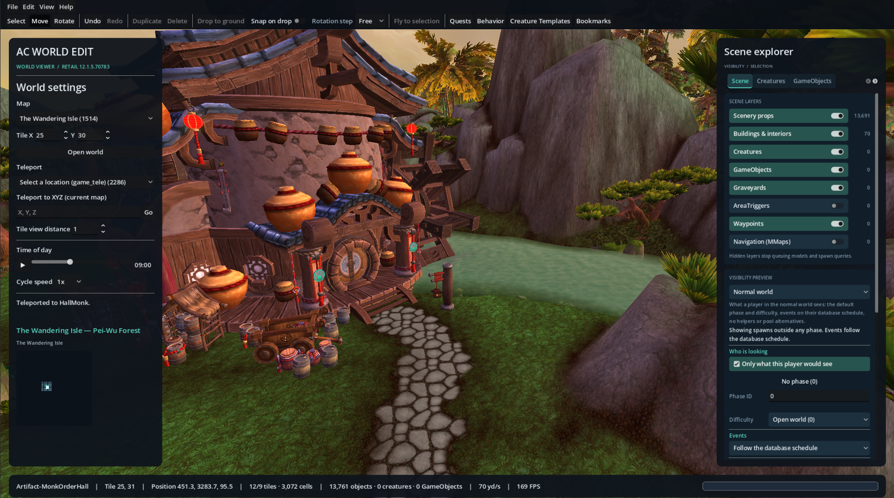</a>
      <p>Explore terrain, liquids and models straight from the client, toggle whole scene categories out of the way, and preview what a chosen phase, difficulty and event schedule would show a player.</p>
    </td>
  </tr>
  <tr>
    <td width="50%" valign="top">
      <p><strong>Spawns and templates</strong></p>
      <a href="docs/img/creature-template.png">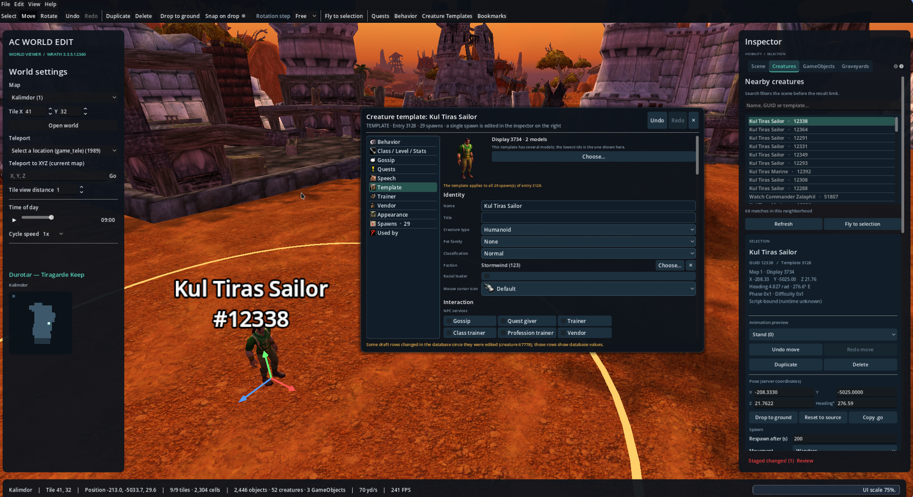</a>
      <p>Edit a creature template once and every spawn that uses it inherits the change, or open a single spawn to tune its health, masks, equipment, stance, weapons, emotes and auras without touching the rest.</p>
    </td>
    <td width="50%" valign="top">
      <p><strong>SmartAI behavior</strong></p>
      <a href="docs/img/smartai-editor.png">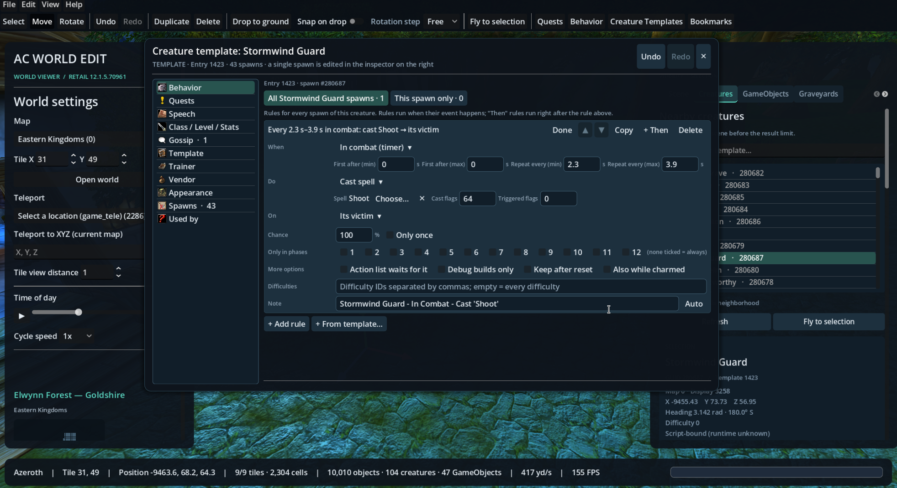</a>
      <p>Build SmartAI rules from events, actions and targets (or copy one from a template) and choose whether they apply to every spawn of a creature or only the one under the gizmo.</p>
    </td>
  </tr>
  <tr>
    <td width="50%" valign="top">
      <p><strong>Vendor lists</strong></p>
      <a href="docs/img/vendor-editing.png">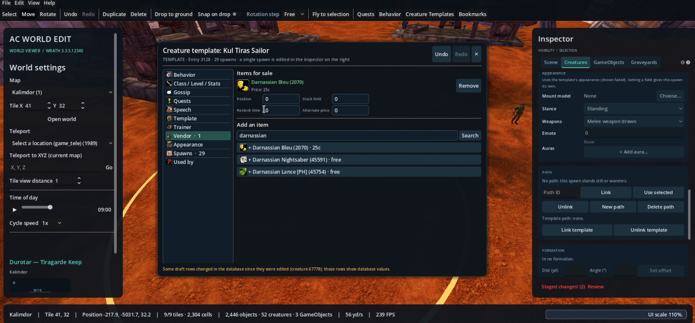</a>
      <p>Give a vendor its stock by searching for items by name and setting prices, stock and restock limits without hand-editing vendor tables.</p>
    </td>
    <td width="50%" valign="top">
      <p><strong>GameObject templates</strong></p>
      <a href="docs/img/gameobject-template.png">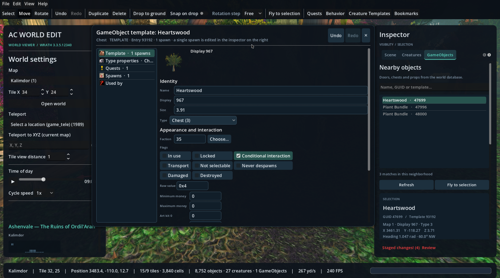</a>
      <p>Edit a GameObject template's display, size, type, interaction flags, money limits, quests and spawns in one window, the same way as a creature.</p>
    </td>
  </tr>
  <tr>
    <td width="50%" valign="top">
      <p><strong>Quests</strong></p>
      <a href="docs/img/quest-editor.png">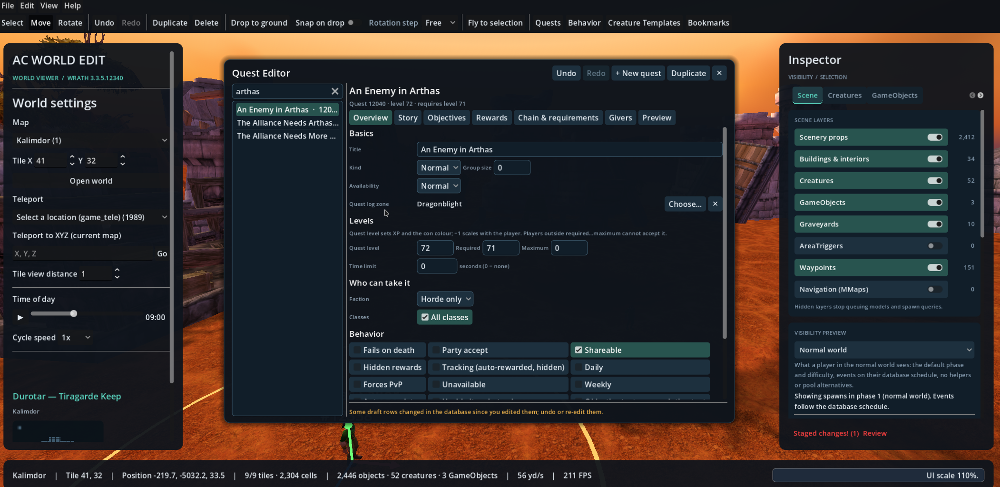</a>
      <p>Write an entire quest across its overview, story, objectives, rewards, chain and givers in one window, picking references by icon and name instead of typing IDs.</p>
    </td>
    <td width="50%" valign="top">
      <p><strong>Area triggers</strong></p>
      <a href="docs/img/at-screen.png">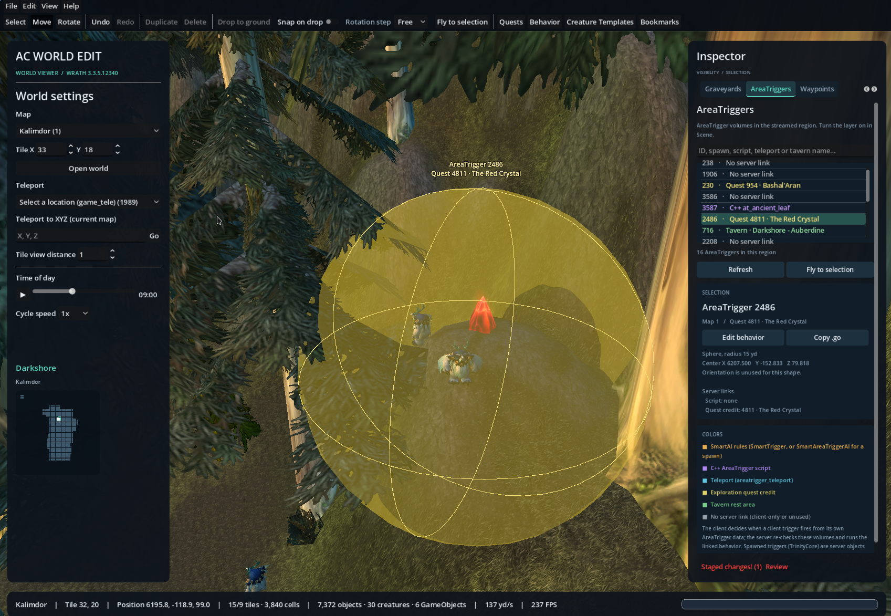</a>
      <p>See trigger volumes at their true size and open the behavior or server row each one runs, so you know what covers a spot without cross-checking coordinates.</p>
    </td>
  </tr>
  <tr>
    <td width="50%" valign="top">
      <p><strong>Waypoint paths</strong></p>
      <a href="docs/img/waypoint-editing.png">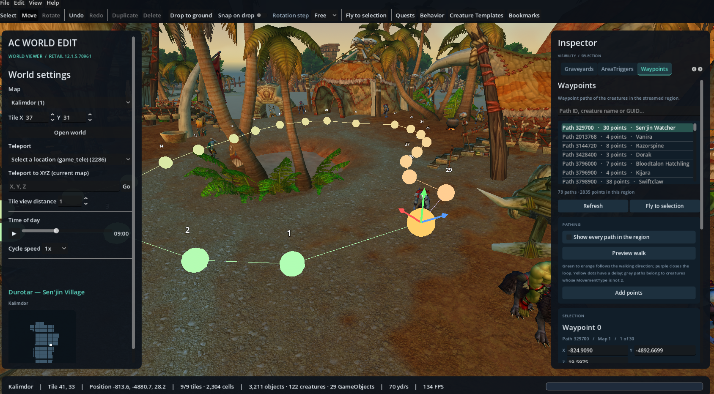</a>
      <p>Lay out a patrol route by clicking the ground, insert or delete nodes, and set each stop's facing and delay while the finished path draws in the world.</p>
    </td>
    <td width="50%" valign="top">
      <p><strong>Formations</strong></p>
      <a href="docs/img/formation-editing.png">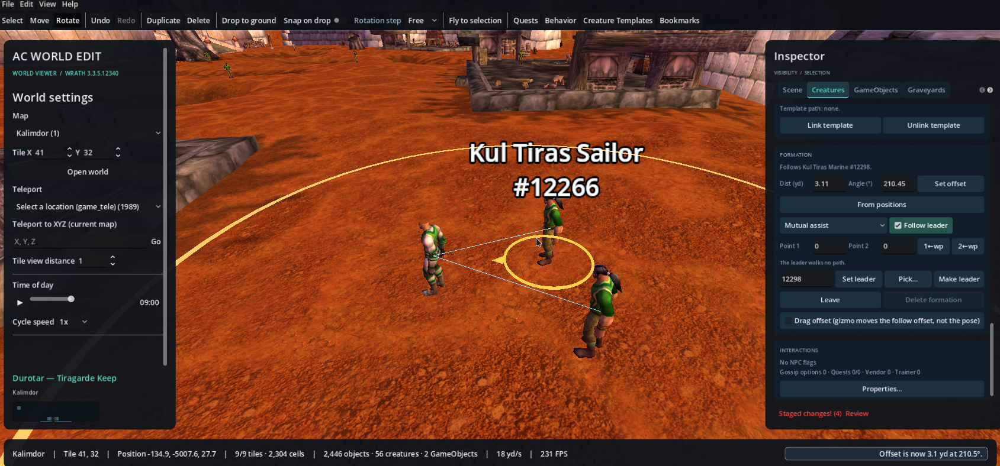</a>
      <p>Pick a leader, place members around it and drag the offset, and the group follows while the distance and angle update as you work.</p>
    </td>
  </tr>
  <tr>
    <td width="50%" valign="top">
      <p><strong>Change history</strong></p>
      <a href="docs/img/db-change-history.png">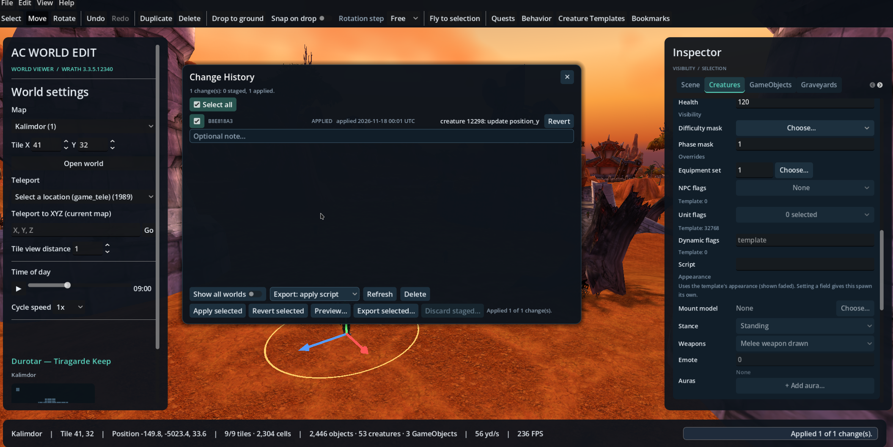</a>
      <p>Stage edits as you work, then apply, revert, export or discard them from one list, so the world database changes only when you choose.</p>
    </td>
    <td width="50%" valign="top">
      <p><strong>Scripted changes</strong></p>
      <a href="docs/img/db-revert-script.png">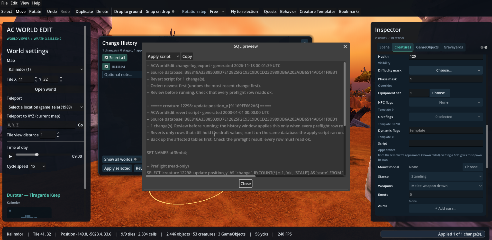</a>
      <p>Review the exact SQL a change will run, with a preflight that flags rows that have moved on, before applying it or handing it to someone else.</p>
    </td>
  </tr>
</table>

## Architecture

See [docs/architecture/overview.md](docs/architecture/overview.md) for diagrams and an overview, or the
[docs index](docs/README.md) for the whole documentation map. Detail pages:

- [Client data and asset pipeline](docs/architecture/client-data.md)
- [Viewer runtime](docs/architecture/viewer-runtime.md)
- [Rendering and the retail shader port](docs/architecture/rendering.md)
- [Editing, data access and SQL export](docs/architecture/editing-and-export.md)
- [Testing and tooling](docs/architecture/testing-and-tooling.md)
- [Editor plan](docs/plans/editor-plan.md)
- [Completed work](docs/status/completed-work.md)

## Prerequisites

| Requirement                                                                                        | Needed for                    | Notes                                                                              |
| -------------------------------------------------------------------------------------------------- | ----------------------------- | ---------------------------------------------------------------------------------- |
| Windows x64 or Linux x64                                                                           | everything                    | Native builds and the `native/win-x64` / `native/linux-x64` layouts                |
| Git                                                                                                | cloning, submodules           | Clone with `--recurse-submodules`, or run the setup script                         |
| .NET SDK matching [`global.json`](global.json) (10.0.114, roll-forward to the latest feature band) | build, tests                  | Projects target `net8.0`                                                           |
| Godot 4.7.2 **.NET (mono) edition**                                                                | running, packaging            | Found via `--godot-path`, the `GODOT_BIN` environment variable, or `godot` on PATH |
| Python 3                                                                                           | setup and launch scripts      | Standard library only                                                              |
| CMake and a C++ toolchain (Visual Studio Build Tools on Windows, g++/clang++ plus Ninja or Make on Linux) | `Tools/setup.py`              | Builds CascLib (Retail profile) and StormLib (tests)                               |
| A WoW client: 3.3.5 (MPQ) or retail (CASC)                                                         | viewing                       | Never modified                                                                     |
| An AzerothCore (3.3.5) or TrinityCore master (retail) `world` database, plus optional `hotfixes`   | database overlays and editing | Reads need SELECT; applying needs INSERT/UPDATE/DELETE. History lives in `acworld` |

Third-party code comes from pinned git submodules: `ThirdParty/CascLib` and `ThirdParty/StormLib` (both MIT) and `Data/WoWDBDefs` (retail table layouts, CC BY-SA 4.0). NuGet packages (SharpZipLib, MySqlConnector, DBCD) are pinned by version in `ACWorldEdit.csproj` and restored by `dotnet`, so they are not submodules. See [THIRD-PARTY.md](THIRD-PARTY.md).

The Wrath profile needs none of the native libraries; only the Retail profile needs CascLib and the WoWDBDefs definitions.

## Setup

```powershell
git clone --recurse-submodules https://github.com/glitterfartz/ac-world-edit.git
cd ac-world-edit
python Tools/setup.py                     # sync submodules, build CascLib into native/<platform>/
python Tools/setup.py --with-tests        # also build StormLib, used only by the StormLib differential test
python Tools/setup.py --check             # report what is present and change nothing
```

## Build and run

```powershell
python launch_viewer.py                   # dotnet build ACWorldEdit.csproj, then launch the viewer
python launch_viewer.py --smoke           # build, then run Godot headless with --terrain-smoke
python launch_viewer.py --check-assets    # run the corpus test set (needs real client data)
```

Other smoke workflows (`--visual-smoke`, `--water-smoke`, `--reload-smoke`, `--creature-smoke`, `--client-smoke`, ...) are opt-in flags passed to Godot after `--`.

## First run

1. Start the viewer (`python launch_viewer.py`).
2. **File → Load client…**: pick **Wrath** (a 3.3.5 folder containing `common.MPQ`) or **Retail** (the install folder containing `.build.info`). The folder is remembered per profile. A retail client offers to download the community listfile once; **File → Update listfile…** repeats it later.
3. **File → Database connection…**: enter host, port, user, password and the world database (for example `acore_world`; for retail also an optional hotfixes database).
4. Pick a map and fly around. Edits are staged as drafts; **File → Pending changes…** lists them and exports SQL.

## Package a build

```powershell
python Tools/package.py                   # build/win-x64/ACWorldEdit.exe plus its data folder
python Tools/package.py --pack-only       # just ACWorldEdit.pck; needs no export templates
```

This uses the `Windows Desktop` preset in `export_presets.cfg`. It needs the Godot 4.7.2 .NET export templates (Editor → Manage Export Templates), and `Tools/setup.py` must have run first. The csproj publishes `CascLib.dll`, the retail `definitions/` and the licences into the build's `data_ACWorldEdit_windows_x86_64` folder, where the loader looks for them, and the script fails if the export is missing them or the game assembly. Godot's .NET export needs `ACWorldEdit.sln` at the project root (it exports an exe with no game assembly, and only a warning, without it), so keep that file and name the project in `dotnet` commands (`dotnet build ACWorldEdit.csproj`); a bare `dotnet build` in the repo root is ambiguous. Output goes to the git-ignored `build/`. CI runs `python Tools/setup.py` and then `python Tools/package.py` on a Windows runner with Godot and its templates installed (`.github/workflows/`, described in [testing-and-tooling.md](docs/architecture/testing-and-tooling.md)). Do not run the script from a shell with `APPDATA` redirected: Godot would look for the export templates under the redirected folder.

## Test

```powershell
dotnet test Tests/ACWorldEdit.Tests -p:NuGetAudit=false                          # default fast suite
dotnet test Tests/ACWorldEdit.Tests --filter "FullyQualifiedName~SplitTerrainTests"   # one class
dotnet test Tests/ACWorldEdit.Tests --settings Tests/ACWorldEdit.Tests/corpus.runsettings     # Category=Corpus only
dotnet test Tests/ACWorldEdit.Tests --settings Tests/ACWorldEdit.Tests/knownbugs.runsettings  # Category=KnownBug only
dotnet test Tests/ACWorldEdit.Tests --settings Tests/ACWorldEdit.Tests/all.runsettings        # everything
```

The default settings exclude the `Corpus` (needs client data) and `KnownBug` categories, and a command-line `--filter` does not override that; combine it with `corpus.runsettings` or `all.runsettings`. `Db` tests need `ACWORLD_DB_INFO` (AzerothCore) or `ACWORLD_TC_DB_INFO` (TrinityCore) and skip without it. `Tests/ACWorldEdit.GdTests` is a separate gdUnit4 project that needs `GODOT_BIN` set.

## Environment variables

| Variable                  | Purpose                                                                                                                 |
| ------------------------- | ----------------------------------------------------------------------------------------------------------------------- |
| `GODOT_BIN`               | Path to the Godot executable (alternative to `--godot-path`); also required by `Tests/ACWorldEdit.GdTests`              |
| `ACWORLD_DB_INFO`         | `host;port;user;password;database`; AzerothCore connection, required by its `Db` tests                                  |
| `ACWORLD_TC_DB_INFO`      | Same, plus optional `;hotfixes`; TrinityCore connection, required by its `Db` tests                                     |
| `ACWORLD_DATA_DIR`        | 3.3.5 client data directory, for `ClientData`/`Corpus` tests                                                            |
| `ACWORLD_RETAIL_DIR`      | Retail client directory, for `ClientData`/`Corpus` tests                                                                |
| `ACWORLD_CLIENT_PROFILE`  | Client profile selection for `ClientData`/`Corpus` tests                                                                |
| `ACWORLD_CASCLIB`         | Path to the CascLib library (default: the one `python Tools/setup.py` builds into `native/<platform>/`)                 |
| `ACWORLD_DBD_DIR`         | WoWDBDefs directory; defaults to `Data/WoWDBDefs/definitions` (the submodule)                                           |
| `ACWORLD_CMAKE_GENERATOR` | CMake generator for `Tools/setup.py` (default: the platform's generator; Visual Studio on Windows)                    |
| `ACWORLD_CMAKE_BUILD_DIR` | Folder for `Tools/setup.py`'s CMake builds (default `.build-env/cmake`, or a short temp folder for long checkout paths) |
| `ACWORLD_RESET_SMOKE`     | `1` lets `--reset-smoke` run; it deletes the whole user data folder, so point `APPDATA` at a throwaway folder first     |
| `ACWORLD_LISTFILE`        | Override for the community listfile location (default `user://community-listfile.csv`)                                  |

## License

MIT, see [LICENSE](LICENSE). Third-party components keep their own licences: [THIRD-PARTY.md](THIRD-PARTY.md).
