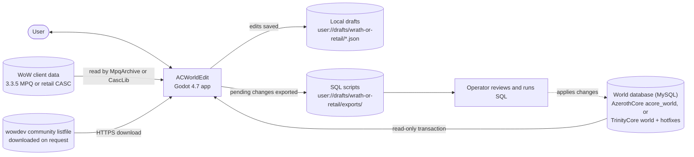
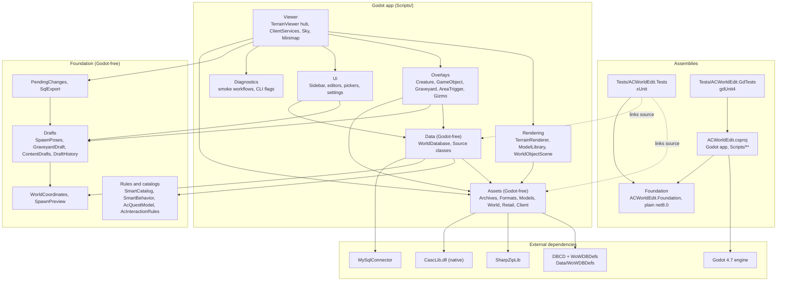

# ACWorldEdit Architecture

ACWorldEdit is a Godot 4.7 (.NET, `net8.0`) 3D viewer and editor for AzerothCore. It renders WoW terrain, models, liquids, lighting and skyboxes from a 3.3.5 MPQ client or a retail CASC client, and overlays world-database content on top (AzerothCore for the 3.3.5 client, TrinityCore master for retail; TrinityCore support is mid-build, see [`tc-status.md`](tc-status.md)): creature and GameObject spawns, graveyards, area triggers, NPC interactions, quests and SmartAI scripts.

The application never writes to the database or the game files. Edits are staged as local drafts and leave the app only as SQL scripts that a person reviews and runs.

Detail pages:

- [Client data and asset pipeline](architecture/client-data.md): `Scripts/Assets`
- [Viewer runtime](architecture/viewer-runtime.md): `Scripts/Viewer`, `Rendering`, `Overlays`, `Ui`, `Diagnostics`, `Shaders`
- [Editing, data access and SQL export](architecture/editing-and-export.md): `Scripts/Data` and `Foundation`
- [Testing and tooling](architecture/testing-and-tooling.md): `Tests`, `Tools`, `launch_viewer.py`, build setup
- [Performance](performance.md): the `--perf-smoke` and `--perf-breakdown` benchmarks, measured costs and open performance work

## System context

## Architecture overview

Solid arrows are compile or runtime dependencies. Dotted arrows are source-linked compiles: the test projects include `Scripts/Assets/**` and `Scripts/Data/**` directly, so those two folders must stay free of Godot types. In the other direction, `ACWorldEdit.csproj` explicitly `Compile Remove`s `Tests/`, `Foundation/` and `artifacts/` so they are not built into the Godot assembly; Foundation reaches the app only as a project reference.

## Layers and dependency rules

| Layer | Location | May depend on | Must not depend on |
|---|---|---|---|
| Foundation | `Foundation/` | base .NET only | Godot, MySQL, file formats, the app |
| Assets | `Scripts/Assets/` | Foundation, DBCD, SharpZipLib, CascLib | Godot, `Scripts/Data`, `Scripts/Viewer` |
| Data | `Scripts/Data/` | Foundation, MySqlConnector, Assets (three files) | Godot, `Scripts/Viewer` |
| Rendering, Overlays, Ui, Viewer, Diagnostics | `Scripts/` | everything above, plus Godot | (top of the stack) |

Rules that follow from the layering:

- **Parsers do not branch on client kind.** `ClientKind` (`Wrath335` or `Retail`) is passed to the source abstraction; parsers consume `IClientFiles` and ask it for bytes.
- **Godot halves of mixed classes live in the viewer.** `AreaLookup` (`Scripts/Viewer/AreaTable.cs`) and `ClientLighting` (`Scripts/Viewer/ClientLighting.cs`) are partial classes whose Godot-facing parts sit in `Scripts/Viewer`, while the engine-free parts sit in `Scripts/Assets/World`.
- **Per-client side data is attached to the source, not passed around.** `RetailLiquids` and `LiquidTextures` are looked up through `ConditionalWeakTable` keyed on the `IClientFiles` instance.
- **Edits only reach Foundation drafts.** Overlays and editors never write to the database. SQL leaves the app only through `Foundation/SqlExport.cs`.

## Threading model

Godot objects are touched only on the main thread. Expensive work runs on worker threads that produce plain CPU data:

- **Terrain:** one decode task at a time (`TerrainViewer.pending`). The worker runs `WorldMap.ReadTile`, texture decode and liquid decode, and creates no Godot resources.
- **Models:** one decode task at a time in `ModelLibrary`. It decodes up to four nearest variants back to back (stopping after about 100 ms) into a short queue, and runs while earlier results upload on the main thread.
- **Overlay queries:** `RegionQuery<T>` runs one cancellable query at a time per overlay.
- **Client open:** `ClientServices.Open` runs on `Task.Run` during `LoadClient`.

Uploads are throttled per frame: terrain and model uploads take at most 8 items and about 1.5 ms per frame. Results from an earlier map or client are discarded using a `generation` counter and a `CancellationTokenSource`.

## Data flow in brief

A client folder is opened by `ClientServices`, which wires an `IClientFiles` source (MPQ or CASC), the map list, lighting and area lookups. `TerrainViewer` reads the WDT, then streams ADT tiles around the camera. Each tile is parsed into engine-free terrain data on a worker, then turned into meshes and materials on the main thread. Placements (doodads, WMOs, creatures, GameObjects, graveyards, triggers) come from the tile data and from read-only database queries. The user edits positions and content in the UI; those edits go into local drafts with undo history. The pending-changes window turns the drafts into SQL apply and revert scripts.

## Repository layout

| Path | Contents |
|---|---|
| `Scripts/Assets/` | Godot-free parsers for MPQ, CASC, BLP, DBC/DB2, M2, WMO, ADT, WDT, liquids, catalogs |
| `Scripts/Data/` | Read-only MySQL sessions, `IDBSource`, and per-dialect sources in `AzerothCore/` (`Ac*Source`) and `TrinityCore/` (`Tc*Source`) |
| `Scripts/Viewer/` | `TerrainViewer` (partial class), `ClientServices`, sky, minimap, picking |
| `Scripts/Rendering/` | Terrain, model, WMO and sky node construction |
| `Scripts/Overlays/` | Creature, GameObject, graveyard and AreaTrigger overlays, gizmo, region queries |
| `Scripts/Ui/` | Editor windows, sidebar, menus, pickers, settings |
| `Scripts/Diagnostics/` | Smoke workflows, CLI flag parsing and the F12 diagnostic dump |
| `Foundation/` | Draft model, SQL export, SmartAI and quest rules, coordinates |
| `Shaders/` | `terrain.gdshader`, `liquid.gdshader`, `model.gdshader` |
| `Tests/` | xUnit suite, gdUnit4 suite, `run_stormlib_checks.py` |
| `Tools/` | `generate_smart_catalog.py`, `generate_condition_catalog.py`, `get_casclib.py` |
| `Data/WoWDBDefs/` | WoWDBDefs git submodule (`.dbd` layouts), pinned by the submodule commit |
| `launch_viewer.py` | Build and launch helper, `--smoke` and `--check-assets` modes |

Generated or local-only folders (`artifacts/`, `native/`, `.build-env/`, `bin/`, `obj/`, `wow-data/`) are not part of the architecture.

## Glossary

- **ADT**: a map tile file (64x64 per map); holds MCNK chunks (256 per tile in retail split files).
- **WDT**: the per-map index file. MAIN lists which tiles exist; MAID gives retail FileDataIDs.
- **MCNK**: one terrain chunk inside an ADT (16x16 per tile).
- **M2 / MD20 / MD21**: the doodad and creature model format. MD21 is the retail wrapper with SFID and TXID FileDataID lists.
- **WMO**: a building or world-object model made of a root file and group files.
- **BLP**: the texture format.
- **DBC / DB2**: client database tables. DBC is the 3.3.5 format, read by field index; DB2 is the retail format, read through DBCD with WoWDBDefs layouts.
- **FileDataID (FDID)**: a numeric retail file identifier. The app encodes it in path strings as `fdid:N`.
- **MH2O**: retail liquid data in the root ADT.
- **SmartAI**: the scripting table `smart_scripts` of both servers (the columns and ID ranges differ; `SmartCatalog` holds each dialect's).
- **Conditions**: the `conditions` table's condition types and source types (the ids and meanings differ; `ConditionCatalog` holds each dialect's, reached through `IWorldSchema.Conditions`).
- **Draft**: a locally stored, undoable set of edits that is not yet in the database.
- **Apply / revert script**: the generated SQL that applies a set of changes, and the SQL that undoes them.
