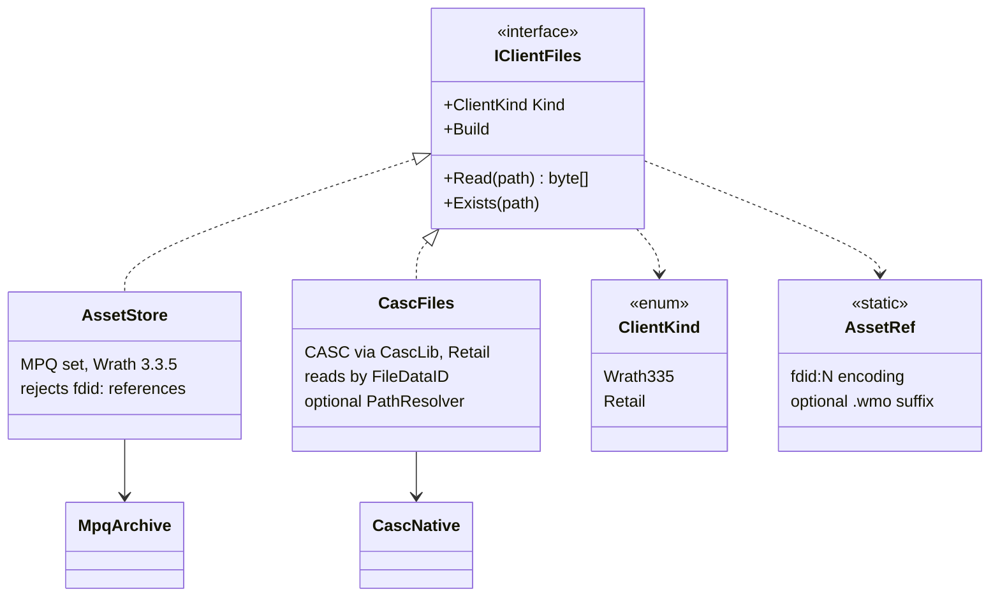
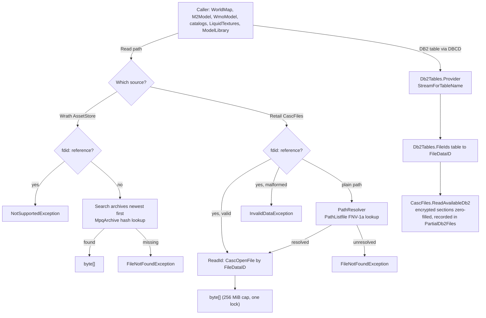
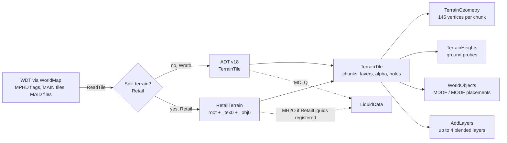
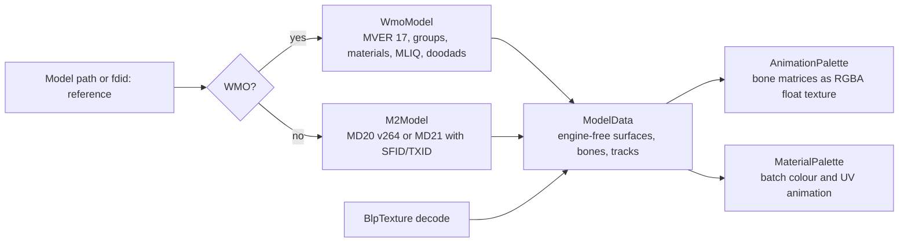
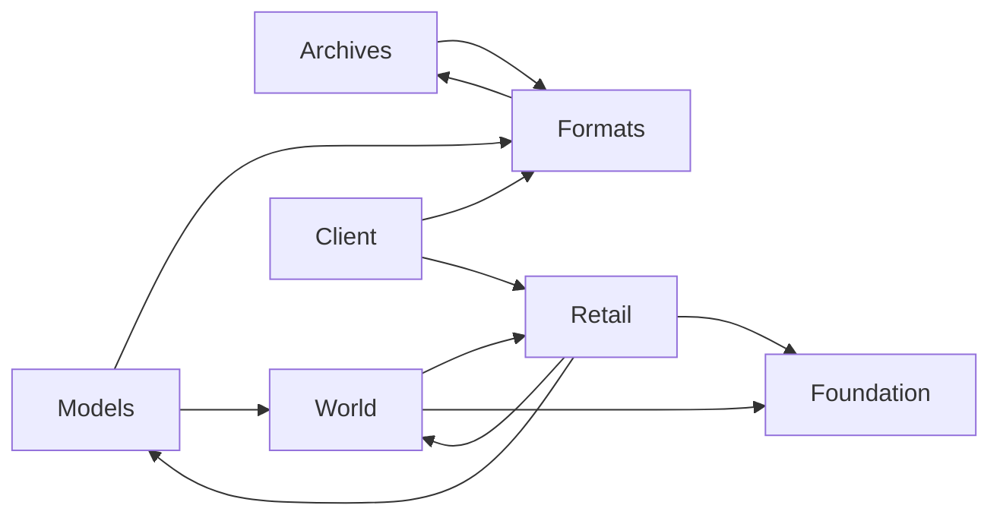

# Client data and asset pipeline

Covers `Scripts/Assets/`. Everything here is engine-free: it produces plain CPU data (`byte[]`, records, arrays) that the viewer turns into Godot resources. The folder is compiled directly into the test projects, so it must not reference Godot.

## Source abstraction

Key points:

- `IClientFiles` (`Scripts/Assets/Archives/IClientFiles.cs`) is the only file-access interface. Reads are read-only, thread-safe, and return detached `byte[]`. A missing file throws `FileNotFoundException`; a reference the client cannot resolve throws `NotSupportedException`.
- There are two implementations. `AssetStore` (`Archives/AssetStore.cs`) mounts a 3.3.5 archive set and searches archives newest first. `CascFiles` (`Retail/CascFiles.cs`) opens a retail install through `CascLib.dll`.
- `MpqArchive` (`Archives/MpqArchive.cs`) is a managed MPQ v0/v1 reader with zlib and BZip2 (SharpZipLib). StormLib is not used.
- `CascNative` is the P/Invoke surface for `CascLib.dll`. The DLL is located through `ACWORLD_CASCLIB`, next to the assembly, or in `native/win-x64/`. Only the Retail profile needs it. It is built from the pinned `ThirdParty/CascLib` submodule by `Tools/setup.py`. `DependencyCheck` (`Retail/DependencyCheck.cs`) reuses `CascNative.Candidates` and `Db2Tables.FindDefinitions` to report a missing DLL or `Data/WoWDBDefs` before a load fails; the viewer posts it to the status bar at startup and when the profile changes, and `ACWorldEdit.csproj` emits build warnings `ACW001`/`ACW002` for the same conditions.
- `ClientFolder` (`Archives/ClientFolder.cs`) is a validation helper, not a source. It checks that a chosen folder looks like a Retail install (`.build.info`) or a Wrath install (`common.MPQ`).
- `ClientMountProfile` (`Archives/ClientMountProfile.cs`) lists the ordered archives for the supported 3.3.5.12340 stock client (17 MPQs).

### `fdid:` references

Retail files are addressed by FileDataID. `AssetRef` (`Archives/AssetRef.cs`) encodes that as a string `fdid:N`, optionally with a `.wmo` suffix, so existing extension checks still tell buildings from doodads. MPQ paths cannot contain `:`, so the two forms never collide.

`fdid:` strings come from:

- the WDT MAID table (per-tile root and texture FileDataIDs);
- the ADT MDID table (texture FileDataIDs in split terrain);
- MDDF and MODF FileDataID flags (placements);
- M2 SFID and TXID lists;
- WMO GFID and MODI lists, and MOMT texture IDs.

Paths that are still stored by name on retail need the community listfile. `PathListfile` (`Retail/PathListfile.cs`) maps a path to a FileDataID through a 64-bit FNV-1a hash of the lower-cased path with `/` separators.

## Reading a file

## Client opening

`ClientServices.Open` (`Scripts/Viewer/ClientServices.cs`) returns a `ClientServices` record: `Files`, `Maps`, `Lighting`, `Areas`, `DatabaseEnabled` and a description.

Wrath 3.3.5:

1. Resolve the folder and create `AssetStore`.
2. Read `DBFilesClient/Map.dbc` through `store.Maps()`; keep maps that have a WDT.
3. `ClientLighting.TryLoad` and `AreaLookup.TryLoad` read the DBC tables.
4. The world database is enabled.

Retail:

1. Find WoWDBDefs definitions (`Db2Tables.FindDefinitions`, honours `ACWORLD_DBD_DIR`).
2. Open `CascFiles`.
3. Read maps through `Db2Tables`.
4. If a listfile is present, install `PathListfile.Resolve` as `PathResolver`.
5. Register `RetailLiquids` and call `ClientLighting.TryLoadRetail`.
6. Build the retail creature and GameObject display catalogs and the `RetailClientLookup` (`IClientLookup`) from `Db2Tables`.
7. Areas are `null`. The world database is enabled (TrinityCore dialect).

If opening fails, the partly opened store is disposed.

Both client profiles support server XYZ navigation on the currently open map without a database connection. The viewer converts server axes through `ViewSpace`; named `game_tele` destinations instead come from the world database and can open a different client map.

## Terrain pipeline

Notes:

- **WDT** (`World/WorldMap.cs`): MPHD bit `0x4` (or `0x80` on retail) sets big alpha. MAIN gives tile existence. MAID gives retail per-tile FileDataIDs. Incomplete tiles are counted and skipped.
- **Unsplit ADT** (`World/TerrainData.cs`): requires MVER 18. Each MCNK is found through its header offsets (MCVT, MCNR, MCCV, MCSH, MCLY/MCAL).
- **Split ADT** (`Retail/RetailTerrain.cs`): root and `_tex0` must both be MVER 18 with 256 MCNKs each, paired by order. Sub-chunks are found by walking the chunk stream because split files leave offsets at zero. MDID supplies texture FileDataIDs and MTXP each texture's scale. Up to 8 layers are read, but only the first 4 are blended; the rest are counted in `DroppedLayers`.
- **Liquids**: retail MH2O is read from the root file only when `RetailLiquids` is registered. MH2O's second `uint16` is a vertex format (below 42) or a LiquidObject ID; 42 means depth only. Wrath uses MCLQ.
- **Holes**: retail high-resolution holes (flag `0x10000`) come from the 8 bytes at offset +20.

## Model pipeline

- **M2** (`Models/M2Model.cs`): on retail the file starts with `MD21`; the MD20 block is extracted with SFID (skins) and TXID (textures). MD20 must be version 272 or later. Retail M2s play their sequences from the `.anim` files their AFID chunk names (track data in `AFM2`).
- **WMO** (`Models/WmoModel.cs`): requires MVER 17. Groups come from GFID on retail or from `<root>_NNN.wmo` names on Wrath. Liquid (MLIQ) goes through `LiquidData`.
- **Multi-texture layers** (`Models/ModelLayers.cs`, Godot-free): `M2Combiners.Resolve(shader_id, units)` follows the client's selection (the `0x8000` table, or the legacy decode of the `0x70` and low bits) and returns the pixel combiner plus each unit's coordinate source (first UV set, second UV set, view-space environment map); `WmoCombiners.Resolve` maps a MOMT shader the same way (the DF shader 23 keeps its diffuse in texture 2, which `WmoModel` uses as the base whenever it is set; texture 1 is empty or a tiny shared filler such as the solid-black `fdid:5229975`) (WMO environment coordinates are a fixed-direction reflection, composite layers also read the second UV set and the second MOCV alpha). The result rides on `ModelSurface.Layers` (`SurfaceLayers`). A shader the tables do not map keeps its base texture and adds a model warning, so every warning is a real gap. Empty extra slots: a layered WMO material with every extra slot empty draws its base texture without a warning (nothing to blend), a two-layer environment shader (7) with only its environment map empty is drawn as the plain two-layer shader (6), and a partly filled set still warns. M2 layer units that are replaceable textures take the same customization texture (skin, fur, extra, 11 to 13) as the base batch. Texture weights and per-layer UV animation are not applied.
- **Shared types** (`Models/ModelData.cs`): `ModelData`, `ModelSurface`, `ModelBone`, `ModelTrack<T>`, `ModelDoodad`, `SurfaceAnimation`, `VertexColorMode`, `SurfaceLayers`. They carry no engine types, and M2, WMO and liquids all produce them.
- **Palettes** (`Models/AnimationPalette.cs`, `Models/MaterialPalette.cs`): bake animation into textures so the GPU does the skinning and UV animation.
- **Surface merge** (`Models/SurfaceMerge.cs`): joins opaque batches (blend 0 or 1) with identical texture, layers, flags, colour mode, skinning and static appearance into one surface for upload, keeping translucent, liquid, hidden and animated batches separate and in order. WMO batches are already merged by material in `WmoModel`, so this mostly joins M2 submeshes.

## Retail specifics

- **Split terrain gaps**: MAMP scale is not supported; only the first 4 of up to 8 layers are drawn. MTXP texture scale (`TerrainLayer.Scale`: a layer repeats `8 / scale` times per chunk) and height blending are applied: MHID names each texture's `_h` map (its alpha), MTXP gives height scale and offset, and `terrain.gdshader` weights each layer by `height * scale + offset` and suppresses layers more than 1.0 below the tallest, as the client does (big-alpha maps only; a texture with scale 0 and offset 1 has no height map).
- **Placements**: MDDF/MODF entries flagged as FileDataIDs become `fdid:N` references (WMO ones `fdid:N.wmo`). Placements that name a model by path instead (some old-style WDTs) resolve only through the listfile, for example the "Garrison - …" interiors, whose global WMO is named by path.
- **Character skeletons**: retail character models keep bones, sequences and global loops in a `.skel` file (M2 `SKID` chunk: `SKB1`/`SKS1`/`AFID`, offsets relative to each chunk); their `.anim` files hold bone tracks in `AFSB`. Parent skeletons (`SKPD`) are not followed.
- **Creature displays** (`RetailCreatureCatalog`): use `CreatureDisplayInfo` model data and skins. Humanoids (displays with a `CreatureDisplayInfoExtra`) draw the extra's pre-baked skin (TextureFileData by MaterialResourcesID) and apply their customization choices (`CreatureDisplayInfoOption` → `ChrCustomizationElement`): geoset variants per group (`GeosetVariants`) plus the hair (type 6), eye (type 19), skin extra (type 8) and second extra (type 20) textures. Ungiven groups show variant 1, except ears (7) and head (32), whose variant 1 is an empty stub on character models, and the eye glow (17), which stays hidden unless a choice names a variant. A hotfixed display keeps its `ExtendedDisplayInfoID`, resolved against the client's extras (TrinityCore's hotfixes copy of that table is empty). Equipment is not composed.
- **Liquids**: MH2O is read from the root ADT; its second `uint16` is a vertex format (below 42, format 3 = heights+UV+depth) or a LiquidObject ID (ocean stores 42, which has no row and means depth only). `RetailLiquids` (LiquidType/LiquidObject/LiquidMaterial) is registered per client in `ClientServices.OpenRetail`. Liquid textures are named by path in LiquidType, so they need the listfile; types whose texture is not listed (or when no listfile is downloaded) fall back to the base liquid of their kind. Retail WMO liquids load through `RetailLiquids`. Material 14 also keeps `SwampSettings`: depth thresholds/scales/opacity, texture slot 3 for the shore overlay, slot 5 for the animated normal sequence, and inferred surface constants. `LiquidTextures.Style` builds `SwampLiquidStyle` with shared middle/deep/shore pixels and a horizontal normal atlas; base colours and normals share the bounded 60-frame sequence decoder (128 pixels per frame). Missing normal or shore assets are optional; missing middle/deep textures retain the generic base fallback. All surface settings and texture identities participate in `LiquidStyle.CacheKey`, so identical base atlases cannot merge different surface effects. `BlpTexture` supports retail BC5_UNORM (preferred format 11: independent red and green BC4 blocks, blue zero and alpha opaque); shaders reconstruct normal Z. Endpoint interpolation follows [Microsoft's BC5 format](https://learn.microsoft.com/en-us/windows/uwp/graphics-concepts/block-compression#bc5). No engine types enter the asset layer. The DB2 float mapping and renderer substitutions are documented in viewer-runtime.md; floats 7 and 16 remain unassigned.
- **Fog volumes**: retail maps may have a `<map>_fogs.wdt` (a `VFOG` chunk of 104-byte entries, optional `VFEX` and `VFE2` chunks); `FogVolumes.Load` reads it through the file source and returns an empty list where it is absent (MPQ clients, classic continents).
- **Lighting and sky**: `LightRegion.IsDefault` marks the map's default light, which the client identifies by its coordinates being (0, 0, 0). Retail profiles also carry `RetailFog` (LightData `FogDensity`, `EndFogColor` and `EndFogColorDistance` per time sample, plus the height layer as `FogHeightLayer` and the sun scattering `SunFogColor` and `SunFogStrength`; the `MainFog*` fields are not read yet). Each light profile also carries `CloudBands` (the cloud density, LightFloatBand 3 or retail `CloudDensity`, and the sunlit, shaded and base cloud colours, LightIntBand 10 to 12) and `SkyBands` (the middle, band 1 and band 2 sky colours, LightIntBand 3 to 5 or retail `SkyMiddleColor`, `SkyBand1Color`, `SkyBand2Color`, and the LightParams `HighlightSky` flag) for the sky dome. `ClientLighting.TryLoadRetail` reads Light/LightParams/LightData/LightSkybox DB2 (only the default weather slot; LightData `FogEnd` and `FogScaler` per time sample become a `FogCurve`, and the Ocean/River close and far colours, the four LightParams water alphas and `SunColor` fill `LightProfile.Water`, `WaterAlpha` and `SunColor`); skyboxes load by FileDataID. Wrath builds the same from LightFloatBand (six rows per LightParams entry in file order: band 0 fog end, band 1 start multiplier; checked against the client's `6 * id - 5 + band` row formula) and LightIntBand bands 9 and 14 to 17.
- **Community listfile**: `ListfileStore` downloads wowdev/wow-listfile `community-listfile.csv` to `user://community-listfile.csv` (override `ACWORLD_LISTFILE`), only on user request: a one-time prompt on the first retail load, then File → Update listfile…. `PathListfile` loads it keyed by a 64-bit path hash (millions of entries) and `ClientServices.OpenRetail` installs it as `CascFiles.PathResolver`. Nothing is bundled; corpus tests that need it (`RetailListfileFact`) skip unless it is present.

## Tables: DBC and DB2

Lighting and water values reach rendering through `ClientShaderGlobals`; the globals' types and neutral editor defaults live in `project.godot`, independently of opening a client. The runtime replaces these defaults with the selected client's light bands and volume data.

Two readers exist and share no abstraction:

- `DbcTable` (`Formats/DbcTable.cs`) reads WDBC by fixed field index. Callers hard-code the indexes and document them in comments (for example `AreaLookup.cs` and `InteractionCatalog.cs`).
- `Db2Tables` (`Retail/Db2Tables.cs`) reads through DBCD with WoWDBDefs layouts and accesses fields by column name, for example `row.FieldAs<uint>("WdtFileDataID")`. It caches tables lazily; table loads are locked, so any thread can read tables. A build the definitions do not cover raises `InvalidDataException`.

Callers choose the reader that matches their client. `ClientLighting` has both `TryLoad` (Wrath) and `TryLoadRetail` (retail).

## Catalogs and side systems

| Type | File | Purpose | Client |
|---|---|---|---|
| `CreatureCatalog` | `Client/CreatureCatalog.cs` | Joins display, model, extra and char-section tables into a model path, skins, scale and textures | Wrath (DBC) |
| `GameObjectCatalog` | `Client/GameObjectCatalog.cs` | Display ID to model path | Wrath (DBC) |
| `RetailCreatureCatalog`, `RetailGameObjectCatalog` | `Client/RetailCatalogs.cs` | The same jobs from DB2 (`ICreatureCatalog` / `IGameObjectCatalog`), with `hotfixes.creature_display_info` overrides | Retail |
| `RetailClientLookup` | `Client/ClientLookup.cs` | `IClientLookup` (and `ITcStatData`, the creature scaling tables): the TrinityCore stats page's `ContentTuning`, `ExpectedStat`, `ExpectedStatMod`, `ContentTuningXExpected`, `MythicPlusSeason` (`MilestoneSeason`), `MapDifficulty` (`MapDifficultyTuning`) and `AreaTable` (`AreaTuning`, walking `ParentAreaID`) lookups, `MaxBroadcastTextId()` for numbering new broadcast texts, and an optional `fileExists` callback (CASC `fdid:` existence, for `ClientRecord.FileData`); retail `ItemDetails(id)` (ItemSparse and Item rows filled into the tooltip record; item level, stat values, armor, weapon damage and durability computed by `RetailItemStats` from `RetailItemTables`, the DB2 adapter over ItemSquishEra, Curve, CurvePoint, RandPropPoints, ItemArmorQuality/Total/Shield, ArmorLocation and ItemDamage*), AreaTrigger rows (with `ShapeID`) and polygon corners (`Polygon(pathId)`: Path, PathNode, Location and PathProperty as `ObjectMgr::LoadAreaTriggerPolygons` builds them, first node dropped, VolumeHeight as the height), broadcast text, item and spell names, `Exists(ClientRecord, id)` (currency, extended cost, player condition, bonus list, skill line and difficulty rows, for the TC reference checks), and the ContentTuning, ExpectedStat, ExpectedStatMod and ContentTuningXExpected rows behind creature scaling (`ITcStatData`), for the TrinityCore sources | Retail |
| `InteractionCatalog` | `Client/InteractionCatalog.cs` | Spell, taxi, item cost, emote, faction lookups for the NPC and content editors | Wrath (DBC) |
| `LiquidTextures` | `Client/LiquidTextures.cs` | Liquid texture atlases; uses `RetailLiquids` on retail | Both |
| `ClientLighting`, `LightBand`, `LightFloatBand`, `FogCurve` | `Viewer/ClientLighting.cs`, `World/LightBand.cs`, `World/FogCurve.cs` | Time-of-day colour and float keyframes, fog curves and light regions | Both |
| `SkyDome` | `World/SkyDome.cs` | The client's sky tables: highlight curve, sun and moon paths and widths, dome ring geometry and `InterpTable` | Both |
| `AreaLookup` | `World/AreaLookup.cs`, `Viewer/AreaTable.cs` | Zone and parent names | Wrath only (`null` on retail) |
| `RetailLiquids` | `Retail/RetailLiquids.cs` | LiquidType (including each type's ripple normal map), LiquidObject and LiquidMaterial as plain dictionaries | Retail |
| `ListfileStore` | `Retail/ListfileStore.cs` | Downloads and validates the wowdev community listfile on request; `ACWORLD_LISTFILE` overrides the path | Retail |

The Wrath-only catalogs read `DBFilesClient/*.dbc` through `IClientFiles`. `ModelLibrary` only builds them when `Kind == Wrath335`.

## Type reference by folder

| Folder | Key types |
|---|---|
| `Archives/` | `IClientFiles`, `ClientKind`, `AssetStore`, `MapInfo`, `MpqArchive`, `ClientMountProfile`, `ClientFolder`, `AssetRef` |
| `Retail/` | `CascFiles`, `RetailInstall`, `CascReadException`, `CascNative`, `ListfileStore`, `PathListfile`, `Db2Tables`, `RetailLiquids`, `RetailTerrain` |
| `Formats/` | `BinaryAsset` (bounds-checked little-endian reader), `Chunks` / `ChunkHeader`, `DbcTable`, `BlpTexture` |
| `Models/` | `ModelData` family, `ModelLayers`, `M2Model`, `WmoModel`, `AnimationPalette`, `MaterialPalette`, `SurfaceMaterial`, `SurfaceMerge` |
| `World/` | `WorldMap`, `TileFiles`, `TileKey`, `TerrainTile`, `TerrainChunk`, `TerrainLayer`, `TerrainGeometry`, `TerrainHeights`, `WorldObject`, `WorldObjects`, `LiquidData`, `GroundProbe`, `AreaLookup`, `LightBand`, `LightFloatBand`, `FogCurve`, `SkyDome`, `LightCoordinates` |
| `Client/` | `CreatureCatalog`, `GameObjectCatalog`, `InteractionCatalog`, `LiquidTextures`, `ICreatureCatalog`, `IGameObjectCatalog`, `RetailCreatureCatalog`, `RetailGameObjectCatalog`, `IClientLookup`, `RetailClientLookup` |

## Dependency directions

The two-way links are deliberate and small: `WorldMap` calls `RetailTerrain`, which builds `TerrainTile` through an internal constructor; `Chunks` uses `MpqArchive.U` (a little-endian read helper), and `AssetStore` uses `DbcTable`.

Per-client side data (`RetailLiquids`, `LiquidTextures`) is attached to an `IClientFiles` instance through `ConditionalWeakTable`, not passed as an argument.

## Generated navigation files

`Scripts/Assets/Navigation` reads server-generated MMaps from an independently selected disk folder. It does not use client archives. `AcNavigationReader` accepts AzerothCore MMap 20 (56-byte wrapper); `TcNavigationReader` accepts TrinityCore MMap 16 (20-byte wrapper). Both consume little-endian Detour 7 with six polygon vertices and 64-bit references. Other versions and reference layouts are rejected. The shared `DetourReader` checks payload sizes, counts, indices, finite coordinates, bounds and detail-mesh ranges before returning plain navigation data. It retains static polygon neighbor codes, flags, areas, detail triangle flags, agent dimensions and off-mesh connections. Serialized runtime link slots do not describe live server connectivity.

AC map parameters are 28 bytes, and tile headers include the generator's Recast settings. TC map files have a 40-byte header followed by 44-byte map-level off-mesh records. Both generators store a polygon capacity of `0x80000000` when built for 64-bit references; the reader preserves that bit pattern as an unsigned capacity.

`NavigationSource` tries the requested tile first. TC falls back only when that file is missing, to its immediate parent, without walking ancestors or replacing corrupt child tiles. `Db2Tables.NavigationParents` reads the complete retail Map table, including rows excluded from the map picker: ParentMapID takes precedence over CosmeticParentMapID. Requested and source map IDs, filename coordinates and Detour grid coordinates remain separate. Filename X/Y are reversed relative to viewer tile X/Y. Detour stores `(server Y, server Z, server X)`; the explicit viewer conversion is `(-detour X, detour Y, -detour Z)`.

These files are a snapshot of generated navigation surfaces. The viewer does not calculate routes, edit or generate meshes, apply live obstacles, or rebuild instance-specific navigation.

### Material 13 liquid inputs

`RetailLiquids.FelSettings` retains texture slot 1 and the inferred layer UV/depth
constants for material 13. `LiquidTextures.Style` builds an engine-free
`FelLiquidStyle` when the shallow texture resolves; its settings and decoded
texture identity participate in the material cache key. Missing extra textures
retain the generic liquid fallback. The common base texture decoder continues
to load slot 0. Current listfiles do not name the two venom base textures for
types 1233/1234, although the DB2 rows name them. Type 898 resolves both layers.
Animated normal and other procedural inputs are not bound by this core port.

### Material 12 detail inputs

`RetailLiquids.LeySettings` carries texture slot 1, the first two inferred UV
triples and packed Color[0] for material 12. `LiquidTextures.Style` returns
`LeyLiquidStyle` with the shared decoded second atlas; slot 0 uses the existing
base decoder. Both static and printf-style animated details are supported.
Settings and texture identity participate in material caching. Missing second
layers retain the generic fallback. The additional procedural surface inputs
are not bound by this core port.

Venom input follow-up (deferred at user request): the listfile lookup gap does
not establish missing game assets. Current listfiles resolve shore/specular to
7568587/7568588, both readable from CASC, but do not name deep/shallow/emissive.
Direct name lookup also fails for the known readable files, so it is not a
valid absence check. DB2 frame counts for the three unresolved slots are zero.
Investigate generated/substituted inputs, stale names and unnamed FileDataIDs
before treating this as an asset blocker. Do not substitute guessed FileDataIDs.

### Material 5 mercury routing

`RetailLiquids.Material` exposes the parsed LiquidMaterial ID independently of
SoundBank. Material 5 makes `LiquidTextures.Style` set `LiquidStyle.Mercury` and
retain the shared decoded bump map from texture slot 2. The marker participates
in cache identity, preventing ordinary ocean water with the same source texture
and sound bank from sharing a mercury material. A missing bump map keeps the
mercury marker and renders a flat reflective surface. Existing base atlas loading
is retained, although the procedural mercury shader does not sample that atlas.
Per-type mercury float-to-buffer bindings are not asserted; runtime ripple
transforms and highlight parameters currently use documented estimates.

### Material 10 fog-liquid inputs

`RetailLiquids.FogSettings` retains inferred Color[0] RGB and Float[1] opacity
for material 10. `LiquidTextures.Style` carries those settings as `LiquidStyle.Fog`
and bypasses the ordinary water bump lookup. Texture slot 0 uses the existing
bounded base-atlas decoder; multiple authored fog colors share decoded density
pixels but their settings participate in cache identity. Material tint alpha,
depth/height extinction parameters and auxiliary masks remain unbound by this
basic port. Both the parsed settings and cached styles remain Godot-free.

### Material 4 magma inputs

Material 4 is procedural magma; material 3 is procedural water. Its LiquidType
rows name `Magma0`, `Magma1` and `Magma2` without extensions. `RetailLiquids.Pattern`
appends `.blp` for material 4 only, preserving explicit extensions and all other
material names. `MagmaSettings` retains normalized extra paths and inferred
layer scales, base color, scroll and noise speed. `LiquidTextures.Style` builds
`MagmaLiquidStyle` with shared middle/top pixels; absent extra layers retain the
generic base-layer fallback. All settings and texture identities participate
in cache identity, so terrain 302 and faster WMO 303 keep distinct materials.
The settings and decoded layers remain Godot-free. The client 3D noise source
has not been identified; runtime uses a documented shader-only approximation.
