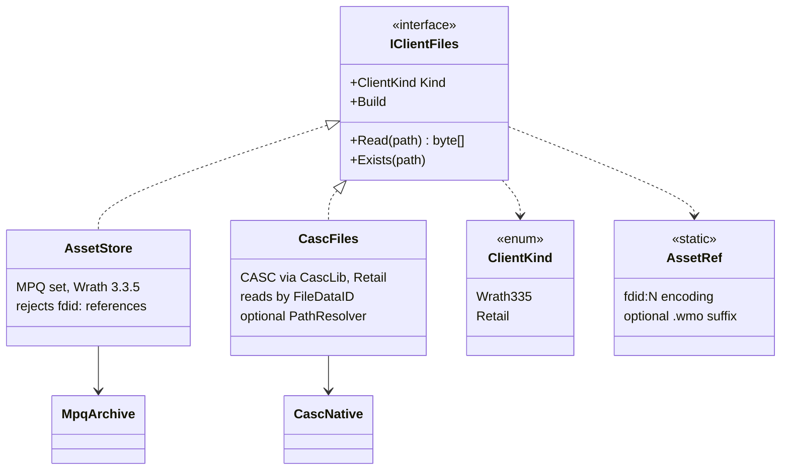
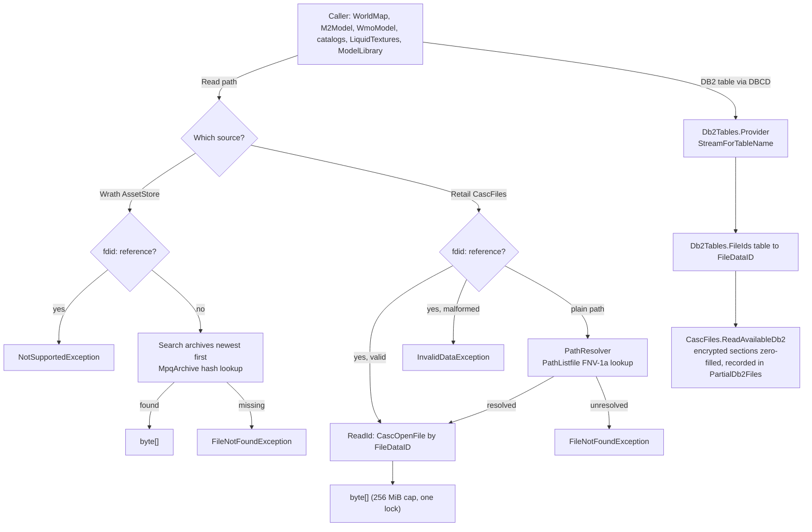
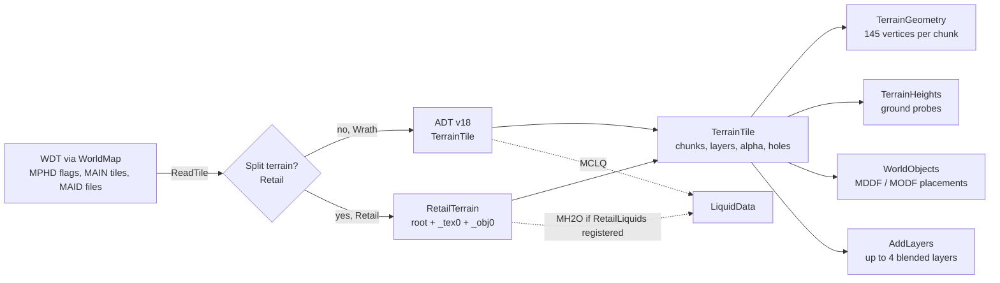
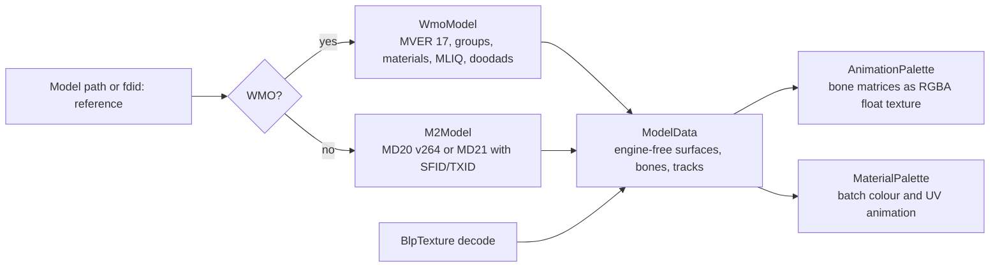
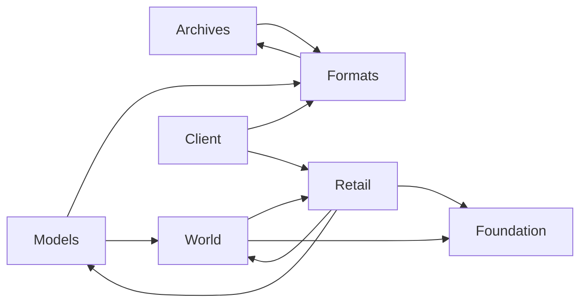

# Client data and asset pipeline

Covers `Scripts/Assets/`. Everything here is engine-free: it produces plain CPU data (`byte[]`, records, arrays) that the viewer turns into Godot resources. The folder is compiled directly into the test projects, so it must not reference Godot.

## Source abstraction

Key points:

- `IClientFiles` (`Scripts/Assets/Archives/IClientFiles.cs`) is the only file-access interface. Reads are read-only, thread-safe, and return detached `byte[]`. A missing file throws `FileNotFoundException`; a reference the client cannot resolve throws `NotSupportedException`.
- There are two implementations. `AssetStore` (`Archives/AssetStore.cs`) mounts a 3.3.5 archive set and searches archives newest first. `CascFiles` (`Retail/CascFiles.cs`) opens a retail install through `CascLib.dll`.
- `MpqArchive` (`Archives/MpqArchive.cs`) is a managed MPQ v0/v1 reader with zlib and BZip2 (SharpZipLib). StormLib is not used.
- `CascNative` is the P/Invoke surface for `CascLib.dll`. The DLL is located through `ACWORLD_CASCLIB`, next to the assembly, or in `native/win-x64/`. Only the Retail profile needs it.
- `ClientFolder` (`Archives/ClientFolder.cs`) is a validation helper, not a source. It checks that a chosen folder looks like a Retail install (`.build.info`) or a Wrath install (`common.MPQ`).
- `ClientMountProfile` (`Archives/ClientMountProfile.cs`) lists the ordered archives for the supported 3.3.5.12340 stock client (17 MPQs).

### `fdid:` references

Retail files are addressed by FileDataID. `AssetRef` (`Archives/AssetRef.cs`) encodes that as a string `fdid:N`, optionally with a `.wmo` suffix, so existing extension checks still tell buildings from doodads. MPQ paths cannot contain `:`, so the two forms never collide.

`fdid:` strings come from:

- the WDT MAID table (per-tile root and texture FileDataIDs);
- the ADT MDID table (texture FileDataIDs in split terrain);
- MDDF and MODF FileDataID flags (placements);
- M2 SFID and TXID lists;
- WMO GFID and MODI lists, and MOMT texture IDs.

Paths that are still stored by name on retail need the community listfile. `PathListfile` (`Retail/PathListfile.cs`) maps a path to a FileDataID through a 64-bit FNV-1a hash of the lower-cased path with `/` separators.

## Reading a file

## Client opening

`ClientServices.Open` (`Scripts/Viewer/ClientServices.cs`) returns a `ClientServices` record: `Files`, `Maps`, `Lighting`, `Areas`, `DatabaseEnabled` and a description.

Wrath 3.3.5:

1. Resolve the folder and create `AssetStore`.
2. Read `DBFilesClient/Map.dbc` through `store.Maps()`; keep maps that have a WDT.
3. `ClientLighting.TryLoad` and `AreaLookup.TryLoad` read the DBC tables.
4. The world database is enabled.

Retail:

1. Find WoWDBDefs definitions (`Db2Tables.FindDefinitions`, honours `ACWORLD_DBD_DIR`).
2. Open `CascFiles`.
3. Read maps through `Db2Tables`.
4. If a listfile is present, install `PathListfile.Resolve` as `PathResolver`.
5. Register `RetailLiquids` and call `ClientLighting.TryLoadRetail`.
6. Build the retail creature and GameObject display catalogs and the `RetailClientLookup` (`IClientLookup`) from `Db2Tables`.
7. Areas are `null`. The world database is enabled (TrinityCore dialect).

If opening fails, the partly opened store is disposed.

## Terrain pipeline

Notes:

- **WDT** (`World/WorldMap.cs`): MPHD bit `0x4` (or `0x80` on retail) sets big alpha. MAIN gives tile existence. MAID gives retail per-tile FileDataIDs. Incomplete tiles are counted and skipped.
- **Unsplit ADT** (`World/TerrainData.cs`): requires MVER 18. Each MCNK is found through its header offsets (MCVT, MCNR, MCCV, MCSH, MCLY/MCAL).
- **Split ADT** (`Retail/RetailTerrain.cs`): root and `_tex0` must both be MVER 18 with 256 MCNKs each, paired by order. Sub-chunks are found by walking the chunk stream because split files leave offsets at zero. MDID supplies texture FileDataIDs. Up to 8 layers are read, but only the first 4 are blended; the rest are counted in `DroppedLayers`.
- **Liquids**: retail MH2O is read from the root file only when `RetailLiquids` is registered. MH2O's second `uint16` is a vertex format (below 42) or a LiquidObject ID; 42 means depth only. Wrath uses MCLQ.
- **Holes**: retail high-resolution holes (flag `0x10000`) come from the 8 bytes at offset +20.

## Model pipeline

- **M2** (`Models/M2Model.cs`): on retail the file starts with `MD21`; the MD20 block is extracted with SFID (skins) and TXID (textures). MD20 must be version 272 or later. Retail M2s play their sequences from the `.anim` files their AFID chunk names (track data in `AFM2`).
- **WMO** (`Models/WmoModel.cs`): requires MVER 17. Groups come from GFID on retail or from `<root>_NNN.wmo` names on Wrath. Liquid (MLIQ) goes through `LiquidData`.
- **Shared types** (`Models/ModelData.cs`): `ModelData`, `ModelSurface`, `ModelBone`, `ModelTrack<T>`, `ModelDoodad`, `SurfaceAnimation`, `VertexColorMode`. They carry no engine types, and M2, WMO and liquids all produce them.
- **Palettes** (`Models/AnimationPalette.cs`, `Models/MaterialPalette.cs`): bake animation into textures so the GPU does the skinning and UV animation.
- **Surface merge** (`Models/SurfaceMerge.cs`): joins opaque batches (blend 0 or 1) with identical texture, flags, colour mode, skinning and static appearance into one surface for upload, keeping translucent, liquid, hidden and animated batches separate and in order. WMO batches are already merged by material in `WmoModel`, so this mostly joins M2 submeshes.

## Retail specifics

- **Split terrain gaps**: height texturing (MHID/MTXP) and MAMP scale are not supported; only the first 4 of up to 8 layers are drawn.
- **Placements**: MDDF/MODF entries flagged as FileDataIDs become `fdid:N` references (WMO ones `fdid:N.wmo`). Placements that name a model by path instead (some old-style WDTs) resolve only through the listfile, for example the "Garrison - …" interiors, whose global WMO is named by path.
- **Character skeletons**: retail character models keep bones, sequences and global loops in a `.skel` file (M2 `SKID` chunk: `SKB1`/`SKS1`/`AFID`, offsets relative to each chunk); their `.anim` files hold bone tracks in `AFSB`. Parent skeletons (`SKPD`) are not followed.
- **Creature displays** (`RetailCreatureCatalog`): use `CreatureDisplayInfo` model data and skins. Humanoids (displays with a `CreatureDisplayInfoExtra`) draw the extra's pre-baked skin (TextureFileData by MaterialResourcesID) and apply their customization choices (`CreatureDisplayInfoOption` → `ChrCustomizationElement`): geoset variants per group (`GeosetVariants`) plus the hair (type 6), eye (type 19), skin extra (type 8) and second extra (type 20) textures. Ungiven groups show variant 1, except ears (7) and head (32), whose variant 1 is an empty stub on character models, and the eye glow (17), which stays hidden unless a choice names a variant. A hotfixed display keeps its `ExtendedDisplayInfoID`, resolved against the client's extras (TrinityCore's hotfixes copy of that table is empty). Equipment is not composed.
- **Liquids**: MH2O is read from the root ADT; its second `uint16` is a vertex format (below 42, format 3 = heights+UV+depth) or a LiquidObject ID (ocean stores 42, which has no row and means depth only). `RetailLiquids` (LiquidType/LiquidObject/LiquidMaterial) is registered per client in `ClientServices.OpenRetail`. Liquid textures are named by path in LiquidType, so they need the listfile; types whose texture is not listed (or when no listfile is downloaded) fall back to the base liquid of their kind. Retail WMO liquids load through `RetailLiquids`.
- **Lighting and sky**: `ClientLighting.TryLoadRetail` reads Light/LightParams/LightData/LightSkybox DB2 (only the default weather slot); skyboxes load by FileDataID.
- **Community listfile**: `ListfileStore` downloads wowdev/wow-listfile `community-listfile.csv` to `user://community-listfile.csv` (override `ACWORLD_LISTFILE`), only on user request: a one-time prompt on the first retail load, then File → Update listfile…. `PathListfile` loads it keyed by a 64-bit path hash (millions of entries) and `ClientServices.OpenRetail` installs it as `CascFiles.PathResolver`. Nothing is bundled; corpus tests that need it (`RetailListfileFact`) skip unless it is present.

## Tables: DBC and DB2

Two readers exist and share no abstraction:

- `DbcTable` (`Formats/DbcTable.cs`) reads WDBC by fixed field index. Callers hard-code the indexes and document them in comments (for example `AreaLookup.cs` and `InteractionCatalog.cs`).
- `Db2Tables` (`Retail/Db2Tables.cs`) reads through DBCD with WoWDBDefs layouts and accesses fields by column name, for example `row.FieldAs<uint>("WdtFileDataID")`. It caches tables lazily; table loads are locked, so any thread can read tables. A build the definitions do not cover raises `InvalidDataException`.

Callers choose the reader that matches their client. `ClientLighting` has both `TryLoad` (Wrath) and `TryLoadRetail` (retail).

## Catalogs and side systems

| Type | File | Purpose | Client |
|---|---|---|---|
| `CreatureCatalog` | `Client/CreatureCatalog.cs` | Joins display, model, extra and char-section tables into a model path, skins, scale and textures | Wrath (DBC) |
| `GameObjectCatalog` | `Client/GameObjectCatalog.cs` | Display ID to model path | Wrath (DBC) |
| `RetailCreatureCatalog`, `RetailGameObjectCatalog` | `Client/RetailCatalogs.cs` | The same jobs from DB2 (`ICreatureCatalog` / `IGameObjectCatalog`), with `hotfixes.creature_display_info` overrides | Retail |
| `RetailClientLookup` | `Client/ClientLookup.cs` | `IClientLookup`: AreaTrigger rows (with `ShapeID`) and polygon corners (`Polygon(pathId)`: Path, PathNode, Location and PathProperty as `ObjectMgr::LoadAreaTriggerPolygons` builds them, first node dropped, VolumeHeight as the height), broadcast text, item and spell names, `Exists(ClientRecord, id)` (currency, extended cost, player condition, bonus list, skill line and difficulty rows, for the TC reference checks), and the ContentTuning, ExpectedStat, ExpectedStatMod and ContentTuningXExpected rows behind creature scaling (`ITcStatData`), for the TrinityCore sources | Retail |
| `InteractionCatalog` | `Client/InteractionCatalog.cs` | Spell, taxi, item cost, emote, faction lookups for the NPC and content editors | Wrath (DBC) |
| `LiquidTextures` | `Client/LiquidTextures.cs` | Liquid texture atlases; uses `RetailLiquids` on retail | Both |
| `ClientLighting`, `LightBand` | `Viewer/ClientLighting.cs`, `World/LightBand.cs` | Time-of-day colour keyframes and light regions | Both |
| `AreaLookup` | `World/AreaLookup.cs`, `Viewer/AreaTable.cs` | Zone and parent names | Wrath only (`null` on retail) |
| `RetailLiquids` | `Retail/RetailLiquids.cs` | LiquidType, LiquidObject and LiquidMaterial as plain dictionaries | Retail |
| `ListfileStore` | `Retail/ListfileStore.cs` | Downloads and validates the wowdev community listfile on request; `ACWORLD_LISTFILE` overrides the path | Retail |

The Wrath-only catalogs read `DBFilesClient/*.dbc` through `IClientFiles`. `ModelLibrary` only builds them when `Kind == Wrath335`.

## Type reference by folder

| Folder | Key types |
|---|---|
| `Archives/` | `IClientFiles`, `ClientKind`, `AssetStore`, `MapInfo`, `MpqArchive`, `ClientMountProfile`, `ClientFolder`, `AssetRef` |
| `Retail/` | `CascFiles`, `RetailInstall`, `CascReadException`, `CascNative`, `ListfileStore`, `PathListfile`, `Db2Tables`, `RetailLiquids`, `RetailTerrain` |
| `Formats/` | `BinaryAsset` (bounds-checked little-endian reader), `Chunks` / `ChunkHeader`, `DbcTable`, `BlpTexture` |
| `Models/` | `ModelData` family, `M2Model`, `WmoModel`, `AnimationPalette`, `MaterialPalette`, `SurfaceMaterial`, `SurfaceMerge` |
| `World/` | `WorldMap`, `TileFiles`, `TileKey`, `TerrainTile`, `TerrainChunk`, `TerrainLayer`, `TerrainGeometry`, `TerrainHeights`, `WorldObject`, `WorldObjects`, `LiquidData`, `GroundProbe`, `AreaLookup`, `LightBand`, `LightCoordinates` |
| `Client/` | `CreatureCatalog`, `GameObjectCatalog`, `InteractionCatalog`, `LiquidTextures`, `ICreatureCatalog`, `IGameObjectCatalog`, `RetailCreatureCatalog`, `RetailGameObjectCatalog`, `IClientLookup`, `RetailClientLookup` |

## Dependency directions

The two-way links are deliberate and small: `WorldMap` calls `RetailTerrain`, which builds `TerrainTile` through an internal constructor; `Chunks` uses `MpqArchive.U` (a little-endian read helper), and `AssetStore` uses `DbcTable`.

Per-client side data (`RetailLiquids`, `LiquidTextures`) is attached to an `IClientFiles` instance through `ConditionalWeakTable`, not passed as an argument.
