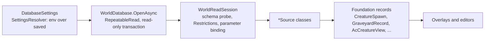
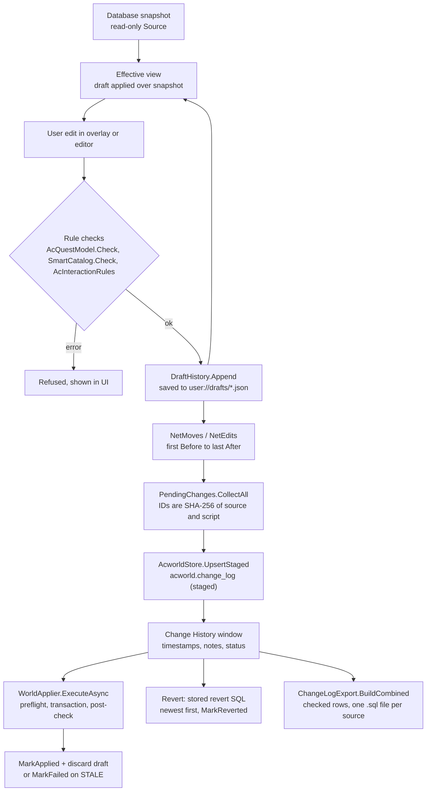

# Editing, data access and change history

Covers `Scripts/Data/` (world database reads, the editor's own `acworld` tracking database and
applying changes) and `Foundation/` (the draft model, SQL generation, the change record and rule
checks). Foundation has no Godot or MySQL references, and the tests compile it directly.

Reads run inside read-only transactions that are never committed. Edits stage in local drafts, sync
into the `acworld` change log, and only reach the world when the user applies them from the Change
History window; every apply runs the same guarded scripts the export writes, with a stale-row abort
before anything is written.

## Read path: `Scripts/Data`

- `WorldDatabase` (`Scripts/Data/WorldDatabase.cs`) holds the connection string in memory. `SourceKey` is a SHA-256 of `host:port/database` (plus `#TrinityCore` for TrinityCore, so AzerothCore keys are unchanged); drafts are tied to it.
- `WorldReadSession` reads `information_schema.COLUMNS` for the dialect's known tables (`WorldReadSession.SchemaTables`), then `RequireDialect` rejects a database of the other dialect. A missing column raises `SpawnSchemaException`, so a query fails rather than guessing.
- User values are always bound as parameters. Table and column names come from code. LIKE wildcards in search text are escaped and terms are capped at 80 characters.
- `Restrictions` builds EXISTS filters over event, pool and conditions tables so spawn queries can respect the preview policy.
- `DatabaseSettings` (`Scripts/Data/DatabaseSettings.cs`) parses `host;port;user;password;database`. The connection string sets short timeouts, disables `LOAD DATA LOCAL` and does not pool. `ToString` omits the password.
- `SettingsResolver` (`Scripts/Data/SettingsResolver.cs`) lets environment variables (`ACWORLD_DB_INFO`, `ACWORLD_TC_DB_INFO`, `ACWORLD_DATA_DIR`, `ACWORLD_RETAIL_DIR`, `ACWORLD_CLIENT_PROFILE`) override saved settings. An invalid `ACWORLD_DB_INFO` falls back to saved values silently. Settings saved before client profiles (the `[database]` section) are moved into `[database.wrath]` the first time `UserSettings` opens the file (`SettingsResolver.LegacyDatabaseMigration` decides what to copy).

### Dialects: `IDBSource`

Reads go through `IDBSource` (`Scripts/Data/IDBSource.cs`), opened with `DBSource.Open`, which picks the dialect and takes the client's `IClientLookup`. AzerothCore lives in `Scripts/Data/AzerothCore/` (`Ac*Source`), TrinityCore in `Scripts/Data/TrinityCore/` (`Tc*Source`). TrinityCore coverage and gaps are tracked in [`status/open-work.md`](../status/open-work.md); schema differences are in [`reference/database-differences.md`](../reference/database-differences.md).

Callers outside `Scripts/Data` use `DBSource.Open` and `IDBSource.Schema`, not the source classes. The Db tests do the same (`Test.AcSource` wraps `DBSource.Open`).

### Source classes and the tables they read

AzerothCore (`Scripts/Data/AzerothCore/`):

| Source | Tables read |
|---|---|
| `AcCreatureSource` | `creature` joined to `creature_template`; `creature_template_model` if present, otherwise `modelid1..4` and `scale`; event, pool and condition filters |
| `AcGameObjectSource` | `gameobject` joined to `gameobject_template`; event, pool and condition filters |
| `AcGraveyardSource` | `game_graveyard`, `graveyard_zone`; spirit healers from `creature` joined to `creature_template` (npcflag) |
| `AcTeleportSource` | `game_tele` |
| `AcWaypointSource` | `waypoint_data`; paths found through `creature_addon.path_id`, else `creature_template_addon.path_id` |
| `TcWaypointSource` | `waypoint_path_node` and `waypoint_path`; paths found through `creature_addon.PathId`, else `creature_template_addon.PathId`. Each node carries its path's move type and velocity; the path is marked `WorldDialect.TrinityCore` |
| `AcAreaTriggerSource` | `areatrigger`, `areatrigger_scripts`, `areatrigger_teleport`, `areatrigger_involvedrelation`, `areatrigger_tavern`, `quest_template`, `smart_scripts` |
| `AcInteractionSource` | `creature_template`, `creature`, `creature_queststarter`, `creature_questender`, `npc_vendor`, `creature_default_trainer`, `npc_spellclick_spells`, `gossip_menu`, `gossip_menu_option`, `npc_text`, `trainer`, `trainer_spell`, `item_template`, `quest_template`, `broadcast_text`, `points_of_interest`, `conditions`, `smart_scripts` |
| `AcContentSource` | the four quest tables, starter and ender links, `creature_template` (AIName), `smart_scripts` (source types 0, 9, 2), `creature_text`, `areatrigger_scripts`, `areatrigger`, `creature`, `gameobject_template`, `item_template` |

`AcContentSource` also provides name search (`SearchAsync`). The content browser's template search, `IDBSource.SearchTemplatesAsync`, is one shared query for both dialects (`DbTemplateSearch`): `creature_template` or `gameobject_template` by escaped name or exact entry, optionally one `type`, at most `DbLimits.MaxSearch` `TemplateHit`s with the exact entry first and unnamed rows only matched by entry. The type names come from `CreatureTypes` and the per-dialect `GameObjectTypeCatalog` (`GameObjectTypes.For`). `AcInteractionSource` uses `InteractionCatalog` (from `Scripts/Assets/Client`) to look up client-side names and icons.

TrinityCore (`Scripts/Data/TrinityCore/`, opened through `TcDBSource`; coverage in [`status/open-work.md`](../status/open-work.md)):

| Source | Reads |
|---|---|
| `TcSpawnSource` | `creature` / `gameobject` with their templates, `creature_template_model`; `pool_members`, event and `conditions` filters |
| `TcGraveyardSource` | `world_safe_locs`, `graveyard_zone`, team rows in `conditions`, teleport overlaps from `areatrigger_teleport`; healers via `AcGraveyardSource.ReadHealers` |
| `TcAreaTriggerSource` | client `AreaTrigger.db2` (through `IClientLookup`, with polygon corners from its Path tables) joined to `areatrigger_scripts`, `areatrigger_teleport` → `world_safe_locs`, `areatrigger_involvedrelation`, `areatrigger_tavern`, `smart_scripts` (type 2); server spawns from `areatrigger` with their `areatrigger_create_properties` shape and `areatrigger_create_properties_polygon_vertex` corners, and their template's `smart_scripts` (types 11 and 12) |
| `TcInteractionSource` | the `TcTables` creature tables (template, difficulty, gossip, trainers, vendor, quest links, spell clicks); the template, difficulty (including level scaling), vendor, gossip option and greeting, trainer and quest-link rows are editable; `creature_classlevelstats` is read for the stats page; `SearchQuestsAsync` searches `quest_template` |
| `TcContentSource` | the quest snapshot: `quest_template`, `quest_template_addon`, `quest_request_items`, `quest_offer_reward`, `quest_objectives` (by `QuestID`) and the creature starter/ender links, with creature, object and quest names from the world database and item and spell names from the client; also the creature, object, item, spell and quest search |
| `TcBehaviorSource` | the behavior snapshot of one creature: `smart_scripts` (source types 0 and the timed action lists of type 9 they run), `creature_template` (AIName, ScriptName), `creature_text`, with creature, object and quest names from the world database, item and spell names from the client, and each linked broadcast text from the hotfixes database before the client; also the used action list IDs |
| `TcHotfixSource` | `hotfixes` database: `creature_display_info`, `creature_model_data`, `broadcast_text`, `area_trigger` (including `ShapeID`; the path tables are not read), `item_sparse` (vendor item name and quality) |

A guard on a 0 in a column that is neither a key nor declared nullable also accepts NULL (`(`SpellID` = 0 OR `SpellID` IS NULL)`), because the loader reads NULL numbers as 0 and real rows have NULLs the catalogs do not model; `PhaseSixRealDataTests` runs the exported guards against the live databases. `TableSchema.Sql` may name a table of another database on the same server (`hotfixes.broadcast_text`, `hotfixes.hotfix_data` in `TcTables`); `SqlExport.TableIdent` quotes each part and the preflights and reverts query it the same way. `TcBroadcastText.Create` stages a new text's two rows and `TcBroadcastText.Staged` lets the creature read model show a text that is not exported yet.

Read helpers outside the source classes: `DbSpawnRows` (spawn and addon rows by GUID), `DbTemplateColumns` (the template values the inspector shows as inherited), `DbSpawnImpact` (reverse references for the delete warning), `DbSpawnPaths` (the path a creature walks and who else uses it), `DbTemplateAddon` (template addon row and use counts), `DbTemplateSearch` (the content browser's search), `DbGameObjectTemplate` (one GameObject template, its addon/quest links/items and quest titles), `DbGameObjectSpawns` (its bounded spawn count and sample), `DbCreatureLooks` and `DbGameObjectLooks` (batch looks for staged and existing spawns), `DbIds` and `DbLimits` (allocator maxima and search caps), `WorldConnection` (open and validate), and `UserDataReset` (the reset smoke).

Teleports reuse `AcTeleportSource` (same `game_tele` schema). `TcBehaviorSource.ReadAreaTriggerAsync` reads AreaTrigger rules: a client trigger's (`smart_scripts` type 2, `areatrigger_scripts`; the trigger must be in the client's AreaTrigger.db2 or the hotfix rows) or a spawned trigger template's (types 11 and 12 by `areatrigger_template`, with the spawn's `ScriptName` as the `areatrigger_ai` row and its create properties' `ScriptName` as the fallback the server uses).

## Draft model: `Foundation/`

`Foundation` is organised by responsibility: `Drafts/` (draft state and history), `Spawn/` (spawn rows, poses and appearance), `Placement/` (coordinates and map placement), `Interaction/` (row model, views and the NPC pages), `Smart/` (SmartAI catalogs, sentences and rule edits), `Conditions/`, `Sql/` (export and the SQL dialect contract), `Pages/` (entity page descriptors), `World/` (dialect and schema contracts) and `Tooltips/`. Each server's code stays in `AzerothCore/` or `TrinityCore/` at the layer root; a shared file names a core type only in the schema factory and composition points. Namespaces stay flat `ACWorldEdit.Foundation`, so the folders are organisational only. `Tools/foundation-budget.json` and `Tools/foundation-long-methods.json` ratchet the shape.

Each kind of edit has its own draft type. All of them are backed by `DraftHistory<T>` and store their state in a JSON file under `user://drafts/`.

| Draft | File | Covers |
|---|---|---|
| `SpawnPoses` | `Spawn/SpawnPoses.cs` | Spawn rows (and their addon rows) as `creature` / `gameobject` row edits on the content draft: `Effective`, `Conflict`, `Move`, `Delete`, `Duplicate`, `EditMany`, `DeleteMany`, `DuplicateMany`, `Undo`, `Redo`; `GameObjectPlacement` holds the placement maths |
| `GraveyardDraft` | `Drafts/GraveyardDraft.cs` | Graveyard location, name and zone links, dialect-neutral (`ISqlDialect.Graveyard` maps them to tables). ID and map cannot change |
| `WaypointState` | `Drafts/WaypointDraft.cs` | Waypoint positions and properties of either dialect as the display model; the rows themselves (`waypoint_data`, `waypoint_path(_node)`, `creature_formations`) are `RowEdit`s on the content draft (`MovementEdits` builds link/unlink, node and formation commands; `WaypointProps.EditableOn` still says which node properties a dialect stores: TrinityCore only facing and delay) |
| `ContentDrafts` | `Drafts/ContentDrafts.cs` | One shared `InteractionDraft` for the interaction, quest and behavior editors |
| `InteractionDraft` | `Drafts/InteractionDraft.cs` | Generic row edits (insert, update, delete); several edits undo as one command. Each source's table catalog comes from `SourceDialects` (`sources.json`); an unknown source is AzerothCore |
| `InteractionRows` | `Interaction/InteractionRows.cs` | The row model; `AcTables` (`Foundation/AzerothCore/AcTables.cs`) is the AzerothCore catalog; TrinityCore's catalog is `TcTables` (`Foundation/TrinityCore/TcTables.cs`) |

`SpawnPoses` keeps the spawn row and its addon row in one draft. A spawn with its own `creature_addon` row replaces the template's completely on both servers, so `SpawnPoses.OverrideAddon` starts a spawn's row as a copy of the template's (`SpawnEdits.AddonFromTemplate`) and `RemoveAddon` deletes it so the spawn inherits again. `SpawnPoses.EditAddon` edits the spawn's addon row under one rule: the row exists only while it differs from `SpawnEdits.AddonBaseline` (the template's addon copied under the spawn's GUID, or blank). An edit produces nothing, an Insert, an Update or a Delete (`SpawnEdits.SameAddon` compares every column but the key, with NULL and empty auras equal, so a row holding a waypoint path is never pruned). `UseTemplateAppearance` copies only the appearance fields from the template. `SpawnFields` describes the inspector's row fields per dialect and kind (label, type, and whether the column overrides the template: NULL on TrinityCore, 0 on AzerothCore flags) and applies a typed value, moving a creature's movement type and wander radius together as `.npc set movetype` / `.npc set spawndist` do. `TemplateAddons` does the same for a creature template's `creature_template_addon` row (`Load` with the database's answer first, then `Edit`; `SpawnEdits.NewTemplateAddon`, `IDBSource.ReadTemplateAddonAsync` and `CountTemplateUseAsync` supply the row and the spawn counts).

The GameObject editor uses the same shell and draft. `GameObjectContext` reads one template through `DbGameObjectTemplate`, merges the draft and commits through `ContentDrafts`; `GameObjectPage` builds the fixed Template page and the per-type page from `GameObjectTypeCatalog`; `GameObjectEdits.ChangeType` resets all Data columns as one command; `GameObjectRules` checks the catalogue ranges, addon money order and the six-item cap. `gameobject_template_addon` is optional: `GameObjectContext.DisplayRows` adds a default display row and `PageFields` inserts it on the first edit. Quests are `gameobject_queststarter`/`questender`/`questitem` through `GameObjectQuestPage`; the Spawns page shows the paginated spawn table from `DbGameObjectSpawns` with a Fly to button per spawn. The per-dialect catalogs are `AcGameObjectTypes` and `TcGameObjectTypes`, generated by `Tools/generate_gameobject_catalog.py`; the physical Data signedness still comes from `AcTables`/`TcTables`.

`AcTables` lists the editable AzerothCore tables: `creature_template` (npcflag, gossip_menu_id, subname), `gossip_menu`, `npc_text`, `gossip_menu_option`, `creature_queststarter`, `creature_questender`, `npc_vendor`, `creature_default_trainer`, `trainer`, `trainer_spell`, `npc_spellclick_spells`, `creature_ai` (a logical name for `creature_template.AIName`), the four quest tables, `smart_scripts`, `creature_text`, `areatrigger_scripts`, `gameobject_template`, `gameobject_template_addon`, `gameobject_queststarter`, `gameobject_questender` and `gameobject_questitem`. `TcTables` holds the creature-property tables, the five quest tables (`quest_template`, `quest_template_addon`, `quest_request_items`, `quest_offer_reward`, `quest_objectives`), `smart_scripts`, `creature_text`, `areatrigger_scripts`, `areatrigger_ai` (a logical name for `areatrigger.ScriptName`, keyed by `SpawnId`) and the same five GameObject tables. `TcQuestRules` holds TrinityCore's quest vocabulary (objective types and flags) and the loader checks.

Both catalogs also list the spawn tables `creature`, `gameobject`, `creature_addon` and `gameobject_addon` (`SpawnCreature`, `SpawnGameObject`, `SpawnCreatureAddon`, `SpawnGameObjectAddon`). The spawn inspector and the place/duplicate/delete commands edit them in both dialects; `creature_template_addon` and `gameobject_template_addon` are read for the template appearance and path links. The design of the remaining spawn work is in [`editor-gap-plan.md`](../plans/editor-gap-plan.md) phase 11. `TableSchema.Nullable` names the columns whose NULL means something: TrinityCore spawn overrides (`npcflag`, `unit_flags*`, `curHealthPct`, `PhaseId`, `PhaseGroup`, `StringId`) where NULL inherits the template's value. A `Row` stores NULL as the reserved `Row.NullValue`, so it stays a string-valued, JSON-stable row; `Row.Validate` allows it only in those columns, the loader keeps it (every other NULL still reads as 0 or empty), and `SqlExport` writes `NULL` and guards with `IS NULL`. AzerothCore spawn flags are NOT NULL and 0 inherits (`ObjectMgr::ChooseCreatureFlags`), so an AzerothCore spawn cannot override a flag down to 0.

New rows get their IDs from `IdAllocator` (`Foundation/Drafts/IdAllocator.cs`): past the database maximum (`IDBSource.MaxIdAsync`, which reads `MAX` of a whole-number column of a catalog table), past everything the draft has staged (`InteractionDraft.MaxStaged`, which counts undone inserts too so a redo cannot collide) and not below an optional reserved range start for custom content. `Block` returns consecutive IDs for a command that inserts a group.

`SpawnEdits` (`Foundation/Spawn/SpawnEdits.cs`) builds the row edits for a spawn: `NewCreature` / `NewGameObject` start from what `.npc add` and `.gobject add` write (`Creature::SaveToDB`, `GameObject::SaveToDB`: 300 s respawn, no wander, full health, TC flags NULL, GameObject animprogress 255 and state ready, a turn about Z for the rotation); the creature's equipment ID is a required argument because the server uses set 1 only when the template has one and 0 means no equipment. `Place` adds the addon row of a copy, `Duplicate` keeps the source's equipment, overrides and addon, `Delete` removes the spawn and its addon in one command, and `Move` is an update that stays on the map. `References` lists the tables that name a spawn by GUID (SmartAI, linked respawn, spawn groups, pools, events, formations) for a delete-impact list. A move followed by a delete collapses to a delete of the original database row, so its guard matches what the database holds.

### Undo, redo and freshness

Creature page metadata lives in `EntityPage.cs`. `ItemListSpec` describes child rows by source table, parent column, ordering, fields and a complete new-row factory. Its add/remove helpers use the dialect's table; changing a primary-key field produces a delete plus insert in one command. `VendorPage` supplies the AC and TC vendor descriptors through `IWorldSchema.VendorPage`. `ItemListTests` covers selection, defaults, grouped edits, undo/redo and export. `IWorldSchema.GossipPage` supplies `GossipPageSpec` (menu text links, options and the greeting table) from `GossipPage.cs`. Its option text helper clears the broadcast override atomically; its reorder helper deletes both old keys before inserting replacements. `GossipPageTests` covers the dialect-specific defaults, selection, text edits, reordering, undo/redo and export. List ordering uses signed 64-bit comparisons to accommodate signed vendor slots and the full unsigned 32-bit gossip IDs. `IWorldSchema.TrainerPage` supplies `TrainerPageSpec` (trainer storage, creature bindings and spell fields) from `TrainerPage.cs`. Spells sort by required level then spell ID; new rows include all catalog requirements. `IWorldSchema.QuestLinksPage` supplies starter/ender lists from `QuestLinksPage.cs`; `SetRoles` changes both roles as one command, retaining existing rows. `CreatureServicePageTests` covers selection, complete defaults, requirements, role changes, undo/redo and SQL export.

Each draft holds a `DraftHistory<T>` (`Foundation/Drafts/DraftHistory.cs`):

- Opening a draft takes an exclusive lock on a sibling `.lock` file, so a second writer fails. When that happens the editor says another ACWorldEdit may be using the profile's draft and offers to delete the lock file and continue; deleting it only works when the other process is gone or the file is not held.
- The file is a JSON envelope `[payload, SHA-256(payload)]`. Saves write a `.tmp` file, flush it and move it over the real file.
- On load, a checksum mismatch, an unknown version or an out-of-range cursor throws. A bad file is rejected, never silently reset. Each entry is re-validated by its draft type.
- Entries before the cursor are applied; entries from the cursor onward are the redo branch. Appending drops the redo branch. Undo and redo move the cursor.
- Snapshots are immutable, so worker threads can read them.

Freshness uses each row's remaining net change. Discarded or mutually cancelling edits keep their undo history but neither report conflicts nor replace database values in the effective view. A later edit of that row starts a new baseline from the current snapshot; SQL export uses that baseline too. `InteractionConflictTests` covers discarded template changes, cancelled inserts/deletes, reopen, frozen views and subsequent edits for both dialects. Every edit records the value it replaced (`Before`). A new edit is refused if the current effective value no longer matches. Per-row staleness shows up as a conflict, and the database value is displayed instead of the draft value.

`ContentDrafts.Commit` also refuses edits that introduce a new rule error, using `AcInteractionRules` and the quest and SmartAI checks. TC creature commits use `TrinityCore/TcGossipRules` for service IDs, confirmation booleans/costs, greeting weights and, when the client or database can answer, language, spell, client-option and point-of-interest references (the gossip section also assigns, unassigns, copies and creates a creature's menus and greetings), `TrinityCore/TcTrainerRules` for trainer type, spell and skill-line existence (when the client is open), required level and required abilities, and each `creature_trainer` binding (trainer exists, gossip option exists; the trainer section assigns, rebinds, copies and removes bindings), `TrinityCore/TcQuestLinkRules` for quest IDs that must exist in `quest_template`, and `TrinityCore/TcVendorRules` for vendor checks: vendor flag, signed slot range, item/type validity, paired item stock/restock, positive currency quantity, bonus-list integer syntax and filtering boolean. Item, currency, extended cost, player condition and bonus list existence is checked against the retail client when available (`IClientLookup.Exists`, `ClientRecord`), and `TcStatRules` checks the difficulty ID the same way. Shared-reference expansion remains a gap. Stock and restock are one command so a valid limited-stock row can be created from unlimited stock.

## Draft lifecycle

Details:

- **Net changes.** Draft entries are collapsed per source, GUID or key: the first `Before` to the last `After`. Changes that end up at the baseline are dropped.
- **Staged changes** (`Foundation/Drafts/PendingChanges.cs`): each net change becomes a `PendingChange`. Its ID is a SHA-256 of the source and its apply script, built with a fixed timestamp so the ID is stable. `ChangeKey` separately hashes the logical object (source, kind, graveyard ID or row table/key), so editing the same object keeps one history row even though its script fingerprint changes. `CollectAll` lists everything staged; the legacy `exported.json` set is no longer written (it only hides old file exports, and is cleared with the drafts).
- **Change log** (`Foundation/ChangeLog/ChangeRecord.cs`, `Scripts/Data/AcworldStore.cs`): each staged change is upserted into the history database with its apply/revert scripts, status (`staged`, `applied`, `reverted`, `failed`), timestamps and the user's optional note. The upsert key is `(source_key, change_key)`, so an edited draft updates its row in place and keeps the note and first-seen timestamp; `fingerprint` remains the script hash for exports and integrity. After staging, staged rows for the open source whose change key no longer matches a draft are removed; applied and reverted rows are never touched. Reconciliation assumes one editor writes staged rows per source: two clients sharing one history database for the same world would each remove the other's staged drafts, so use separate history databases or profiles for simultaneous editors. Stored scripts use the draft's fixed header timestamp, so an unchanged refresh writes nothing and the window does not rebuild. Applied and reverted rows survive draft clears; the history defaults to the open world (its `SourceKey`) with a "Show all worlds" checkbox for the full audit. The connection form always shows the history database name (`acworld` unless changed, so hosted users without CREATE rights can point at a database they already own); the "different server" box points the whole connection elsewhere. Same-server overrides save only the database name and follow the world credentials. Saved under `[acworld.wrath]` / `[acworld.retail]`, or `ACWORLD_ACWORLD_INFO` / `ACWORLD_TC_ACWORLD_INFO`.
- **Schema check:** `EnsureSchemaAsync` reads `information_schema` and issues only the missing `CREATE`/`ALTER` statements; a complete database needs no DDL, so a DML-only grant works. The successful check is cached per host/database/user until a connection is applied.
- **Applying** (`Scripts/Data/WorldApplier.cs`): the script's preflight SELECTs run first and any `STALE` row aborts before anything is written; the body and its post-checks then run in one transaction, and only a successful post-check commits. A failed post-check or body rolls back, so a committed-but-unverified change is never recorded as failed. The viewer executes the script generated from the local draft (after checking the stored row's fingerprint); success marks the row applied and discards its draft. A failed history write keeps the draft and reports the failure instead of claiming success.
- **Reverting** runs the stored revert script the same way (newest first for multi-select) after verifying its `scripts_hash` and that `applied_by` names this client profile; a row applied by another installation is not reverted. A failed mark keeps the row and reports the failure. Stale rows never partially apply: the transaction rolls back.
- **Discard** calls the owning draft's `Revert` and deletes the staged row, only after the status-aware delete succeeds. Applied history is kept; Clear cache removes drafts and their staged rows but never applied history.
- **Deleting old history** (`AcworldStore.DeleteOldAsync`): "Delete old…" removes applied and reverted rows of the open world whose last lifecycle timestamp (`reverted_at` for a reverted row, `applied_at` for an applied one, else `created_at`) is older than the chosen age (7, 30 or 90 days, or every finished change). Staged drafts and failed attempts are never touched, and other worlds are left alone even while "Show all worlds" is on. The confirmation counts the matching rows and disables Delete when none match.
- **Trust and sources:** the history database is not trusted executable input. Before an apply, the stored fingerprint must match the stored script and the script that runs is regenerated from the local draft; before a revert, the stored script pair must match `scripts_hash` and `applied_by` must name this client profile (rows applied before provenance existed are treated as another client's). Show-all rows display their source and foreign rows have no active Apply/Revert; the viewer also refuses to run a record whose `SourceKey` is not the open world, or a cached list after a connection change. Export writes one file per source instead of mixing worlds in one script.
  This is a deliberate single-writer trust boundary, not a cryptographic signature: someone who can write the history database can still insert a row with a copied `applied_by` and a recomputed public `scripts_hash`. For a hostile shared database, use a separate database with restricted credentials; the world connection's write access is the real boundary.
- **Local file locations** come from `ContentDraftFiles` (`Scripts/Ui/Settings/UserSettings.cs`). Each client profile has its own folder, `user://drafts/wrath/` or `user://drafts/retail/`, so a Wrath and a retail viewer can run together (each draft file is single-writer; two viewers on the same profile still conflict). If the content draft is locked, the viewer says another editor may be running and offers to delete the lock file and continue; the draft file itself is never deleted. `UseProfile` picks the folder at startup and on a client switch, which rebinds the content draft (`ContentDrafts.Rebind`); drafts stay on disk across a switch. Files: `graveyards.json`, `interactions.json`, `sources.json` (plus the retired `exported.json`, `waypoints.json` and `exports/` folders from the file-export era). Smoke runs use `res://artifacts/drafts/<guid>/`.

## SQL generation: `Foundation/Sql/SqlExport.cs`

`SqlExport.Build(source, graveyards, rows, generated?, schema?)` returns `SqlScripts(Apply, Revert, Changes, Summary)`. It never connects to anything. `schema` (default `AcSchema`) picks the dialect: content rows (spawn moves, placements, deletes, waypoint paths, formations) use `schema.Tables`, and graveyards use `schema.Sql` (`AcSqlDialect` in `Foundation/AzerothCore/`, `TcSqlDialect` in `Foundation/TrinityCore/`). The viewer passes each source's schema from `SourceDialects`.

Each script has the same structure:

1. A header comment and `SET NAMES utf8mb4;`.
2. A read-only preflight: one `SELECT ... IF(COUNT(*)=1,'ok','STALE')` per change. Rows that must not exist yet use `COUNT(*)=0`.
3. `START TRANSACTION;`, the statements, and `COMMIT;`.
4. A post-check that confirms the new state.

The revert script is the same shape, with the statements in reverse order.

Per change:

- **Creature move:** `UPDATE creature SET position_x, position_y, position_z, orientation WHERE guid = ...` with a guard that the four columns still hold their old values (floats compared with `ABS(col - v) < 0.0001`).
- **GameObject move:** the same pattern on `gameobject`.
- **Graveyard position or name:** an `UPDATE` guarded by ID, position and comment, on `game_graveyard` (AzerothCore) or `world_safe_locs` (TrinityCore).
- **Graveyard links:** `INSERT`, `DELETE` or `UPDATE` on `graveyard_zone`, one per changed link. TrinityCore has no `Faction` column; the faction is a team row in `conditions` (source type 27).
- **Waypoint point:** an `UPDATE` on `waypoint_data` for AzerothCore, or on `waypoint_path_node` for TrinityCore, keyed by path and point; only the changed columns are set and guarded. `TcSqlDialect` exports position, facing and delay and refuses an edit that changes the path-level move type or velocity, smooth transition or action instead of dropping it.
- **Content rows:** insert writes every allowed column; delete matches every allowed column; update changes and guards only the key plus the changed columns. Restricting updates this way is what lets `creature_ai` and `creature_template` share a table safely.

Escaping and guards:

- Text is compared with `BINARY COALESCE(col,'') = BINARY '...'`, and strings are MySQL-escaped with backslashes.
- Numbers are re-parsed before they are written, so only canonical values appear unquoted.
- INSERT statements have no guard by design. A duplicate primary key makes the script fail, which is the intended signal.

## Change-history flow in the viewer

`Scripts/Viewer/Export/ViewerShell.Export.cs` ties it together:

- `CollectStaged` feeds creature `NetMoves`, graveyard `NetEdits` and content `NetEdits` into `PendingChanges.CollectAll` (the sidebar staged count polls this every 0.4 s; the history itself reloads at most every 5 s while open, plus on demand).
- `LoadHistoryAsync` ensures the `acworld` schema (once per connection), upserts only changed records by `change_key` (preserving notes and applied/reverted status), reconciles stale staged rows for the open source, then lists the filtered history into the window. An upsert or list failure is shown and disables the actions.
- `ApplyHistoryAsync` runs the checked staged rows oldest-first through `WorldApplier`; each success marks the row applied and discards its draft. Rows from another source, a tampered row, or a stale/erroring history list are never run.
- `RevertHistoryAsync` verifies `scripts_hash`, runs the checked applied rows newest-first and marks them reverted.
- `PreviewHistory` / `ExportHistory` build the combined script from the checked rows via `ChangeLogExport.BuildCombined` (apply oldest-first, revert newest-first) for review or sharing. A single source writes one file; a show-all selection writes one file per source, labelled by its source key.
- `DeleteOldHistoryAsync` deletes the finished rows of the open source older than the age picked in "Delete old…", then reloads the history and reports the count.

## SmartAI and quest rules

SmartAI is one engine over two catalogs; `AcQuestModel` and `AcCreatureView` are the AzerothCore data and read model (TrinityCore has `TcQuestRules` and `TcCreatureView`); both read models implement `ICreatureView`.

- `SmartCatalog` (`Foundation/Smart/SmartCatalog.cs`, `SmartCategories.cs`) is an instance per dialect, `SmartCatalog.Ac` and `SmartCatalog.Trinity` (reached through `IWorldSchema.Smart`). Each holds its event, action and target types, how many parameter columns `smart_scripts` has (events 6/5, actions 6/7, targets 4), the event-flag checkboxes, its tables (`smart_scripts`, `creature_text`, the `creature_ai` AIName group) and the loader rules (`Check`). The ID ranges differ, so nothing is shared by ID.
- The type arrays are generated: `AcSmartTypes` (`Foundation/AzerothCore/AcSmartTypes.cs`) and `TcSmartTypes` (`Foundation/TrinityCore/TcSmartTypes.cs`) come from `Tools/generate_smart_catalog.py` over each server's `SmartScriptMgr.h`, with hand-written names and sentences. TrinityCore reuses an AzerothCore sentence only when the code name and parameter comment match; the rest read their parameters from the comment. `SmartTypes.cs` holds `SmartType`, `SmartParam` and `SmartParamKind`. `SmartCatalog.IsMarker` hides range markers, `RESERVED` slots and slots the server marks "UNUSED".
- `SmartCatalog` (`Foundation/Smart/SmartCatalog.Describe.cs`) turns rows into readable sentences, groups linked rows into chains, and checks rules that mirror `SmartScriptMgr.cpp`. `SmartRule` reads a missing parameter column as 0 (and the string parameters as empty), so one routine serves both row shapes.
- AreaTrigger scripts: `SmartScope.IsAreaTrigger` covers source types 2 (client trigger), 11 and 12 (TrinityCore spawned trigger templates, `IsTriggerEntity`). `SmartCatalog.AllowedForAreaTrigger` follows each core's event masks (AzerothCore: On trigger and Then; TrinityCore adds "Area trigger left", and spawned triggers also run the timed updates); a spawned trigger is an object, so Self and its own action lists are allowed. `CheckAreaTriggerScript` and `EnableTriggerScript` check and fix the script name that runs the rules (SmartTrigger in `areatrigger_scripts`, SmartAreaTriggerAI in the spawn's `areatrigger_ai` row).
- `ConditionCatalog` (`Foundation/Conditions/ConditionCatalog.cs`, data in `AcConditionTypes` / `TcConditionTypes`) is the model of the `conditions` table: each condition type has a name, a sentence ("has aura {1} (effect {2})") and parameter kinds for `ConditionValue1..3`, and each source type labels what `SourceGroup`, `SourceEntry` and `SourceId` mean for it (an empty label means the column is unused). `Describe` renders a row as a sentence, prefixing "not:" for `NegativeCondition`. Ids are sparse: AzerothCore's own types start at 101, and TrinityCore has no source 20. Types the server only keeps for old rows are `Deprecated` (TrinityCore's spawn mask and legacy object entry and type mask) and those the server says not to use on this client are `NotForClient` (AzerothCore's terrain swap, phase and graveyard sources on 3.3.5a). The data comes from `Tools/generate_condition_catalog.py`; the visual builder is Phase 13 and nothing in the UI reads the catalog yet.
- `SmartRuleEdits` (`Foundation/Smart/SmartRuleEdits.cs`) does the row math for add, delete, swap, duplicate and copy-scope; every function takes the dialect's `SmartCatalog` for its tables. Changing a key column becomes a delete plus an insert. `SpeechEdits` does the same for `creature_text` (TrinityCore lines carry `SoundPlayType`).
- `AcQuestModel` (`Foundation/AzerothCore/AcQuestModel.cs`) holds AzerothCore's quest vocabulary and checks rules that mirror `ObjectMgr::LoadQuests`; `QuestVocabulary` (`Foundation/Pages/QuestVocabulary.cs`) has the quest types and text placeholders both dialects show.
- `AcCreatureView` (`Foundation/AzerothCore/AcCreatureView.cs`) is a read-only view of one NPC's interaction data; `AcInteractionRules` in the same file are its validation rules. `InteractionViews.cs` holds the row views both dialects share and `InteractionText.Render`, which previews client text placeholders.

## Types by file

| File | Types |
|---|---|
| `WorldCoordinates.cs` | `Point3`, `WorldPose`, `WorldCoordinates` (server to view conversion, tile maths, ray hits), `PoseText` |
| `CreatureSpawn.cs` | `CreatureSpawn`, `CreatureRegion`, `CreatureRegionResult` |
| `SpawnPreview.cs` | `SpawnPreview`, `EventPreviewMode`, `SpawnQueryPoint`, `SpawnVisibility`, `GameObjectSpawn` (phase and event filters, `QueryLimit` 384, `ModelLimit` 128) |
| `AreaTrigger.cs` | `AreaTriggerRecord` (shape, server membership test `Contains`, `Focus`, spawn identity), `AreaTriggerShape`, `AreaTriggerKind`, `AreaTriggerKey`, `AreaTriggerOwner` (whose rules: source type 2, or 11/12 with the spawn), `AreaTriggerTeleport` |
| `PendingChanges.cs` | `PendingKind`, `PendingChange`, `PendingChanges` (`CollectAll` lists everything staged; the legacy `Collect`/`MarkExported` file set is retired) |
| `ChangeRecord.cs` | `ChangeStatus`, `ChangeRecord` (fingerprint, stable `ChangeKey`, `ScriptsHash`), `ChangeIntegrity`, `ChangeLogExport` (a combined apply/revert file per source from checked rows) |
| `SqlExport.cs` | `SqlScripts`, `SqlExport` (`ISqlDialect`, `AcSqlDialect`, `TcSqlDialect` live in `SqlDialect.cs`) |
| `EntityPage.cs` | `EntityPage`, `FieldSpec`, `ItemListSpec`, `RowBinding`, `DifficultySpec` (the descriptor every properties page is drawn from) |
| `SpawnPoses.cs` | `SpawnPoses`, `AddonEdit` (spawn rows and addon rows as draft edits) |
| `SpawnEdits.cs` | `SpawnEdits` (new-row defaults, place/duplicate/delete/move, addon math, `References`) |
| `SpawnFields.cs` | `SpawnFields` (the inspector's row fields per dialect and kind) |
| `SpawnRules.cs` | `SpawnRules`, `SpawnFacts` |
| `TemplateAddons.cs` | `TemplateAddons` (template addon load, edit and new-row defaults) |
| `IdAllocator.cs` | `IdAllocator` (`Next`, `Block`) |
| `InteractionDraft.cs`, `InteractionRows.cs` | `InteractionDraft`, `RowEdit`, `Row`, `RowSet`, `TableSchema` |
| `ContentDrafts.cs`, `DraftHistory.cs` | The shared content draft and the undo/redo history envelope |
| `SourceDialects.cs` | `SourceDialects` (source key → dialect, persisted in `sources.json`) |
| `ScopeText.cs`, `PreviewSummary.cs` | Creature/spawn scope wording and the one-sentence visibility summary |
| `ConditionCatalog.cs` | `ConditionCatalog`, `ConditionType`, `ConditionSource`, `ConditionParam`, `ConditionStatus` |
| `Tooltips/` | `ItemDetails`, `ItemTooltipBuilder`, `ItemVocabulary`, `RetailItemStats`, `IRetailItemTables`, `Tooltip`, `TooltipLine` |