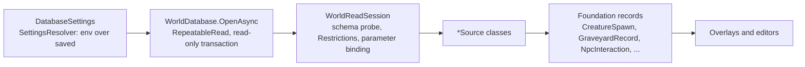

# Editing, data access and SQL export

Covers `Scripts/Data/` (read-only database access) and `Foundation/` (the draft model, SQL generation and rule checks). Foundation has no Godot or MySQL references, and the tests compile it directly.

The guarantee this part of the system exists to keep: **the app never writes to the database.** Reads run inside read-only transactions that are never committed. Edits are kept in local drafts. The only output that changes the server is SQL that a person reviews and runs.

## Read path: `Scripts/Data`

- `WorldDatabase` (`Scripts/Data/WorldDatabase.cs`) holds the connection string in memory. `SourceKey` is a SHA-256 of `host:port/database` (plus `#TrinityCore` for TrinityCore, so AzerothCore keys are unchanged); drafts are tied to it.
- `WorldReadSession` reads `information_schema.COLUMNS` for the dialect's known tables (`WorldReadSession.SchemaTables`), then `RequireDialect` rejects a database of the other dialect. A missing column raises `SpawnSchemaException`, so a query fails rather than guessing.
- User values are always bound as parameters. Table and column names come from code. LIKE wildcards in search text are escaped and terms are capped at 80 characters.
- `Restrictions` builds EXISTS filters over event, pool and conditions tables so spawn queries can respect the preview policy.
- `DatabaseSettings` (`Scripts/Data/DatabaseSettings.cs`) parses `host;port;user;password;database`. The connection string sets short timeouts, disables `LOAD DATA LOCAL` and does not pool. `ToString` omits the password.
- `SettingsResolver` (`Scripts/Data/SettingsResolver.cs`) lets environment variables (`ACWORLD_DB_INFO`, `ACWORLD_TC_DB_INFO`, `ACWORLD_DATA_DIR`, `ACWORLD_RETAIL_DIR`, `ACWORLD_CLIENT_PROFILE`) override saved settings. An invalid `ACWORLD_DB_INFO` falls back to saved values silently.

### Dialects: `IDBSource`

Reads go through `IDBSource` (`Scripts/Data/IDBSource.cs`), opened with `DBSource.Open`, which picks the dialect and takes the client's `IClientLookup`. AzerothCore lives in `Scripts/Data/AzerothCore/` (`Ac*Source`), TrinityCore in `Scripts/Data/TrinityCore/` (`Tc*Source`). TrinityCore coverage and gaps are tracked in [`docs/tc-status.md`](../tc-status.md); schema differences are in [`docs/DB-DIFFERENCES.md`](../DB-DIFFERENCES.md).

Callers outside `Scripts/Data` use `DBSource.Open` and `IDBSource.Schema`, not the source classes. The `Ac*Source(DatabaseSettings)` constructors are legacy, used only by the AzerothCore Db tests, and are slated for removal.

### Source classes and the tables they read

AzerothCore (`Scripts/Data/AzerothCore/`):

| Source | Tables read |
|---|---|
| `AcCreatureSource` | `creature` joined to `creature_template`; `creature_template_model` if present, otherwise `modelid1..4` and `scale`; event, pool and condition filters |
| `AcGameObjectSource` | `gameobject` joined to `gameobject_template`; event, pool and condition filters |
| `AcGraveyardSource` | `game_graveyard`, `graveyard_zone`; spirit healers from `creature` joined to `creature_template` (npcflag) |
| `AcTeleportSource` | `game_tele` |
| `AcWaypointSource` | `waypoint_data`; paths found through `creature_addon.path_id`, else `creature_template_addon.path_id` |
| `AcAreaTriggerSource` | `areatrigger`, `areatrigger_scripts`, `areatrigger_teleport`, `areatrigger_involvedrelation`, `areatrigger_tavern`, `quest_template`, `smart_scripts` |
| `AcInteractionSource` | `creature_template`, `creature`, `creature_queststarter`, `creature_questender`, `npc_vendor`, `creature_default_trainer`, `npc_spellclick_spells`, `gossip_menu`, `gossip_menu_option`, `npc_text`, `trainer`, `trainer_spell`, `item_template`, `quest_template`, `broadcast_text`, `points_of_interest`, `conditions`, `smart_scripts` |
| `AcContentSource` | the four quest tables, starter and ender links, `creature_template` (AIName), `smart_scripts` (source types 0, 9, 2), `creature_text`, `areatrigger_scripts`, `areatrigger`, `creature`, `gameobject_template`, `item_template` |

`AcContentSource` also provides name search (`SearchAsync`). `AcInteractionSource` uses `InteractionCatalog` (from `Scripts/Assets/Client`) to look up client-side names and icons.

TrinityCore (`Scripts/Data/TrinityCore/`, opened through `TcDBSource`; coverage in [`docs/tc-status.md`](../tc-status.md)):

| Source | Reads |
|---|---|
| `TcSpawnSource` | `creature` / `gameobject` with their templates, `creature_template_model`; `pool_members`, event and `conditions` filters |
| `TcGraveyardSource` | `world_safe_locs`, `graveyard_zone`, team rows in `conditions`, teleport overlaps from `areatrigger_teleport`; healers via `AcGraveyardSource.ReadHealers` |
| `TcAreaTriggerSource` | client `AreaTrigger.db2` (through `IClientLookup`) joined to `areatrigger_scripts`, `areatrigger_teleport` → `world_safe_locs`, `areatrigger_involvedrelation`, `areatrigger_tavern`, `smart_scripts` |
| `TcInteractionSource` | the `TcTables` creature tables (template, difficulty, gossip, trainers, vendor, quest links, spell clicks); the template, difficulty (including level scaling), vendor, gossip option and greeting, trainer and quest-link rows are editable; `creature_classlevelstats` is read for the stats page; `SearchQuestsAsync` searches `quest_template` |
| `TcContentSource` | the quest snapshot: `quest_template`, `quest_template_addon`, `quest_request_items`, `quest_offer_reward`, `quest_objectives` (by `QuestID`) and the creature starter/ender links, with creature, object and quest names from the world database and item and spell names from the client; also the creature, object, item, spell and quest search |
| `TcHotfixSource` | `hotfixes` database: `creature_display_info`, `creature_model_data`, `broadcast_text`, `area_trigger`, `item_sparse` (vendor item name and quality) |

Teleports reuse `AcTeleportSource` (same `game_tele` schema). TrinityCore has a quest source (`TcContentSource`) but no SmartAI or waypoint source yet; the quest editor panel is still off for it, as are the behavior editor and the waypoint layer.

## Draft model: `Foundation/`

Each kind of edit has its own draft type. All of them are backed by `DraftHistory<T>` and store their state in a JSON file under `user://drafts/`.

| Draft | File | Covers |
|---|---|---|
| `CreatureDraft` | `CreatureDraft.cs` | Creature positions. `Move`, `Revert`, `Undo`, `Redo`, `NetMoves()` |
| `GameObjectDraft` | `GameObjectDraft.cs` | GameObject positions and rotation |
| `GraveyardDraft` | `GraveyardDraft.cs` | Graveyard location, name and zone links, dialect-neutral (`ISqlDialect.Graveyard` maps them to tables). ID and map cannot change |
| `WaypointDraft` | `WaypointDraft.cs` | AzerothCore `waypoint_data` point positions and properties |
| `ContentDrafts` | `ContentDrafts.cs` | One shared `InteractionDraft` for the interaction, quest and behavior editors |
| `InteractionDraft` | `InteractionDraft.cs` | Generic row edits (insert, update, delete); several edits undo as one command. Each source's table catalog comes from `SourceDialects` (`sources.json`); an unknown source is AzerothCore |
| `InteractionRows` | `InteractionRows.cs` | The row model and `AcTables`, the AzerothCore catalog (`InteractionTables` is its legacy static facade); TrinityCore's catalog is `TcTables` (`TcTables.cs`) |

`AcTables` lists the editable AzerothCore tables: `creature_template` (npcflag, gossip_menu_id, subname), `gossip_menu`, `npc_text`, `gossip_menu_option`, `creature_queststarter`, `creature_questender`, `npc_vendor`, `creature_default_trainer`, `trainer`, `trainer_spell`, `npc_spellclick_spells`, `creature_ai` (a logical name for `creature_template.AIName`), the four quest tables, `smart_scripts`, `creature_text`, and `areatrigger_scripts`. `TcTables` holds the creature-property tables and the five quest tables (`quest_template`, `quest_template_addon`, `quest_request_items`, `quest_offer_reward`, `quest_objectives`); a TrinityCore SmartAI row is refused. `TcQuestRules` holds TrinityCore's quest vocabulary (objective types and flags) and the loader checks.

### Undo, redo and freshness

Creature page metadata lives in `CreaturePage.cs`. `ItemListSpec` describes child rows by source table, parent column, ordering, fields and a complete new-row factory. Its add/remove helpers use the dialect's table; changing a primary-key field produces a delete plus insert in one command. `VendorPage` supplies the AC and TC vendor descriptors through `IWorldSchema.VendorPage`. `ItemListTests` covers selection, defaults, grouped edits, undo/redo and export. `IWorldSchema.GossipPage` supplies `GossipPageSpec` (menu text links, options and the greeting table) from `GossipPage.cs`. Its option text helper clears the broadcast override atomically; its reorder helper deletes both old keys before inserting replacements. `GossipPageTests` covers the dialect-specific defaults, selection, text edits, reordering, undo/redo and export. List ordering uses signed 64-bit comparisons to accommodate signed vendor slots and the full unsigned 32-bit gossip IDs. `IWorldSchema.TrainerPage` supplies `TrainerPageSpec` (trainer storage, creature bindings and spell fields) from `TrainerPage.cs`. Spells sort by required level then spell ID; new rows include all catalog requirements. `IWorldSchema.QuestLinksPage` supplies starter/ender lists from `QuestLinksPage.cs`; `SetRoles` changes both roles as one command, retaining existing rows. `CreatureServicePageTests` covers selection, complete defaults, requirements, role changes, undo/redo and SQL export.

Each draft holds a `DraftHistory<T>` (`Foundation/DraftHistory.cs`):

- Opening a draft takes an exclusive lock on a sibling `.lock` file, so a second writer fails.
- The file is a JSON envelope `[payload, SHA-256(payload)]`. Saves write a `.tmp` file, flush it and move it over the real file.
- On load, a checksum mismatch, an unknown version or an out-of-range cursor throws. A bad file is rejected, never silently reset. Each entry is re-validated by its draft type.
- Entries before the cursor are applied; entries from the cursor onward are the redo branch. Appending drops the redo branch. Undo and redo move the cursor.
- Snapshots are immutable, so worker threads can read them.

Freshness uses each row's remaining net change. Discarded or mutually cancelling edits keep their undo history but neither report conflicts nor replace database values in the effective view. A later edit of that row starts a new baseline from the current snapshot; SQL export uses that baseline too. `InteractionConflictTests` covers discarded template changes, cancelled inserts/deletes, reopen, frozen views and subsequent edits for both dialects. Every edit records the value it replaced (`Before`). A new edit is refused if the current effective value no longer matches. Per-row staleness shows up as a conflict, and the database value is displayed instead of the draft value.

`ContentDrafts.Commit` also refuses edits that introduce a new rule error, using `InteractionRules` and the quest and SmartAI checks. TC creature commits use `TrinityCore/TcGossipRules` for service IDs, confirmation booleans/costs, greeting weights and, when the client or database can answer, language, spell, client-option and point-of-interest references (the gossip section also assigns, unassigns, copies and creates a creature's menus and greetings), `TrinityCore/TcTrainerRules` for trainer type, spell and skill-line existence (when the client is open), required level and required abilities, and each `creature_trainer` binding (trainer exists, gossip option exists; the trainer section assigns, rebinds, copies and removes bindings), `TrinityCore/TcQuestLinkRules` for quest IDs that must exist in `quest_template`, and `TrinityCore/TcVendorRules` for vendor checks: vendor flag, signed slot range, item/type validity, paired item stock/restock, positive currency quantity, bonus-list integer syntax and filtering boolean. Item, currency, extended cost, player condition and bonus list existence is checked against the retail client when available (`IClientLookup.Exists`, `ClientRecord`), and `TcStatRules` checks the difficulty ID the same way. Shared-reference expansion remains a gap. Stock and restock are one command so a valid limited-stock row can be created from unlimited stock.

## Draft lifecycle

Details:

- **Net changes.** Draft entries are collapsed per source, GUID or key: the first `Before` to the last `After`. Changes that end up at the baseline are dropped.
- **Pending changes** (`Foundation/PendingChanges.cs`): each net change becomes a `PendingChange`. Its ID is a SHA-256 of the source and its apply script, built with a fixed timestamp so the ID is stable. The set of exported IDs is saved as a JSON array.
- **Discard** calls the owning draft's `Revert`. Reverts are themselves undoable entries.
- **Local file locations** come from `ContentDraftFiles` (`Scripts/Ui/UserSettings.cs`): `user://drafts/creature-positions.json`, `gameobject-positions.json`, `graveyards.json`, `waypoints.json`, `interactions.json`, `sources.json`, `exported.json`. Smoke runs use `res://artifacts/drafts/<guid>/`.

## SQL generation: `Foundation/SqlExport.cs`

`SqlExport.Build(source, creatures, graveyards, rows, ..., waypoints, schema, gameObjects)` returns `SqlScripts(Apply, Revert, Changes, Summary)`. It never connects to anything. `schema` (default `AcSchema`) picks the dialect: content rows use `schema.Tables`, and moves, graveyards and waypoints use `schema.Sql` (`AcSqlDialect` or `TcSqlDialect` in `Foundation/SqlDialect.cs`). The viewer passes each source's schema from `SourceDialects`.

Each script has the same structure:

1. A header comment and `SET NAMES utf8mb4;`.
2. A read-only preflight: one `SELECT ... IF(COUNT(*)=1,'ok','STALE')` per change. Rows that must not exist yet use `COUNT(*)=0`.
3. `START TRANSACTION;`, the statements, and `COMMIT;`.
4. A post-check that confirms the new state.

The revert script is the same shape, with the statements in reverse order.

Per change:

- **Creature move:** `UPDATE creature SET position_x, position_y, position_z, orientation WHERE guid = ...` with a guard that the four columns still hold their old values (floats compared with `ABS(col - v) < 0.0001`).
- **GameObject move:** the same pattern on `gameobject`.
- **Graveyard position or name:** an `UPDATE` guarded by ID, position and comment, on `game_graveyard` (AzerothCore) or `world_safe_locs` (TrinityCore).
- **Graveyard links:** `INSERT`, `DELETE` or `UPDATE` on `graveyard_zone`, one per changed link. TrinityCore has no `Faction` column; the faction is a team row in `conditions` (source type 27).
- **Waypoint point:** an `UPDATE` on `waypoint_data` (AzerothCore only; `TcSqlDialect` refuses waypoint edits).
- **Content rows:** insert writes every allowed column; delete matches every allowed column; update changes and guards only the key plus the changed columns. Restricting updates this way is what lets `creature_ai` and `creature_template` share a table safely.

Escaping and guards:

- Text is compared with `BINARY COALESCE(col,'') = BINARY '...'`, and strings are MySQL-escaped with backslashes.
- Numbers are re-parsed before they are written, so only canonical values appear unquoted.
- INSERT statements have no guard by design. A duplicate primary key makes the script fail, which is the intended signal.

## Export flow in the viewer

`Scripts/Viewer/TerrainViewer.Export.cs` ties it together:

- `CollectPending` feeds creature `NetMoves`, graveyard `NetEdits` and content `NetEdits` into `PendingChanges.Collect`.
- `BuildSqlExports` groups changes by source and calls `SqlExport.Build` once per group.
- `WriteSqlExports` writes UTF-8 without BOM to `user://drafts/exports/<yyyyMMdd-HHmmss>/<source-prefix>-apply.sql` and `-revert.sql`.
- `ExportAllPending` writes, calls `MarkExported`, then opens the folder.

## SmartAI and quest rules

These are AzerothCore-only static data today; the quest and behavior editors are off in TrinityCore mode until Phases 7–8 add TrinityCore descriptors to `IWorldSchema`.

- `SmartCatalog` (`Foundation/SmartCatalog.cs`) is generated by `Tools/generate_smart_catalog.py` from AzerothCore's `SmartScriptMgr.h` enums, with hand-written names and sentences. `SmartCategories.cs` hides the server's marker entries (`_TC_END`, `_AC_START`, `_AC_END`, `RESERVED`).
- `SmartBehavior` (`Foundation/SmartBehavior.cs`) turns rows into readable sentences, groups linked rows into chains, and checks rules that mirror `SmartScriptMgr.cpp`.
- `SmartRuleEdits` (`Foundation/SmartRuleEdits.cs`) does the row math for add, delete, swap, duplicate and copy-scope. Changing a key column becomes a delete plus an insert.
- `QuestModel` (`Foundation/QuestModel.cs`) holds the quest vocabulary and checks rules that mirror `ObjectMgr::LoadQuests`.
- `NpcInteraction` (`Foundation/NpcInteraction.cs`) is a read-only view of one NPC's interaction data and its validation rules.

## Types by file

| File | Types |
|---|---|
| `WorldCoordinates.cs` | `Point3`, `WorldPose`, `WorldCoordinates` (server to view conversion, tile maths, ray hits), `PoseText` |
| `CreatureSpawn.cs` | `CreatureSpawn`, `CreatureRegion`, `CreatureRegionResult` |
| `SpawnPreview.cs` | `SpawnPreview`, `EventPreviewMode`, `SpawnQueryPoint`, `SpawnVisibility`, `GameObjectSpawn` (phase and event filters, `QueryLimit` 384, `ModelLimit` 128) |
| `AreaTrigger.cs` | `AreaTriggerRecord`, `AreaTriggerKind`, `AreaTriggerTeleport` |
| `PendingChanges.cs` | `PendingKind`, `PendingChange`, `PendingChanges` |
| `SqlExport.cs` | `SqlScripts`, `SqlExport` |
