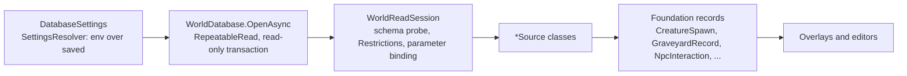
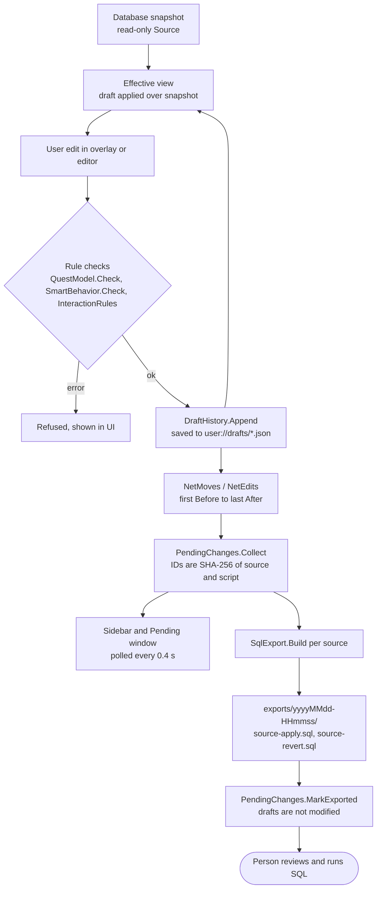

# Editing, data access and SQL export

Covers `Scripts/Data/` (read-only database access) and `Foundation/` (the draft model, SQL generation and rule checks). Foundation has no Godot or MySQL references, and the tests compile it directly.

The guarantee this part of the system exists to keep: **the app never writes to the database.** Reads run inside read-only transactions that are never committed. Edits are kept in local drafts. The only output that changes the server is SQL that a person reviews and runs.

## Read path: `Scripts/Data`

- `WorldDatabase` (`Scripts/Data/WorldDatabase.cs`) holds the connection string in memory. `SourceKey` is a SHA-256 of `host:port/database`; drafts are tied to it.
- `WorldReadSession` reads `information_schema.COLUMNS` for about 40 known tables. A missing column raises `SpawnSchemaException`, so a query fails rather than guessing.
- User values are always bound as parameters. Table and column names come from code. LIKE wildcards in search text are escaped and terms are capped at 80 characters.
- `Restrictions` builds EXISTS filters over event, pool and conditions tables so spawn queries can respect the preview policy.
- `DatabaseSettings` (`Scripts/Data/DatabaseSettings.cs`) parses `host;port;user;password;database`. The connection string sets short timeouts, disables `LOAD DATA LOCAL` and does not pool. `ToString` omits the password.
- `SettingsResolver` (`Scripts/Data/SettingsResolver.cs`) lets environment variables (`ACWORLD_DB_INFO`, `ACWORLD_DATA_DIR`, `ACWORLD_RETAIL_DIR`, `ACWORLD_CLIENT_PROFILE`) override saved settings. An invalid `ACWORLD_DB_INFO` falls back to saved values silently.

### Source classes and the tables they read

| Source | Tables read |
|---|---|
| `CreatureSource` | `creature` joined to `creature_template`; `creature_template_model` if present, otherwise `modelid1..4` and `scale`; event, pool and condition filters |
| `GameObjectSource` | `gameobject` joined to `gameobject_template`; event, pool and condition filters |
| `GraveyardSource` | `game_graveyard`, `graveyard_zone`; spirit healers from `creature` joined to `creature_template` (npcflag) |
| `TeleportSource` | `game_tele` |
| `AreaTriggerSource` | `areatrigger`, `areatrigger_scripts`, `areatrigger_teleport`, `areatrigger_involvedrelation`, `areatrigger_tavern`, `quest_template`, `smart_scripts` |
| `InteractionSource` | `creature_template`, `creature`, `creature_queststarter`, `creature_questender`, `npc_vendor`, `creature_default_trainer`, `npc_spellclick_spells`, `gossip_menu`, `gossip_menu_option`, `npc_text`, `trainer`, `trainer_spell`, `item_template`, `quest_template`, `broadcast_text`, `points_of_interest`, `conditions`, `smart_scripts` |
| `ContentSource` | the four quest tables, starter and ender links, `creature_template` (AIName), `smart_scripts` (source types 0, 9, 2), `creature_text`, `areatrigger_scripts`, `areatrigger`, `creature`, `gameobject_template`, `item_template` |

`ContentSource` also provides name search (`SearchAsync`). `InteractionSource` uses `InteractionCatalog` (from `Scripts/Assets/Client`) to look up client-side names and icons.

## Draft model: `Foundation/`

Each kind of edit has its own draft type. All of them are backed by `DraftHistory<T>` and store their state in a JSON file under `user://drafts/`.

| Draft | File | Covers |
|---|---|---|
| `CreatureDraft` | `CreatureDraft.cs` | Creature positions. `Move`, `Revert`, `Undo`, `Redo`, `NetMoves()` |
| `GraveyardDraft` | `GraveyardDraft.cs` | Whole `game_graveyard` rows plus `graveyard_zone` links. ID and map cannot change |
| `ContentDrafts` | `ContentDrafts.cs` | One shared `InteractionDraft` for the interaction, quest and behavior editors |
| `InteractionDraft` | `InteractionDraft.cs` | Generic row edits (insert, update, delete); several edits undo as one command |
| `InteractionRows` | `InteractionRows.cs` | Allowed tables and columns (`InteractionTables.All`) and the row model |

`InteractionTables.All` lists the editable tables: `creature_template` (npcflag, gossip_menu_id, subname), `gossip_menu`, `npc_text`, `gossip_menu_option`, `creature_queststarter`, `creature_questender`, `npc_vendor`, `creature_default_trainer`, `trainer`, `trainer_spell`, `npc_spellclick_spells`, `creature_ai` (a logical name for `creature_template.AIName`), the four quest tables, `smart_scripts`, `creature_text`, and `areatrigger_scripts`.

### Undo, redo and freshness

Each draft holds a `DraftHistory<T>` (`Foundation/DraftHistory.cs`):

- Opening a draft takes an exclusive lock on a sibling `.lock` file, so a second writer fails.
- The file is a JSON envelope `[payload, SHA-256(payload)]`. Saves write a `.tmp` file, flush it and move it over the real file.
- On load, a checksum mismatch, an unknown version or an out-of-range cursor throws. A bad file is rejected, never silently reset. Each entry is re-validated by its draft type.
- Entries before the cursor are applied; entries from the cursor onward are the redo branch. Appending drops the redo branch. Undo and redo move the cursor.
- Snapshots are immutable, so worker threads can read them.

Freshness: every edit records the value it replaced (`Before`). A new edit is refused if the current effective value no longer matches. Per-row staleness shows up as a conflict, and the database value is displayed instead of the draft value.

`ContentDrafts.Commit` also refuses edits that introduce a new rule error, using `InteractionRules` and the quest and SmartAI checks.

## Draft lifecycle

Details:

- **Net changes.** Draft entries are collapsed per source, GUID or key: the first `Before` to the last `After`. Changes that end up at the baseline are dropped.
- **Pending changes** (`Foundation/PendingChanges.cs`): each net change becomes a `PendingChange`. Its ID is a SHA-256 of the source and its apply script, built with a fixed timestamp so the ID is stable. The set of exported IDs is saved as a JSON array.
- **Discard** calls the owning draft's `Revert`. Reverts are themselves undoable entries.
- **Local file locations** come from `Scripts/Ui/ContentDraftFiles.cs`: `user://drafts/creature-positions.json`, `graveyards.json`, `interactions.json`, `exported.json`. Smoke runs use `res://artifacts/drafts/<guid>/`.

## SQL generation: `Foundation/SqlExport.cs`

`SqlExport.Build(source, creatures, graveyards, rows)` returns `SqlScripts(Apply, Revert, Changes, Summary)`. It never connects to anything.

Each script has the same structure:

1. A header comment and `SET NAMES utf8mb4;`.
2. A read-only preflight: one `SELECT ... IF(COUNT(*)=1,'ok','STALE')` per change. Rows that must not exist yet use `COUNT(*)=0`.
3. `START TRANSACTION;`, the statements, and `COMMIT;`.
4. A post-check that confirms the new state.

The revert script is the same shape, with the statements in reverse order.

Per change:

- **Creature move:** `UPDATE creature SET position_x, position_y, position_z, orientation WHERE guid = ...` with a guard that the four columns still hold their old values (floats compared with `ABS(col - v) < 0.0001`).
- **Graveyard position or name:** an `UPDATE` on `game_graveyard` guarded by ID, position and comment.
- **Graveyard links:** `INSERT`, `DELETE` or `UPDATE` on `graveyard_zone`, one per changed link.
- **Content rows:** insert writes every allowed column; delete matches every allowed column; update changes and guards only the key plus the changed columns. Restricting updates this way is what lets `creature_ai` and `creature_template` share a table safely.

Escaping and guards:

- Text is compared with `BINARY COALESCE(col,'') = BINARY '...'`, and strings are MySQL-escaped with backslashes.
- Numbers are re-parsed before they are written, so only canonical values appear unquoted.
- INSERT statements have no guard by design. A duplicate primary key makes the script fail, which is the intended signal.

## Export flow in the viewer

`Scripts/Viewer/TerrainViewer.Export.cs` ties it together:

- `CollectPending` feeds creature `NetMoves`, graveyard `NetEdits` and content `NetEdits` into `PendingChanges.Collect`.
- `BuildSqlExports` groups changes by source and calls `SqlExport.Build` once per group.
- `WriteSqlExports` writes UTF-8 without BOM to `user://drafts/exports/<yyyyMMdd-HHmmss>/<source-prefix>-apply.sql` and `-revert.sql`.
- `ExportAllPending` writes, calls `MarkExported`, then opens the folder.

## SmartAI and quest rules

- `SmartCatalog` (`Foundation/SmartCatalog.cs`) is generated by `Tools/generate_smart_catalog.py` from AzerothCore's `SmartScriptMgr.h` enums, with hand-written names and sentences. `SmartCategories.cs` hides the server's marker entries (`_TC_END`, `_AC_START`, `_AC_END`, `RESERVED`).
- `SmartBehavior` (`Foundation/SmartBehavior.cs`) turns rows into readable sentences, groups linked rows into chains, and checks rules that mirror `SmartScriptMgr.cpp`.
- `SmartRuleEdits` (`Foundation/SmartRuleEdits.cs`) does the row math for add, delete, swap, duplicate and copy-scope. Changing a key column becomes a delete plus an insert.
- `QuestModel` (`Foundation/QuestModel.cs`) holds the quest vocabulary and checks rules that mirror `ObjectMgr::LoadQuests`.
- `NpcInteraction` (`Foundation/NpcInteraction.cs`) is a read-only view of one NPC's interaction data and its validation rules.

## Types by file

| File | Types |
|---|---|
| `WorldCoordinates.cs` | `Point3`, `WorldPose`, `WorldCoordinates` (server to view conversion, tile maths, ray hits), `PoseText` |
| `CreatureSpawn.cs` | `CreatureSpawn`, `CreatureRegion`, `CreatureRegionResult` |
| `SpawnPreview.cs` | `SpawnPreview`, `EventPreviewMode`, `SpawnQueryPoint`, `SpawnVisibility`, `GameObjectSpawn` (phase and event filters, `QueryLimit` 384, `ModelLimit` 128) |
| `AreaTrigger.cs` | `AreaTriggerRecord`, `AreaTriggerKind`, `AreaTriggerTeleport` |
| `PendingChanges.cs` | `PendingKind`, `PendingChange`, `PendingChanges` |
| `SqlExport.cs` | `SqlScripts`, `SqlExport` |
