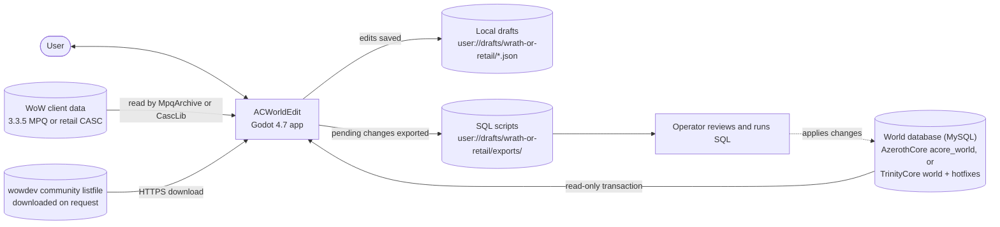
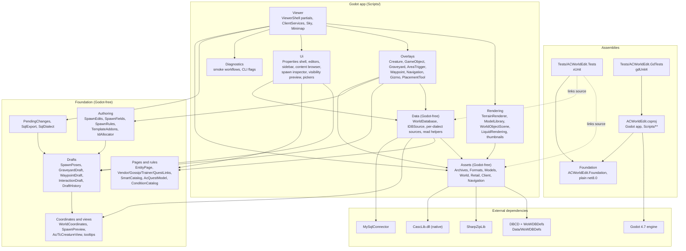

# Architecture overview

ACWorldEdit is a Godot 4.7 (.NET, `net8.0`) 3D viewer and editor. It renders WoW terrain, models,
liquids, lighting and skyboxes from a 3.3.5 MPQ client or a retail CASC client, and overlays
world-database content on top: creature and GameObject spawns, graveyards, area triggers, NPC
interactions, quests and SmartAI scripts. A 3.3.5 client uses AzerothCore; a retail client uses
TrinityCore master (`world` plus `hotfixes`). Read
[status/open-work.md](../status/open-work.md) for what is built and what is open.

The application never writes to the database or the game files. Edits are staged as local drafts and
leave the app only as SQL scripts that a person reviews and runs.

Detail pages:

- [Client data and asset pipeline](client-data.md): `Scripts/Assets`
- [Viewer runtime](viewer-runtime.md): `Scripts/Viewer`, `Rendering`, `Overlays`, `Ui`, `Diagnostics`
- [Rendering and the retail shader port](rendering.md): `Shaders/`, materials, lighting passes
- [Editing, data access and SQL export](editing-and-export.md): `Scripts/Data` and `Foundation`
- [Testing and tooling](testing-and-tooling.md): `Tests`, `Tools`, `launch_viewer.py`, CI
- [Database differences](../reference/database-differences.md): AzerothCore vs TrinityCore schema
- [Performance](../status/performance.md): the `--perf-smoke` and `--perf-breakdown` benchmarks and open work
- [Status and open work](../status/open-work.md), [deferred tests](../status/needed-tests.md),
  and the [editor gap plan](../plans/editor-gap-plan.md)

## System context

## Architecture overview

Solid arrows are compile or runtime dependencies. Dotted arrows are source-linked compiles: the test
projects include `Scripts/Assets/**` and `Scripts/Data/**` directly, so those two folders must stay free
of Godot types. In the other direction, `ACWorldEdit.csproj` explicitly `Compile Remove`s `Tests/`,
`Foundation/` and `artifacts/` so they are not built into the Godot assembly; Foundation reaches the app
only as a project reference.

## Layers and dependency rules

| Layer | Location | May depend on | Must not depend on |
|---|---|---|---|
| Foundation | `Foundation/` | base .NET only | Godot, MySQL, file formats, the app |
| Assets | `Scripts/Assets/` | Foundation, DBCD, SharpZipLib, CascLib | Godot, `Scripts/Data`, `Scripts/Viewer` |
| Data | `Scripts/Data/` | Foundation, MySqlConnector, Assets types | Godot, `Scripts/Viewer` |
| Rendering, Overlays, Ui, Viewer, Diagnostics | `Scripts/` | everything above, plus Godot | (top of the stack) |

Rules that follow from the layering:

- **One database gateway.** Reads go through `DBSource.Open(...)` → `IDBSource`, and schema knowledge
  through `IDBSource.Schema` (`IWorldSchema`, with `WorldSchemas.For(dialect)` for Foundation code).
  `Ac*Source`/`Tc*Source` are constructed only inside `Scripts/Data`. Shared and TrinityCore code must
  not use the AzerothCore statics (`AcTables`, `AcQuestModel`, `AcNpcFlags`); a missing descriptor is
  added to `IWorldSchema`.
- **Parsers do not branch on client kind.** `ClientKind` (`Wrath335` or `Retail`) is passed to the
  source abstraction; parsers consume `IClientFiles` and ask it for bytes.
- **Godot halves of mixed classes live in the viewer.** `AreaLookup` (`Scripts/Viewer/Session/AreaTable.cs`)
  and `ClientLighting` (`Scripts/Viewer/Lighting/ClientLightingView.cs`) are partial classes whose Godot-facing
  parts sit in `Scripts/Viewer`, while the engine-free parts sit in `Scripts/Assets/World`
  (`ClientLighting.cs`, `LightBand.cs`).
- **Per-client side data is attached to the source, not passed around.** `RetailLiquids` and
  `LiquidTextures` are looked up through `ConditionalWeakTable` keyed on the `IClientFiles` instance.
- **Edits only reach Foundation drafts.** Overlays and editors never write to the database. SQL leaves
  the app only through `Foundation/SqlExport.cs`.
- **Dialect-specific classes are prefixed.** `Ac`/`Tc` classes (and file names) live in the layer's
  `AzerothCore/` / `TrinityCore/` folders (`Scripts/Ui/AzerothCore`, `Scripts/Data/AzerothCore`), not
  in a copy of those folders under each feature. Shared interfaces, descriptors, context, renderers
  and the one factory or registry that names both dialects stay unprefixed.

## Threading model

Godot objects are touched only on the main thread. Expensive work runs on worker threads that produce
plain CPU data:

- **Terrain:** one tile decode task at a time (`ViewerShell.pending`). The worker runs
  `WorldMap.ReadTile`, texture decode and liquid decode, and creates no Godot resources. The main
  thread builds the tile within the upload budget (8 chunks, about 1.5 ms per frame).
- **Models:** three decode workers (`ModelLibrary.DecodeWorkers`). Each decodes a batch of up to four
  nearest variants, stopping after about 100 ms so a camera turn can re-prioritize. Decoded entries
  wait in a short queue capped at 256 MiB, upload on the main thread (8 surfaces, about 1.5 ms per
  frame), and dormant models are evicted with a 256 MiB least-recently-used limit. Thumbnail requests
  decode ahead of the world.
- **Overlay queries:** `RegionQuery<T>` runs one cancellable query at a time per overlay.
- **Client open:** `ClientServices.Open` runs on `Task.Run` during `LoadClient`.

Results from an earlier map or client are discarded using a `generation` counter and a
`CancellationTokenSource`.

## Data flow in brief

A client folder is opened by `ClientServices`, which wires an `IClientFiles` source (MPQ or CASC), the
map list, lighting and area lookups. `ViewerShell` reads the WDT, then streams ADT tiles around the
camera. Each tile is parsed into engine-free terrain data on a worker, then turned into meshes and
materials on the main thread. Placements (doodads, WMOs, creatures, GameObjects, graveyards, triggers)
come from the tile data and from read-only database queries.

The user edits in the viewport and in the entity windows: moves and places spawns with the gizmo or the
Place card, edits a spawn's row fields or a creature template's pages, edits graveyards, waypoints and
content rows. Every edit becomes a row edit in a local draft with undo history. The pending-changes
window turns the net changes into SQL apply and revert scripts; exporting moves the scripts to disk and
marks them, and the drafts stay as they are.

## Repository layout

| Path | Contents |
|---|---|
| `Scripts/Assets/` | Godot-free parsers for MPQ, CASC, BLP, DBC/DB2, M2, WMO, ADT, WDT, liquids, catalogs and generated MMaps (`Navigation/`) |
| `Scripts/Data/` | Read-only MySQL sessions, `IDBSource`, per-dialect sources in `AzerothCore/` (`Ac*Source`) and `TrinityCore/` (`Tc*Source`), and the `Db*` read helpers |
| `Scripts/Viewer/` | `ViewerShell` partial classes, `ClientServices`, sky and lighting, minimap, picking, teleports |
| `Scripts/Rendering/` | Terrain, model, WMO and sky construction; liquid material routing; model thumbnails; shader globals |
| `Scripts/Overlays/` | Creature, GameObject, graveyard, AreaTrigger, waypoint and navigation overlays, gizmo, region query, placement tool |
| `Scripts/Ui/` | Shared toolkit in `Framework/`, scene panels in `Scene/`, settings in `Settings/`, the creature/quest/behavior/properties editors in their feature folders, and every `Ac*` / `Tc*` page in `AzerothCore/` / `TrinityCore/` |
| `Scripts/Diagnostics/` | Smoke workflows, CLI flag parsing and the F12 diagnostic dump |
| `Foundation/` | Drafts and spawn authoring, entity pages and rules, SQL export, tooltips, coordinates |
| `Shaders/` | `*.gdshader` (terrain, liquid, model, sky, clouds, glare, sunshafts, swamp, mercury, fel, leyline, liquidfog, procmagma, procwater, azerite) and the shared `*.gdshaderinc` includes |
| `Tests/` | xUnit suite, gdUnit4 suite, `run_stormlib_checks.py` |
| `Tools/` | `setup.py` (submodules and native builds), `package.py` (release export), `generate_smart_catalog.py`, `generate_condition_catalog.py` |
| `ThirdParty/` | `CascLib` and `StormLib` git submodules, built by `Tools/setup.py` |
| `Data/WoWDBDefs/` | WoWDBDefs git submodule (`.dbd` layouts), pinned by the submodule commit |
| `launch_viewer.py` | Build and launch helper, `--smoke` and `--check-assets` modes |

Generated or local-only folders (`artifacts/`, `native/`, `build/`, `.build-env/`, `bin/`, `obj/`,
`wow-data/`) are not part of the architecture.

## Glossary

- **ADT**: a map tile file (64x64 per map); holds MCNK chunks (256 per tile in retail split files).
- **WDT**: the per-map index file. MAIN lists which tiles exist; MAID gives retail FileDataIDs.
- **MCNK**: one terrain chunk inside an ADT (16x16 per tile).
- **M2 / MD20 / MD21**: the doodad and creature model format. MD21 is the retail wrapper with SFID and
  TXID FileDataID lists.
- **WMO**: a building or world-object model made of a root file and group files.
- **BLP**: the texture format.
- **DBC / DB2**: client database tables. DBC is the 3.3.5 format, read by field index; DB2 is the
  retail format, read through DBCD with WoWDBDefs layouts.
- **FileDataID (FDID)**: a numeric retail file identifier. The app encodes it in path strings as
  `fdid:N`.
- **MH2O**: retail liquid data in the root ADT.
- **MMap / Detour**: server-generated navigation meshes. AzerothCore uses MMap 20, TrinityCore MMap 16
  (Detour 7); the viewer reads them from a folder on disk, never from the client archives.
- **Hotfix**: a retail row shipped from the server's `hotfixes` database to the client, announced by a
  `hotfix_data` row (for example a new `broadcast_text`).
- **Phase**: a world-state variant. AzerothCore uses `phaseMask` bits; TrinityCore uses
  `PhaseId`/`PhaseGroup` and the `phase_name` table.
- **SmartAI**: the scripting table `smart_scripts` of both servers (the columns and ID ranges differ;
  `SmartCatalog` holds each dialect's).
- **Conditions**: the `conditions` table's condition types and source types (the ids and meanings
  differ; `ConditionCatalog` holds each dialect's, reached through `IWorldSchema.Conditions`).
- **Spawn / template**: a spawn is one placed row (`creature` or `gameobject`, keyed by GUID); a
  template is the shared entry (`creature_template`, `gameobject_template`). A spawn may override
  template columns (`NULL` means inherit on TrinityCore; 0 does on AzerothCore flags).
- **Row edit**: one insert, update or delete of a table row, staged in a draft and exported as SQL with
  a guard on the values it replaced.
- **Draft**: a locally stored, undoable set of edits that is not yet in the database.
- **Apply / revert script**: the generated SQL that applies a set of changes, and the SQL that undoes
  them.
