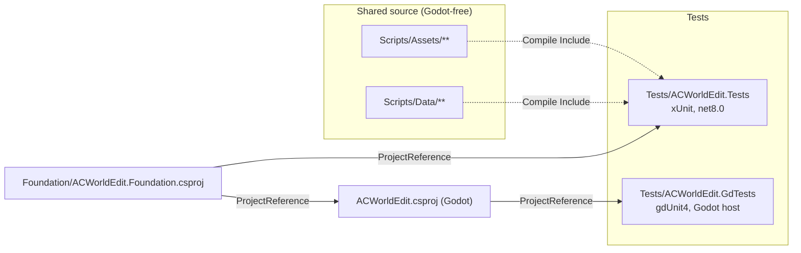

# Testing and tooling

## Test projects



The dotted links show why `Scripts/Assets` and `Scripts/Data` must stay free of Godot types: the xUnit project compiles those files directly, and they have no Godot reference.

### `Tests/ACWorldEdit.Tests` (xUnit)

Folders mirror the layers:

- `Assets/`: area lookup, asset references, animations, BLP, client folder, fog curves and volumes, geoset variants, light bands, liquid styles, listfile store, malformed input, model layers and data, MPQ, navigation, retail client, retail liquids, sky dome, split terrain, surface merge, terrain geometry.
- `Conditions/`: the condition catalog for both dialects.
- `Corpus/`: tests that need real client data (world, model, liquid, item details, parallel model decode, retail catalog, retail client, listfile).
- `Data/`: database settings, read-only guard, settings resolution, user-data reset.
- `Db/`: tests that need a live database: AzerothCore ones per source (`DbFact`), TrinityCore ones in `TrinityConnectionDbTests` and `TrinityReadDbTests` (`TcDbFact`), plus spawn rows/impact, phase catalog, template search, graveyards, AreaTriggers, content and the real-data phase tests.
- `Drafts/`: creature, graveyard, content, spawn and interaction drafts, history, pending changes, item lists, tooltips, stat rules.
- `Placement/`: AreaTrigger shapes, placement ownership and geometry, pose text, spawn preview, world coordinates.
- `Smart/`: quest model, SmartAI behaviour, catalog and rule edits.
- `Sql/`: SQL export scripts and nullable-column guards.
- `Support/`: attributes, DBC and terrain builders, the read-only guard for test SQL, and the old `Check` helpers.

Categories and runsettings:

| Category | Trigger | Run with |
|---|---|---|
| unit (default) | none | `default.runsettings` (excludes Corpus and KnownBug) |
| `Corpus` | needs `ACWORLD_DATA_DIR` or `wow-data` | `corpus.runsettings` |
| `Db` | needs `ACWORLD_DB_INFO` (AzerothCore) or `ACWORLD_TC_DB_INFO` (TrinityCore) | the default suite; each test skips when its variable is unset |
| `KnownBug` | `KnownBug` attribute, added by a custom discoverer | `knownbugs.runsettings` (also needs `ACWE_RUN_KNOWN_BUGS=1`) |

Skip attributes live in `Support/Attributes.cs`: `ClientDataFact`, `ClientDataTheory`, `DbFact`, `TcDbFact`, and `KnownBug`. Retail tests additionally need `ACWORLD_RETAIL_DIR`, `CascLib.dll` and the definitions (`RetailEnvironment` in `Support/RetailData.cs`).

Known-bug records exist for three findings in `SmartCatalogTests`, `SmartBehaviorTests` and `LightBandTests`. They are listed in the test attributes, not in this document. Tests deferred until their feature works are in `docs/status/needed-tests.md`.

### `Tests/ACWorldEdit.GdTests` (gdUnit4)

Runs inside Godot through the `ACWorldEdit.csproj` reference. Covers the client picker, the connection form, the pending-changes window (headless, no drafts or database), the picker popup, creature properties and user settings. `GODOT_BIN` must be set. Its `gdunit.runsettings` sets one CPU and a 180 s timeout. CI runs it in its own `viewer-tests` job, because it needs Godot but no client data or database.

### Golden regression captures (`Tests/golden`)

The viewer writes machine-readable state that nothing used to compare. `Tests/golden` turns it into assertions:

| Golden | Produced by | Pins |
|---|---|---|
| `terrain-smoke-wrath.txt` | `--terrain-smoke` | streamed tile counts, stale-tile ownership, terrain texture count |
| `client-smoke-retail.txt` | `--client-smoke` | client kind, build, map list size, first streamed tile |
| `state-{wrath,retail}.json` | `--state-dump` | wanted/loaded/failed tile sets after a fixed teleport path, zone/continent, lighting at five times of day (light ids, falloff weight, fog, sky, skybox), eight ground probes, eight pick rays, and the exact SQL text grouped by source |
| `ui-{wrath,retail}.json` | `--ui-dump` | every built control in creation order: menu items and accelerators, toolbar buttons, fields, option lists, overlay pages |

`python Tools/smoke_golden.py` and `python Tools/state_golden.py` run one capture and diff it. `--update` is the only way to rewrite a golden; it also rewrites `Tests/golden/.sha256`, and the gate fails if a golden changed without it. `--state-dump` and `--ui-dump` are non-interactive: they suppress startup prompts and the random `game_tele` start, which `--client-shot` does not.

`python Tools/refactor_gate.py` is the standing gate: structural invariants (Godot-free folders, file/method budgets in `Tools/viewer-budget.json` and `Tools/viewer-long-methods.json`, golden manifest), then build plus both test projects, then all six goldens. `--fast` stops after the tests and needs no client data; `--structural` is under a second. The burn-down ratchets are lowered in the same commit as the refactor that earns it.

### `Tests/run_stormlib_checks.py` (StormLib differential)

Needs `python Tools/setup.py --with-tests` first, which builds the `ThirdParty/StormLib` submodule (v9.40, Unicode build because the oracle passes `LPWStr` paths) to `native/win-x64/StormLib.dll`. The script then runs `dotnet test Tests/ACWorldEdit.Tests` with `STORMLIB_DLL` set to that DLL and `ACWORLD_DATA_DIR` as the client data. The xUnit `WorldCorpusTests` use `Support/StormLibOracle.cs` to compare every asset read against StormLib. Only that test reads the variable. StormLib is a test-only dependency: the runtime MPQ reader is managed (`MpqArchive`).

## Tooling

| Tool | Purpose |
|---|---|
| `launch_viewer.py` | Builds `ACWorldEdit.csproj` and launches Godot; `--smoke` runs the terrain smoke headless, `--check-assets` runs the corpus tests |
| `Tools/setup.py` | Syncs the pinned submodules and builds CascLib (and StormLib with `--with-tests`) into `native/win-x64/` |
| `Tools/package.py` | Builds, imports and exports the `Windows Desktop` preset to `build/win-x64/`, then validates the output |
| `Tools/generate_smart_catalog.py` | Regenerates the SmartAI type arrays for both dialects |
| `Tools/generate_condition_catalog.py` | Regenerates the condition type arrays for both dialects |
| `Tools/refactor_gate.py` | Structural invariants, build, both test projects and the golden captures |
| `Tools/smoke_golden.py`, `Tools/state_golden.py` | Run and diff one smoke or one state/UI dump against `Tests/golden` |
| `.claude/hooks/format_cs.py` | Runs `dotnet format whitespace` on each edited `.cs` file |
| `ThirdParty/`, `Data/WoWDBDefs/`, `THIRD-PARTY.md` | Pinned submodules and the licence/purpose record shipped with builds |

`launch_viewer.py` finds Godot through `--godot-path`, `GODOT_BIN` or `PATH`, and sets `APPDATA` and `LOCALAPPDATA` into `.build-env/`.

### `Tools/setup.py`

Builds `ThirdParty/CascLib` (and with `--with-tests` `ThirdParty/StormLib`) out of tree under `.build-env/cmake/`, then copies the DLLs and licences into `native/win-x64/`. A stamp (submodule commit plus CMake options) skips rebuilds; `--force` rebuilds and `--check` only reports. Builds use the static MSVC runtime, so the DLLs need no VC++ redistributable. `ACWORLD_CMAKE_GENERATOR` overrides the CMake generator. A checkout path long enough to push MSVC's `.tlog` files past 260 characters moves the build to a short temp folder (`ACWORLD_CMAKE_BUILD_DIR` overrides it).

### `Tools/package.py`

Exports `export_presets.cfg`'s `Windows Desktop` preset and fails unless the build's `data_ACWorldEdit_windows_x86_64` folder holds the game assemblies, `CascLib.dll`, `definitions/` and the licences (the csproj publishes the last three; the loader searches `AppContext.BaseDirectory`). Godot exits 0 with only a warning when the export lacks the game assembly, which the check catches. The export needs `ACWorldEdit.sln` at the repo root (listing the game and `Foundation` projects) and fails on a missing output folder, so the script creates it. A full export builds and the exe starts headless; `--pack-only` exports just the `.pck` and needs no export templates. `--version X.Y.Z` stamps the exe's file and product version by patching the preset's `application/file_version`, `application/product_version` and `application/modify_resources` for the export and restoring the file afterwards (a hyphenated version such as `0.1.0-rc1` keeps the suffix in the product version and uses `0.1.0.0` as the file version). The GitHub workflows run `setup.py` then `package.py`.

### Generated catalogs

`Tools/generate_smart_catalog.py` regenerates `Foundation/AzerothCore/AcSmartTypes.cs` from AzerothCore's `SmartScriptMgr.h`, and with `--trinity` `Foundation/TrinityCore/TcSmartTypes.cs` from TrinityCore's. `Tools/generate_condition_catalog.py` regenerates `AcConditionTypes.cs` from AzerothCore's `ConditionMgr.h`, and with `--trinity` `TcConditionTypes.cs` from TrinityCore's (the AzerothCore header is a third argument, for reusing labels). Curated names, sentences and source key labels live in the scripts.

`ThirdParty/CascLib` and `ThirdParty/StormLib` are MIT submodules pinned by commit, with a `.gdignore` so Godot does not scan them; `native/` and `build/` are git-ignored outputs. `Data/WoWDBDefs` is a CC BY-SA 4.0 submodule pinned by its commit, and its `definitions/*.dbd` are copied to the output as `definitions/`. `THIRD-PARTY.md` records the licences and purpose of every third-party component and ships with builds together with `LICENSE`.

Build configuration:

- `global.json` pins the SDK (10.0.400, roll forward to latest feature). Projects target `net8.0`.
- `ACWorldEdit.csproj` uses `Godot.NET.Sdk` 4.7.1 and references `SharpZipLib`, `DBCD` and `MySqlConnector` (versions in the project file).
- `Experiments/` holds no tracked source; it only contains leftover build output.
- `artifacts/` and `Tests/artifacts/` hold only generated output, so each carries a `.gdignore` and Godot never imports it. `.gitignore` excludes their contents but re-includes the marker.

## Continuous integration

Workflows live in `.github/workflows`; the steps they share are composite actions in `.github/actions`, so CI and release use identical setup and packaging.

| File | Runs | Does |
|---|---|---|
| `workflows/ci.yml` | push to `master` or `ci/**`, pull requests, manual | Job `test`: `setup-build`, `dotnet build ACWorldEdit.csproj -c Release`, `dotnet test Tests/ACWorldEdit.Tests` (`.trx` uploaded on failure). Job `viewer-tests`: `setup-build`, `setup-godot`, `dotnet test Tests/ACWorldEdit.GdTests`. Job `package` (not on pull requests): `setup-godot`, `package`, then uploads `ACWorldEdit-dev-<sha>-win-x64` with `retention-days: 7` |
| `workflows/release.yml` | push of a `vMAJOR.MINOR.PATCH[-suffix]` tag | Checks the tag format and that the commit is on `master`, builds and tests, packages with the tag as the version, and runs `gh release create --draft --verify-tag` with the zip, its `.sha256`, a commit list since the previous tag and GitHub's generated notes (`--prerelease` when the tag has a hyphen) |
| `actions/setup-build` | | `setup-dotnet` (`global.json` plus 8.0.x), `setup-python`, caches, then `python Tools/setup.py --no-godot`. The `native/win-x64` cache key is the CascLib submodule commit plus a hash of `Tools/setup.py`; `setup.py` skips the CMake build when its stamp matches the restored files. The NuGet cache key hashes the csproj files and `global.json` |
| `actions/setup-godot` | | Downloads Godot 4.7.1 .NET and the export templates from `godotengine/godot-builds`, verifies SHA-512 against hashes pinned in the action, keeps only the Windows x86_64 templates (about 210 MB instead of the 1.2 GB archive), caches the result and sets `GODOT_BIN` |
| `actions/package` | | `python Tools/package.py --version`, a smoke run of the exported exe (`--headless --quit-after 30`, exit code 0, throwaway `APPDATA`), then the zip and its SHA-256 in `dist/`. A failed export uploads `build/dotnet.binlog` as `build-log` |
| `dependabot.yml` | weekly | Updates for the workflow actions and NuGet packages. Submodule pins are bumped by hand |

### Releasing

Merge to `master`, then tag that commit and push the tag:

```powershell
git tag -a v0.1.0 -m "ACWorldEdit 0.1.0"
git push origin v0.1.0
```

`release.yml` checks that the tag is `vMAJOR.MINOR.PATCH` (optionally `-suffix`, which marks a pre-release) and that the commit is on `master`, runs the build and tests, packages with the tag as the exe's file and product version, and creates a **draft** release with `ACWorldEdit-<version>-win-x64.zip` and its `.sha256`. Review the draft under Releases on GitHub, edit the notes if needed, and publish it. The build is unsigned, so Windows SmartScreen may warn.

To upgrade Godot, change the version, asset names, both SHA-512 values (from the release's `SHA512-SUMS.txt`) and the cache key in `actions/setup-godot/action.yml` together, along with the `Godot.NET.Sdk` version in `ACWorldEdit.csproj`. To change a submodule pin, check out the new commit inside the submodule and `git add` it; the cache key follows the commit. Private-repo limits apply: Windows minutes count double and artifact storage is 500 MB, so lower `retention-days` if the 7-day artifacts reach the quota. The `test` job does not run any test that needs client data. The `viewer-tests` job runs the gdUnit4 project, which needs Godot but no client data or database.

Never name a workflow environment variable `VERSION` (or anything else that matches an MSBuild property). MSBuild turns every environment variable into a property, so `VERSION=dev-abc1234` becomes `$(Version)` and NuGet restore fails with only `MSB4181`. The package action passes the version as `ACW_VERSION`, and `Tools/package.py` drops `VERSION` from the environment of `dotnet` and Godot. `package.py` stamps the version into `export_presets.cfg` and restores the file afterwards; if a killed run leaves it stamped, the next stamped run refuses to start until you run `git checkout export_presets.cfg`.

## Test commands and environment

```powershell
dotnet test Tests/ACWorldEdit.Tests -p:NuGetAudit=false                                       # default suite
dotnet test Tests/ACWorldEdit.Tests --filter "FullyQualifiedName~SplitTerrainTests"            # one class
dotnet test Tests/ACWorldEdit.Tests --settings Tests/ACWorldEdit.Tests/corpus.runsettings     # Category=Corpus
dotnet test Tests/ACWorldEdit.Tests --settings Tests/ACWorldEdit.Tests/knownbugs.runsettings  # Category=KnownBug
dotnet test Tests/ACWorldEdit.Tests --settings Tests/ACWorldEdit.Tests/all.runsettings        # everything
```

`default.runsettings` excludes `Corpus` and `KnownBug`, and `--filter` does not override that: filter those tests together with `--settings corpus.runsettings` (or `all.runsettings`). `Tests/ACWorldEdit.GdTests` (gdUnit4) needs `GODOT_BIN`.

Environment variables for tests and tools:

- `ACWORLD_DB_INFO` = `host;port;user;password;database` (AzerothCore Db tests); `ACWORLD_TC_DB_INFO` = the same plus optional `;hotfixes` (TrinityCore Db tests, `TcDbFact`).
- `ACWORLD_DATA_DIR` (3.3.5 client), `ACWORLD_RETAIL_DIR` (retail client), `ACWORLD_CLIENT_PROFILE`: `ClientData`/`Corpus` tests.
- `ACWORLD_CASCLIB` (`CascLib.dll`; `Tools/setup.py` builds it into `native/win-x64/`), `ACWORLD_DBD_DIR` (defaults to the `Data/WoWDBDefs` submodule, which `Tools/setup.py` initialises).
- `ACWORLD_RESET_SMOKE=1` lets `--reset-smoke` run (see `viewer-runtime.md`); it deletes the whole user data folder, so run it only with `APPDATA` pointing at a throwaway folder.
- `ACWORLD_LISTFILE` overrides the community listfile path; `RetailListfileFact` tests skip without it.

## Commit messages

- Subject: `type(scope): summary`, scope optional, imperative, lowercase after the colon, no trailing period, at most 72 characters. No placeholders ("WIP", "misc", "updates", "fixes").
- Types: `feat` (new user-visible capability), `fix`, `perf`, `refactor` (no behavior change), `test`, `docs`, `build` (csproj, global.json, NuGet, launcher), `chore` (repo hygiene, moving or deleting files), `style` (formatting only).
- Scopes: `assets`, `archives`, `formats`, `models`, `world`, `retail`, `client`, `data`, `foundation`, `viewer`, `rendering`, `overlays`, `ui`, `diagnostics`, `tests`, `docs`.
- Body only when needed: blank line, prose wrapped at 72 columns, what changed and why. No file lists.
- One logical change per commit; split unrelated work.

## Navigation validation

`Assets/NavigationTests` builds deterministic AC and TC wrappers with detail-only vertices and off-mesh polygons. It checks detail indices, coordinate conversion, server terrain meanings, malformed versions/counts/lengths/non-finite values, TC map-level connections, 64-bit polygon capacity, child precedence, immediate-parent-only fallback, missing files and corrupt-child rejection.

The opt-in `Category=Corpus` navigation theories read every `.mmtile` and `.mmap` in `ACWORLD_AC_MMAP_DIR` and `ACWORLD_TC_MMAP_DIR`. Set these to server output directories and run with `--settings Tests/ACWorldEdit.Tests/corpus.runsettings --filter FullyQualifiedName~NavigationTests`. The default suite excludes these filesystem checks. Godot's `--navigation-smoke` validates rendering uploads, picking and generation/disable lifecycle; screenshots require a real renderer. Neither suite establishes parity with live server pathfinding or dynamic obstacles.
