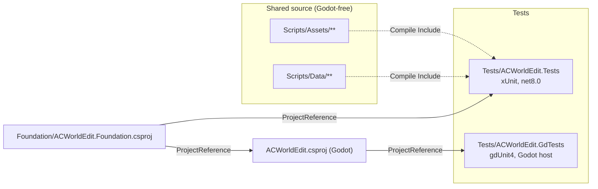

# Testing and tooling

## Test projects

The dotted links show why `Scripts/Assets` and `Scripts/Data` must stay free of Godot types: the xUnit project compiles those files directly, and they have no Godot reference.

### `Tests/ACWorldEdit.Tests` (xUnit)

Folders mirror the layers:

- `Assets/`: area lookup, asset references, client folder, light bands, listfile store, malformed input, retail client, retail liquids, split terrain, terrain geometry.
- `Corpus/`: tests that need real client data (world, model, liquid, retail).
- `Data/`: database settings, read-only guard, settings resolution.
- `Db/`: tests that need a live database: AzerothCore ones per source (`DbFact`), TrinityCore ones in `TrinityConnectionDbTests` and `TrinityReadDbTests` (`TcDbFact`).
- `Drafts/`: creature, graveyard, content and interaction drafts, history, pending changes.
- `Placement/`: AreaTrigger shapes, pose text, spawn preview, world coordinates.
- `Smart/`: quest model, SmartAI behaviour, catalog and rule edits.
- `Sql/`: SQL export scripts.
- `Support/`: attributes, DBC and terrain builders, the read-only guard for test SQL, and the old `Check` helpers.

Categories and runsettings:

| Category | Trigger | Run with |
|---|---|---|
| unit (default) | none | `default.runsettings` (excludes Corpus and KnownBug) |
| `Corpus` | needs `ACWORLD_DATA_DIR` or `wow-data` | `corpus.runsettings` |
| `Db` | needs `ACWORLD_DB_INFO` (AzerothCore) or `ACWORLD_TC_DB_INFO` (TrinityCore) | the default suite; each test skips when its variable is unset |
| `KnownBug` | `KnownBug` attribute, added by a custom discoverer | `knownbugs.runsettings` (also needs `ACWE_RUN_KNOWN_BUGS=1`) |

Skip attributes live in `Support/Attributes.cs`: `ClientDataFact`, `ClientDataTheory`, `DbFact`, `TcDbFact`, and `KnownBug`. Retail tests additionally need `ACWORLD_RETAIL_DIR`, `CascLib.dll` and the definitions (`RetailEnvironment` in `Support/RetailData.cs`).

Known-bug records exist for three findings in `SmartCatalogTests`, `SmartBehaviorTests` and `LightBandTests`. They are listed in the test attributes, not in this document.

### `Tests/ACWorldEdit.GdTests` (gdUnit4)

Runs inside Godot through the `ACWorldEdit.csproj` reference. Covers the client picker, the connection form, the pending-changes window (headless, no drafts or database), the picker popup, and user settings. `GODOT_BIN` must be set. Its `gdunit.runsettings` sets one CPU and a 180 s timeout.

### `Tests/run_stormlib_checks.py` (StormLib differential)

Downloads the pinned official StormLib 9.40 x64 DLL into `artifacts/`, checks its SHA-256, then runs `dotnet test Tests/ACWorldEdit.Tests` with `STORMLIB_DLL` set. The xUnit `WorldCorpusTests` use `Support/StormLibOracle.cs` to compare every asset read against StormLib. Only that test reads the variable.

## Tooling

| Tool | Purpose |
|---|---|
| `launch_viewer.py` | Builds `ACWorldEdit.csproj` and launches Godot. `--smoke` runs the terrain smoke headless. `--check-assets` runs the corpus tests. Godot is found through `--godot-path`, `GODOT_BIN` or `PATH`. Sets `APPDATA` and `LOCALAPPDATA` into `.build-env/` |
| `Tools/generate_smart_catalog.py` | Regenerates `Foundation/AzerothCore/AcSmartTypes.cs` from AzerothCore's `SmartScriptMgr.h`, and with `--trinity` `Foundation/TrinityCore/TcSmartTypes.cs` from TrinityCore's |
| `Tools/get_casclib.py` | Copies a locally built `CascLib.dll` into `native/win-x64/`; the project copies it to the output when present |
| `Data/WoWDBDefs/` | WoWDBDefs git submodule (CC BY-SA 4.0), pinned by its commit; `definitions/*.dbd` are copied to output as `definitions/` |
| `.claude/hooks/block_readonly.py` | Blocks edits and shell writes under the read-only game and data folders |
| `.claude/hooks/format_cs.py` | Runs `dotnet format whitespace` on each edited `.cs` file |

Build configuration:

- `global.json` pins the SDK (10.0.400, roll forward to latest feature). Projects target `net8.0`.
- `ACWorldEdit.csproj` uses `Godot.NET.Sdk` 4.7.1 and references `SharpZipLib`, `DBCD` and `MySqlConnector` (versions in the project file).
- `Experiments/` holds no tracked source; it only contains leftover build output.
- `docs/NEEDED-TESTS.md` lists deferred tests for retail milestones 3 to 5 (terrain, placements and models, liquids and sky) and retail humanoid creatures.
