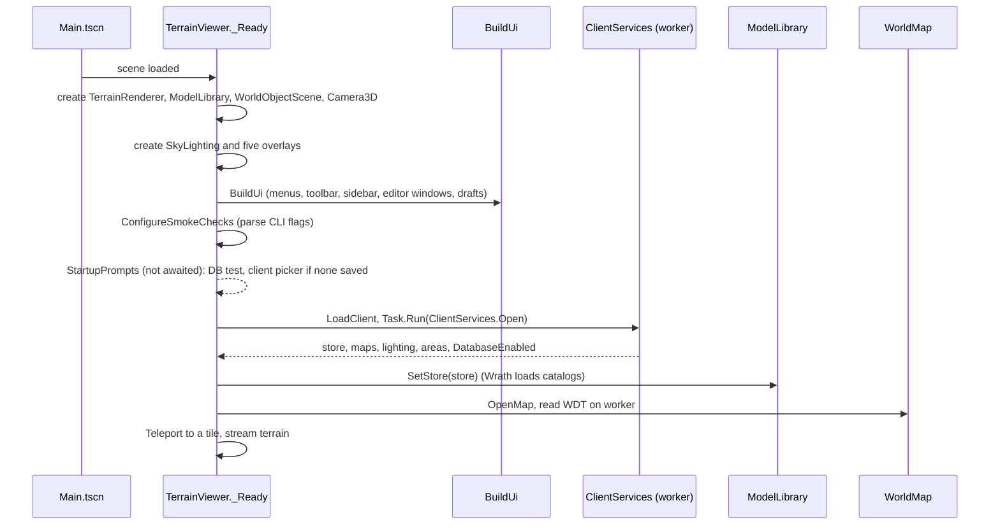
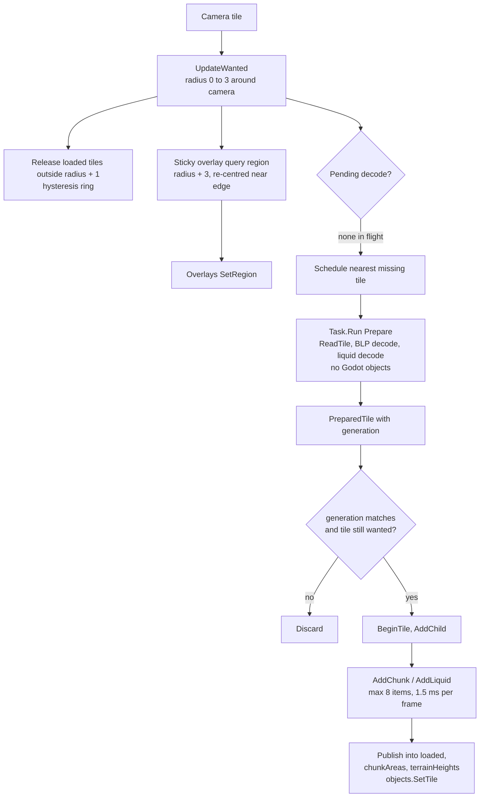
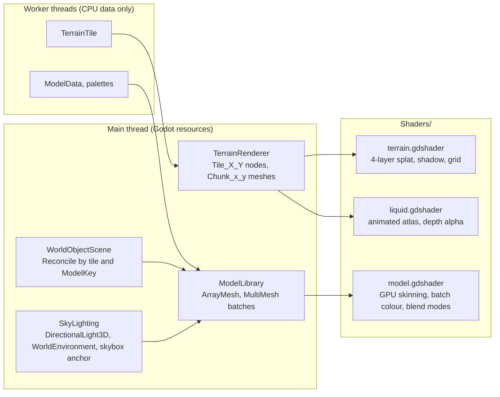

# Viewer runtime

Covers `Scripts/Viewer/`, `Scripts/Rendering/`, `Scripts/Overlays/`, `Scripts/Ui/`, `Scripts/Diagnostics/` and `Shaders/`. This is the Godot layer. Everything here runs on the main thread except where noted.

## Scene and startup

`project.godot` runs `res://Main.tscn`. That scene holds one node, `TerrainViewer` (a `Node3D`, `Scripts/Viewer/TerrainViewer.cs`). The rest of the scene graph is built in code.

Client selection:

- `UserSettings` (`Scripts/Ui/UserSettings.cs`) reads and writes `user://settings.cfg`.
- Environment variables override settings through `SettingsResolver`: `ACWORLD_CLIENT_PROFILE`, `ACWORLD_DATA_DIR`, `ACWORLD_RETAIL_DIR`, `ACWORLD_DB_INFO`, `ACWORLD_TC_DB_INFO`, `ACWORLD_LISTFILE`.
- `ClientPickerDialog` (`Scripts/Ui/ConnectionForm.cs`) offers the Wrath and Retail profiles, remembers one folder per profile and validates it with `ClientFolder.Validate`.

Shutdown (`_ExitTree`) cancels streaming, awaits the model worker and the pending tile task, then disposes the store and the drafts.

## TerrainViewer partial classes

`TerrainViewer` is one class split across files:

| File | Concern |
|---|---|
| `Viewer/TerrainViewer.cs` | Core coordinator: `_Ready`, `LoadClient`, `OpenMap`, streaming state, `Prepare`, camera movement, input, `_Process` |
| `Viewer/TerrainViewer.Ui.cs` | `BuildUi`: menus, toolbar, left navigation, bottom telemetry bar, editor window wiring, client and connection prompts |
| `Viewer/TerrainViewer.Export.cs` | Pending changes, SQL export, polling every 0.4 s, discard and export actions |
| `Viewer/TerrainViewer.Ground.cs` | `GroundAt`: combines terrain height and WMO floors for snapping |
| `Viewer/TerrainViewer.Listfile.cs` | One-time listfile prompt and in-app update (download on a worker, then reload the retail client) |
| `Viewer/TerrainViewer.Locate.cs` | Locate a creature from quest links: fly to a loaded spawn, or query the database and wait for the region to stream in |
| `Viewer/TerrainViewer.Teleports.cs` | `game_tele` dropdown, with a generation guard |
| `Diagnostics/TerrainViewer.*.cs` | Smoke workflows (see Diagnostics below) |

Other viewer files: `SkyLighting.cs` (sun, environment and skybox), `ClientLighting.cs` (light regions and profiles), `ClientServices.cs` (client open), `TerrainMinimap.cs` (a `Control` that raises `Jump` on click), `ScenePicking.cs` (box and sphere ray hits), `AreaTable.cs`.

## Streaming

State fields in `TerrainViewer`:

- `wanted`: tiles inside the radius.
- `pending` and `pendingKey`: the single decode task.
- `building` and `buildingNode`: the tile being uploaded.
- `loaded`: `Dictionary<TileKey, Node3D>`.
- `failed`: tiles that failed, so they are not retried every frame.
- `generation` plus a `CancellationTokenSource`: guards against map and reload races.

Model streaming (`Rendering/ModelLibrary.cs`) follows the same pattern, once per frame in `Update(camera)`:

1. `ConsumeDecodedModel`
2. `UploadPendingModel` (at most 8 surfaces, 1.5 ms)
3. `BindReadyInstances` (at most 8 per frame, 2 ms)
4. `ScheduleModelDecode` (nearest unbuilt instance, one `Task.Run(DecodeModel)`)
5. `EvictDormantModels` (LRU, soft limit 256 MiB, never evicts entries with live instances)

Caches: parsed `ModelData`, palettes and uploaded meshes are keyed by `ModelKey` (path, replacement textures, baked texture, doodad set, animation, skybox flag, hair and fur). Shared textures are ref-counted by path. A `failed` set stops retries. Shader variants are cached by blend mode, two-sidedness, unlit and skybox.

## Rendering

- **Terrain** (`Rendering/TerrainRenderer.cs`): one `MeshInstance3D` per MCNK (145 vertices). Each chunk gets a `ShaderMaterial` on `terrain.gdshader` with four layer textures, a 64x64 blend map and a 64x64 shadow map. Liquids are children of a `Liquids` node and use `liquid.gdshader`, one shared material per texture.
- **Terrain shader**: big-alpha mode uses independent layer weights; legacy mode blends in sequence. Vertex tint and shadow follow, with an optional cell grid.
- **Liquid shader**: unshaded, no depth writes, animated atlas at 30 fps. Water alpha comes from vertex alpha and Fresnel; lava and slime (kind 2 or higher) are opaque and emissive.
- **Models** (`Rendering/ModelInstance.cs`, `Rendering/ModelLibrary.cs`): `ModelInstance` is a `Node3D` that holds its transforms. Instanced placements use a `MultiMeshInstance3D` per mesh with visibility range 1600. Single instances use range 400. Skyboxes are unculled and shadowless.
- **Model shader** (`Shaders/model.gdshader`): GPU skinning from the `animation_palette` texture; batch colour and UV animation from `material_palette`; `vertex_color` mode 1 (interior baked light) or 2 (exterior colour as emission). `ModelLibrary` patches the shader text per variant (`render_mode` and an `ALPHA` line). The skybox variant places vertices on a 7500-yard shell.
- **WMO placement** (`Rendering/WorldObjectScene.cs`): `SetTile`, `RemoveTile`, `SetGlobals` and `SetLayers` each trigger `Reconcile`. Objects are de-duplicated by `(IsWmo, Id)` with sticky owner tiles, grouped by tile and `ModelKey`, and attached as one batch per group. `FloorHeights` feeds ground probes.
- **Sky and lighting** (`Viewer/SkyLighting.cs`): `ClientLighting` supplies light regions and profiles. Each frame it blends bands at `tick = hours * 120`, drives the sun, ambient, sky gradient and fog, and attaches the skybox model.

## Camera and input

All camera and input handling is in `TerrainViewer.cs`.

- **Flight:** hold right mouse to capture the cursor. Mouse motion changes yaw and pitch (pitch clamped to ±1.55). `MoveCamera` reads physical W, A, S, D, Q and E; Shift multiplies speed by 4; the wheel changes speed between 5 and 1500.
- **`_Input`** runs before shortcuts. While captured it swallows keys other than Escape, so flight keys do not trigger toolbar modes. While an editor is dragging it routes motion, release and Escape to that editor.
- **`_UnhandledInput`** runs after the UI. Left click tries the active editor's gizmo first, then the nearest ray hit across creatures, GameObjects, graveyards and triggers (triggers lose ties). A short right click selects a creature and opens its properties window (for TrinityCore only the template page is editable so far). Creatures, GameObjects, graveyards and waypoints each have their own draft; the selected kind owns the gizmo, undo and drop-to-ground.
- **Focus loss** releases capture and cancels drags.
- **Shortcuts** come from `EditorMenu` (Ctrl+Z, Ctrl+Y, End, Ctrl+Shift+C, F, Ctrl+Q) and `EditorToolbar` (Q, W, E for modes, Ctrl+Shift+Z).

Per-frame order in `_Process`:

1. `MoveCamera` (when captured)
2. `UpdateTerrainStreaming`
3. `UpdatePendingLocate`
4. Status, menu and toolbar refresh
5. `sky.Update`
6. Labels, telemetry and minimap
7. Creature, GameObject, graveyard, waypoint and trigger `Update(camera)`
8. `interaction.Track(creatures.SelectedSpawn)`
9. `models.Update(camera)`
10. Sidebar counts
11. `PollPending`
12. `RunSmokeChecks`

## Overlays

Five overlays are children of `TerrainViewer`. They share one shape (`RegionOverlay`):

- `Connection` gives the `WorldConnection` (settings, hotfixes database and dialect); queries open it with `DBSource.Open`. `SetRegion` `SetRegion` receives the query region from `UpdateWanted`.
- `RegionQuery<T>` (`Overlays/RegionQuery.cs`) runs one cancellable, generation-checked query on a worker. A search box has a 0.3 s debounce.
- Results are diffed against existing markers by ID.
- Each overlay exposes `FindHit`, `Select`, `Deselect`, `SelectionChanged`, `FocusRequested(WorldPose)`, `SetLayerEnabled` and `BuildPanel()`, which the sidebar hosts.

| Overlay | Files | Data source | Editable |
|---|---|---|---|
| `CreatureOverlay` | `CreatureOverlay.cs`, `.Editing.cs`, `.Ui.cs` | `IDBSource.ReadCreaturesAsync` | Yes: move, rotate, drop, undo and redo through `CreatureDraft`; opens the properties window and (AzerothCore only) the behavior editor |
| `GameObjectOverlay` | `GameObjectOverlay.cs`, `.Editing.cs`, `.Ui.cs` | `IDBSource.ReadGameObjectsAsync` | Yes: move and rotate through `GameObjectDraft` |
| `GraveyardOverlay` | `GraveyardOverlay.cs`, `.Editing.cs`, `.Ui.cs` | `IDBSource.ReadGraveyardsAsync` | Yes: position, name and zone links through `GraveyardDraft` |
| `WaypointOverlay` | `WaypointOverlay.cs`, `.Editing.cs`, `.Ui.cs` | `IDBSource.ReadWaypointsAsync` | Yes: point positions through `WaypointDraft` (AzerothCore only; the layer is off for TrinityCore) |
| `AreaTriggerOverlay` | `AreaTriggerOverlay.cs`, `.Ui.cs` | `IDBSource.ReadAreaTriggersAsync` | No (behavior editor only, AzerothCore) |

Creature models are shown for the nearest `Preview.ModelLimit` (128) creatures within `Preview.ViewDistance`, refreshed every 0.2 s. Creatures with a model hide their capsule placeholder once the model is ready.

### Editing

`IPlacementEditor` (`Overlays/IPlacementEditor.cs`) is implemented by `CreatureOverlay`, `GameObjectOverlay`, `GraveyardOverlay` and `WaypointOverlay`. `TerrainViewer.ActiveEditor` sends menu, toolbar and viewport commands to whichever editor owns the selection.

`TransformGizmo` (`Overlays/TransformGizmo.cs`) draws three axis arrows and a yaw ring. It has Select, Move and Rotate modes, and emits `Changed(GizmoEdit)` events. Preview events have `Commit = false`; exactly one commit fires per gesture. Rotation snaps in steps, or 15° with Ctrl held.

A committed creature move goes through `CreatureDraft.Move(sourceKey, guid, before, after)`. The displayed pose is `draft.Effective(...)`, and `draft.Conflict` flags a change in the source database.

## Ui windows

| Window | File | Role |
|---|---|---|
| Client picker | `ClientPickerDialog` in `Ui/ConnectionForm.cs` | Profile and folder selection |
| Connection | `Ui/ConnectionForm.cs` | Database settings; tested on a worker before saving |
| Sidebar | `Ui/SceneSidebar.cs` | Layers, spawn preview policy, connection, one tab per overlay, unsaved-changes button |
| Editor base | `Ui/ContentEditorWindow.cs`, `Ui/ContentPanel.cs` | Window frame (drag, size pin) and frameless panel base; both carry the draft hooks, commits and the shared client catalog |
| Creature properties | `Ui/CreatureProperties/` | One window per selected creature: a section picker on the left and the chosen section on the right (see below) |
| Quest editor | `Ui/AcQuestEditorWindow.cs` (search and frame), `Ui/AcQuestPanel.cs`, `.Pages.cs` | `quest_template` and related tables, with `QuestModel.Check`; the panel is also embedded in the creature window |
| Behavior panel | `Ui/AcBehaviorPanel.cs` (with the speech page), `.Rules.cs` | SmartAI rules written as sentences, with entry, spawn and action-list scopes, plus speech; embedded in the creature window |
| AreaTrigger behavior | `AcBehaviorEditorWindow` in `Ui/AcBehaviorPanel.cs` | A window around `AcBehaviorPanel` for AreaTrigger rules, which have no creature |
| Pending changes | `Ui/PendingChangesWindow.cs` (`PendingChangesWindow`, `SqlPreviewWindow`) | Lists pending changes; the viewer performs discard and export. The SQL preview shows the apply or revert script an export would write |
| Menus and toolbar | `Ui/EditorMenu.cs` (`EditorMenu`, `EditorToolbar`) | Callback-driven menus and mode buttons |
| Form controls | `Ui/EditorFields.cs`, `Ui/InspectorUi.cs` | Number, text and picker fields; shared inspector layout |
| Client styling | `Ui/ClientStyle.cs` | Dark editor-window theme, quality colours, gossip icons |

### Creature properties window

`CreaturePropertiesWindow` is only the frame: header (name, Undo/Redo), the section picker (`ItemList`) and a status line. The data lives in `CreatureContext` (the selected spawn, the interaction rows merged with the draft, the connection and draft hooks, commit and ID helpers). The dialect-specific steps (the catalog load, building the view from the effective rows, the commit rule check) sit behind `ICreatureDialect` (`AcCreatureDialect`, `TcCreatureDialect`), picked by `CreatureDialects.For`. Each page is a `CreatureSection` (Gossip, Quests, Vendor, Trainer, Behavior, Speech, Info).

**Template page descriptors.** The Template page (both dialects) is data: `IWorldSchema.TemplatePage` is a `CreaturePage` (`Foundation/CreaturePage.cs`) with shared ordered groups (identity, interaction, combat, movement, loot, links, flags) and the fields each dialect puts in them (`AcCreaturePage`, `TcCreaturePage`). A `FieldSpec` names its table, column, label, tip, editor kind (text, whole, decimal, choice, flags, check) and row binding (template row or the difficulty row picked on the page); signedness and text length come from the `TableSchema` column, with optional field-specific numeric limits. A flag field carries its named bits, or none for raw-hex editing. `PageRenderer` draws any page, including the difficulty picker; when editable it also adds a missing difficulty row through `DifficultySpec.Add` (a copy of the shown row, or the dialect's `NewRow` defaults), then shows it, and removes the shown row through `DifficultySpec.Remove`; a section adds its own controls to a group through `PageRenderer.After` (`PageRenderer.Picked` is the difficulty row shown). `TcStatsPage` is a second, small `CreaturePage` over the same difficulty row (content tuning, level deltas, scaling expansion, the four multipliers); `TcStatsSection` (in `TcTemplateSection.cs`) draws it and, under the multipliers, the level, health, mana, armor, weapon damage and attack power `TcStatCalculator` (`Foundation/TrinityCore/`) gives from the client's ContentTuning, ExpectedStat, ExpectedStatMod and ContentTuningXExpected tables (`ITcStatData`, served by `RetailClientLookup`) and the world database's `creature_classlevelstats` (`InteractionLookupData.TcClassStats`). Add a field by adding one `FieldSpec`; `CreaturePageTests` checks that every field's column exists and that the pages cover their tables.

**Item-list descriptors.** Vendor uses `IWorldSchema.VendorPage` (`VendorPage` in Foundation): an `ItemListSpec` selects child rows by parent and ordering, supplies complete new rows, and declares per-item `FieldSpec` values bound with `RowBinding.Item`. `PageRenderer.RenderItems` draws the AC vendor editor and TC vendor fields, including remove controls when editable; sections supply names, icons, prices and search controls. AC shared-list references stay read-only cards, and its compact read-only vendor view remains specialized. `ItemListTests` covers the descriptors and edits. TC enables editing through `CreatureContext.TcEditable`; `TcVendorSection` searches the retail `IClientLookup` by name or exact ID (30 results, on a worker), and adds items or currencies by ID. Search results are discarded when the creature changes. Stock and restock save together. `TcVendorRules` validates new errors during every TC commit; `TcVendorTests` covers stock, currency quantities, flags, key collisions, persistence, undo/redo and export. Negative IDs remain shared vendor references; their referenced lists are not expanded in TC. Currency, cost, bonus-list and player-condition existence checks still need their lookup catalogs. Gossip uses `IWorldSchema.GossipPage` (`GossipPageSpec` / `GossipPage`): menu text links and option lists select rows by MenuID, with dialect-specific option fields and greeting storage. `RenderItems` accepts field controls and an after-item callback for resolved broadcast text, AC icon selection, validated submenu edits and navigation/reordering. AC keeps its greeting editor, shared-menu copying and compact preview; TC selects among all root menus and reachable submenus with Back navigation, edits option fields/add/remove through `TcEditable`, and edits all eight greeting broadcast ID/weight pairs together per slot. `TcGossipRules` validates new rule errors on commit. Submenu and broadcast-reference edits check existence asynchronously through `IDBSource`, ignoring results after creature changes; TC broadcast lookup currently accepts an exact ID only. Broadcast previews show both text variants when different; literal confirmation edits clear their broadcast override atomically. Menus and greetings can be shared, which the editor labels. Trainer bindings remain read-only. Option text edits clear the broadcast override in one command. `GossipPageTests` covers defaults, menu selection, reordering, broadcast overrides, undo/redo and export. Trainer uses `IWorldSchema.TrainerPage` (`TrainerPageSpec`) for bindings, storage and spell fields, rendered through `RenderItems`; AC retains assignment, shared-trainer copying and spell search, while TC keeps gossip-bound trainers (the bindings stay read-only) and edits the trainer type and greeting plus its spells through `TcEditable`: spell fields, removal, client spell search (30 results, on a worker) and add by ID, with a warning when several creature bindings share the trainer (`TcTrainerView.SharedBy`). `TcTrainerRules` validates on commit and `TcTrainerTests` covers it. Quests use `IWorldSchema.QuestLinksPage` (`QuestLinksPageSpec`) for starter/ender lists and grouped role edits. AC keeps its combined giver/ender icons, role menu, search and embedded quest editor; TC renders separate Starts and Ends lists through `RenderItems`, with removal and a quest search to link a quest as starter or ender when `TcEditable`. `CreatureServicePageTests` covers trainer requirements and quest-role history/export.

Dialect-specific sections live in `Ui/CreatureProperties/AzerothCore/` (`Ac` class/file prefix) and `TrinityCore/` (`Tc` prefix). Common context, registry, base section and rendering stay in `Ui/CreatureProperties/`.

To add a section: derive from `CreatureSection` (or `AcInteractionSection` for pages that draw `NpcInteraction`), implement `Id`, `Title` and `Refresh`, and add one factory to `CreatureSectionRegistry`. Sections with their own data keep it in a `ContentPanel` (as Behavior and Quests do); the context creates and shares those panels. `ctx.ShowSection(id, argument)` navigates between sections.

Cross-window wiring is set up in `BuildUi`:

- the creature inspector's Properties button, a short right-click and the Behavior menu entries open the creature window on a section;
- the creature window and quest givers open the standalone quest editor, and the quest editor's giver cards open the creature window on its Behavior section;
- the interaction summary updates the creature inspector;
- the sidebar's review button opens the pending-changes window.

Every content editor shares one `ContentDrafts` instance and resyncs through its `Changed` event.

## Diagnostics

Smoke workflows run inside the real app. They are opt-in CLI flags passed after `--`, parsed in `ConfigureSmokeChecks` (`Diagnostics/TerrainViewer.Smoke.cs`):

| Flag | Workflow |
|---|---|
| `--terrain-smoke` | Teleport away and back; check for stale tiles |
| `--water-smoke`, `--water-interior-smoke` | Aim at the largest native liquid; frame timing (p50, p95) |
| `--creature-smoke`, `--visual-smoke`, `--gizmo-smoke` | Ray pick, gizmo editing, shortcuts, animation preview, map switching |
| `--reload-smoke` | Force a partial model upload, reload the client, check recovery |
| `--visibility-smoke` | Layers, preview policies, events, phase |
| `--skybox-smoke` | Checks that the skybox does not overwrite opaque pixels |
| `--graveyard-smoke` | Pick, move, undo, comments, links, layer hiding |
| `--waypoint-smoke` | Live waypoint paths near the start, a viewport click on a point, and the edit workflow |
| `--gameobject-smoke` | Select a GameObject, drag the real move handle, typed turn, reopen, undo/redo, exported SQL |
| `--areatrigger-smoke` | Trigger click, volume check, behavior rule add and undo |
| `--interaction-smoke` | Gossip, vendor, quests, edit mode, reopen |
| `--content-smoke` | Behavior rules, speech, quest create and validation |
| `--behavior-smoke` | Behavior editor driven by mouse and key events |
| `--client-smoke`, `--client-shot`, `--client-shot-tile=X,Y`, `--client-shot-water`, `--client-shot-overlays` | Client open check; screenshots to `artifacts/` (combine `--client-shot --client-shot-overlays` to keep the UI, show database layers over Goldshire, and capture gossip, Template, vendor, trainer, stats and quest pages for either dialect; TC also checks gossip submenu/Back navigation, add/text, greeting saves, validation, history and export (saving `client-shot-creature-submenu.png` and `client-shot-creature-greeting.png`), plus adding and removing a difficulty row (`client-shot-difficulty-add.png`), item search, add, stock validation and undo/redo (`client-shot-vendor-search.png`), a trainer spell edit with validation and undo (`client-shot-trainer-edit.png`), the stats page with scaling validation and undo (`client-shot-creature-stats.png`), and unlinking a quest with validation and undo) |

Side effects of any flag ending in `-smoke`: startup database and client prompts are skipped, and drafts go to `res://artifacts/drafts/<guid>/` instead of `user://drafts/`. Success prints `*_PASSED` and quits; failure pushes an error and quits with code 1.

`launch_viewer.py --smoke` builds the project and runs Godot headless with `--terrain-smoke`. For deterministic Goldshire UI screenshots, pass `--client-smoke --client-shot --client-shot-overlays --client-shot-tile=31,49`; the smoke flag skips the normal random database teleport at startup.
