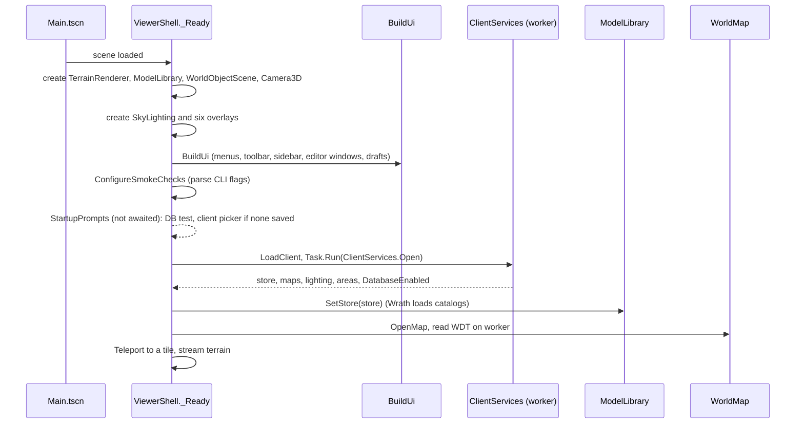
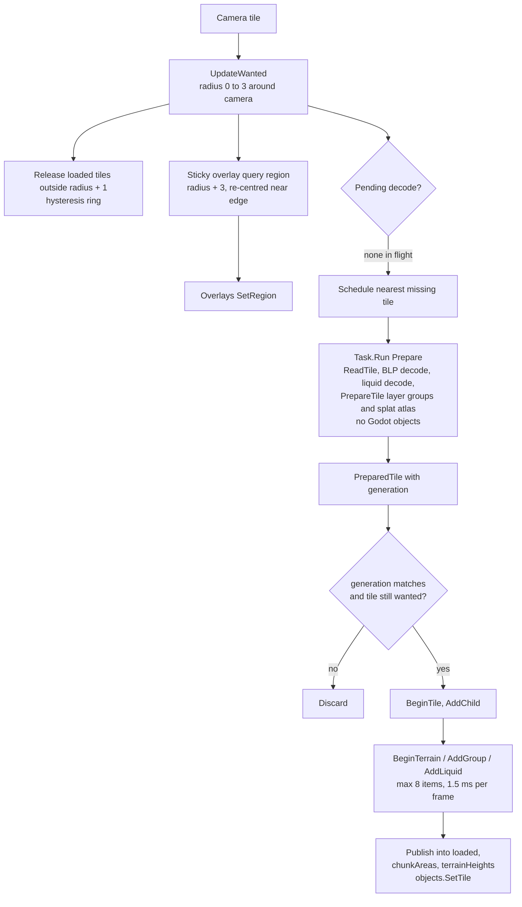
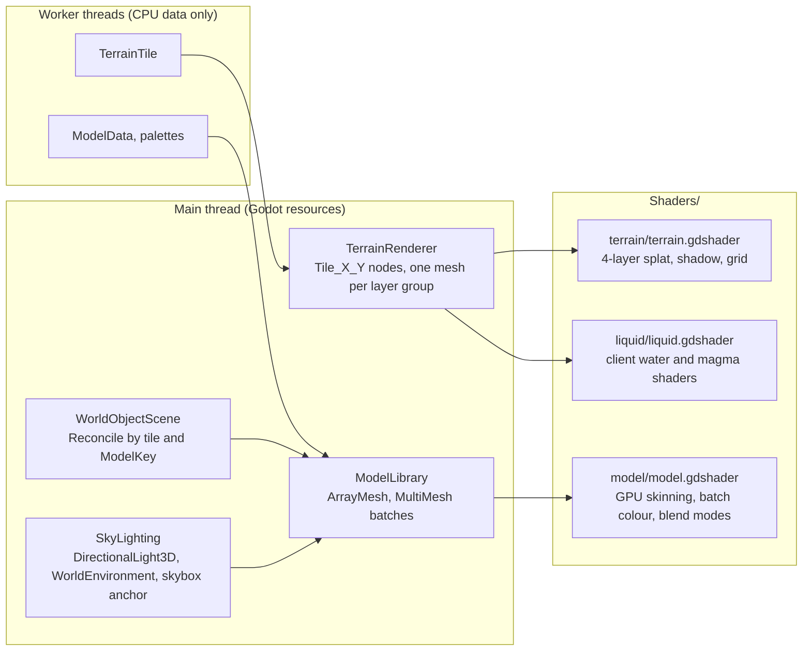

# Viewer runtime

Covers `Scripts/Viewer/`, `Scripts/Rendering/`, `Scripts/Overlays/`, `Scripts/Ui/`, `Scripts/Diagnostics/` and `Shaders/`. This is the Godot layer. Everything here runs on the main thread except where noted.

## Scene and startup

`project.godot` runs `res://Main.tscn`. That scene holds one node, `ViewerShell` (a `Node3D`, `Scripts/Viewer/ViewerShell.cs`). The rest of the scene graph is built in code.

Client selection:

- `UserSettings` (`Scripts/Ui/Settings/UserSettings.cs`) reads and writes `user://settings.cfg`.
- Environment variables override settings through `SettingsResolver`: `ACWORLD_CLIENT_PROFILE`, `ACWORLD_DATA_DIR`, `ACWORLD_RETAIL_DIR`, `ACWORLD_CLIENT_PRODUCT`, `ACWORLD_DB_INFO`, `ACWORLD_TC_DB_INFO`, `ACWORLD_LISTFILE`.
- `ClientPickerDialog` (`Scripts/Ui/Settings/ConnectionForm.cs`) offers the Wrath, Retail and WoW: Forever profiles, remembers one folder per profile and validates it with `ClientFolder.Validate`. The Forever profile needs the install's `_forever_` product folder and opens client-only with the database layers off.

Shutdown (`_ExitTree`) cancels streaming, awaits the model worker and the pending tile task, then disposes the store and the drafts.

## ViewerShell partial classes

`ViewerShell` is one class split across files:

| File | Concern |
|---|---|
| `Viewer/ViewerShell.cs` | Core coordinator: `_Ready`, scene systems, teleport, camera conversion, `SetSession` |
| `Viewer/Session/ViewerSession.cs` | Standalone client/map controller: `LoadClient`, `OpenMap`, `ResetTerrain`, `ExitTree`, with `IViewerSessionHost.OpenClient` as the client-open seam; `ViewerShell.SessionHost.cs` implements the host and keeps the state |
| `Viewer/Session/ViewerShell.Session.cs` | Three-line delegation to `ViewerSession` |
| `Viewer/Streaming/TerrainStreamer.cs` | Owns the wanted/loaded/failed sets, the sticky query window, reset and publication hooks; `.Tiles.cs` holds the worker decode, budgeted upload and nearest-missing schedule |
| `Viewer/Interaction/ViewerInput.cs` | Standalone input router: navigation/selection/placement order, drag ownership, flight look/move and focus loss; `IViewerInputHost` is the shell seam and `ViewerShell.InputHost.cs` implements it |
| `Viewer/ViewerShell.Process.cs` | The per-frame pump: streaming, HUD, overlays, diagnostics |
| `Viewer/Hud/ViewerShell.Layout.cs` | `BuildUi`: the canvas, the shared theme, the strip/body split, and the one place the region builders are called |
| `Viewer/Hud/LeftPanel.cs` | The left navigation panel: world settings, teleports, day-night scrubber, status line, zone labels and minimap, then the Scene explorer |
| `Viewer/Hud/EditorsWiring.cs` | Editor windows and the content browser, plus every signal that ties them to the overlays; selection precedence and tool modes |
| `Viewer/Hud/ViewerShell.Toolbar.cs` | The tool strip's mode buttons and edit actions |
| `Viewer/Hud/ViewerShell.ClientPrompts.cs` | Client profile choice, draft-profile switch, startup checks, connection prompt and info box |
| `Viewer/Hud/ViewerShell.MenuBar.cs` | The command strip at the top: the File/Edit/View/Help menu bar loaded from its sheet |
| `Viewer/Export/ViewerShell.Export.cs` | Pending changes, SQL export, polling every 0.4 s, discard and export actions; File → Clear cache… (saved edits, exported record and the model thumbnails of both profiles) and File → Reset configs and delete cache… (`BeginReset`: starts the cleanup helper, then quits) |
| `Viewer/Interaction/ViewerShell.Ground.cs` | `GroundAt`: combines terrain height and WMO floors for snapping |
| `Viewer/Interaction/ViewerShell.Placement.cs` | Placing a new spawn from a template with the mouse (the viewer side of `PlacementTool`) |
| `Viewer/Interaction/ViewerShell.Selection.cs` | Selecting several spawns: Ctrl-click adds or removes one, Shift-drag draws a box |
| `Viewer/Interaction/ViewerShell.NavigationPicking.cs` | Navigation picks bounded by loaded terrain and visible building render triangles |
| `Viewer/Interaction/ViewerShell.Hotfixes.cs` | Layers the server's creature display hotfixes over the retail client's display table at client load |
| `Viewer/Session/ViewerShell.Listfile.cs` | One-time listfile prompt and in-app update (download on a worker, then reload the retail client) |
| `Viewer/Session/ViewerShell.Locate.cs` | Locate a creature from quest links: fly to a loaded spawn, or query the database and wait for the region to stream in |
| `Viewer/Session/ViewerShell.Teleports.cs` | `game_tele` dropdown with a generation guard, plus same-map server XYZ navigation |
| `Diagnostics/ViewerShell.*.cs` | Smoke workflows and the F12 diagnostic dump (see Diagnostics below) |

Other viewer files: `SkyLighting.cs` (sun, environment, skybox and the client fog, sun and water values it publishes), `ClientLighting.cs` (light regions and profiles), `ClientServices.cs` (client open), `TerrainMinimap.cs` (a `Control` that raises `Jump` on click), `ScenePicking.cs` (the Godot facade over `Assets/World/RayBox.cs`), `AreaTable.cs`, and `NodeExtensions.cs` / `ViewSpace.cs` helpers. `Assets/World/TileWindow.cs` holds the wanted set, hysteresis ring and nearest-missing choice the streamer walks. `Data/UserDataReset.cs` (not a viewer partial) holds the reset logic: the safe-target check (the project's own `app_userdata` folder), the count of exported scripts shown in the confirmation, and `StartCleanerAsync`, which launches a hidden PowerShell through WMI (`Win32_Process.Create`) that waits for the viewer process to exit and then deletes the whole user folder, retrying for up to a minute. WMI creates it with no inherited handles; a plain child would inherit the viewer's open log file and block its own deletion. Windows only.

## Streaming

State fields in `ViewerShell`:

- `wanted`: tiles inside the radius.
- `pending` and `pendingKey`: the single decode task.
- `building` and `buildingNode`: the tile being uploaded.
- `loaded`: `Dictionary<TileKey, Node3D>`.
- `failed`: tiles that failed, so they are not retried every frame.
- `generation` plus a `CancellationTokenSource`: guards against map and reload races.

Model streaming (`Rendering/ModelLibrary.cs`) follows the same pattern, once per frame in `Update(camera)`:

1. `ConsumeDecodedModel` (queues a finished worker batch)
2. `UploadPendingModel` (at most 8 surfaces, 1.5 ms, shared by the queued entries; each publishes when its last surface is up)
3. `BindReadyInstances` (at most 8 per frame, 2 ms)
4. `ScheduleModelDecode` (tops up to three `Task.Run` workers, each decoding the next four nearest unbuilt variants back to back and stopping early after about 100 ms; workers start while earlier results upload, while fewer than three decoded entries are waiting and those hold under 256 MiB; `ConsumeDecodedModel` queues every finished worker)
5. `EvictDormantModels` (LRU over the entries no instance uses; their estimated size is held to a soft 256 MiB, and entries with live instances are neither counted nor evicted)

A published entry keeps only what instances and probes still read (`Entry.ReleaseUploadData`, `ModelData.ForProbes`): doodads, animation IDs and bounds, plus a WMO's batch positions, indices and liquid types. The decoded BLP pixels, palette pixels, normals, UVs, colors, skinning and bone tracks are dropped once the last surface is uploaded. `Entry.Bytes` then estimates the retained CPU data plus the entry's own GPU memory.

Caches: retained model data, palettes and uploaded meshes are keyed by `ModelKey` (path, replacement textures, baked texture, doodad set, animation, skybox flag, hair and fur). Shared textures are ref-counted by path. A `failed` set stops retries. Shader variants are cached by blend mode, two-sidedness, unlit and skybox.

## Rendering

- **Terrain** (`Rendering/TerrainRenderer.cs`): the tile worker (`PrepareTile`) groups a tile's MCNKs by their layer list and concatenates each group into one surface, so a tile draws as one `MeshInstance3D` per distinct layer list (about 20–40) instead of 256 chunk meshes. UV is chunk-local; UV2 is the chunk's cell in the tile's 1024x1024 RGBA splat atlas (64x64 per chunk: RGB layer opacity, A baked shadow), uploaded once per tile by `BeginTerrain`. Each group gets a `ShaderMaterial` on `terrain.gdshader` with its four layer textures, which stay shared and reference-counted across tiles (a per-tile texture array would copy them into every tile). `CellCount` feeds the status bar. Liquids are children of a `Liquids` node and use `liquid.gdshader`, one shared material per texture.
- **Terrain shader**: samples the splat atlas at the chunk-local UV clamped to texel centers inside the chunk's cell, which matches the old per-chunk clamp-to-edge maps. Big-alpha mode uses independent layer weights; legacy mode blends in sequence. Lighting is the client's (`client_surface_light`, from the retail `terrain` pixel shader): unshaded, in gamma space like the client, so layer textures are sampled raw and only the finished color is converted to linear. The doubled vertex tint scales the layers, `clamp(ambient + diffuse * N.L)` scales that, a Blinn-Phong highlight (exponent 20, sun specular color) masked by the layers' alpha channel adds on top, and the baked shadow takes 30 % off (it was `1 - 0.3 * shadow` before as well). The retail permutations that use per-layer color LUTs and a hemisphere ambient (36 to 39) are not ported, nor is the light buffer's contribution from point lights, and the highlight strength (`CLIENT_SPECULAR_STRENGTH`) is an estimate. The terrain does not receive Godot's dynamic sun shadows any more. An optional cell grid draws on top.
- **Liquid shader** (`Shaders/liquid/liquid.gdshader`): unshaded, no depth writes, with two water models (`water_model`) and a magma/slime path; retail swamp selects its own shader. `water_wrath` is the 3.3.5a client's `psLiquidWater` (disassembled from the `.bls` files): `(ambient + diffuse * N.L) * gradient + frame texture + (specular + 0.25) * frame alpha`, with Blinn-Phong exponent 6 and the sun band as colour. `water_retail` is the retail `mediumwater` shader: scrolling ripple normal map, fresnel mix toward the fog colour, and a sun glint, with alpha 1.25 times the gradient alpha. A type uses the retail model when its LiquidType names a ripple normal map (LiquidType texture 2, `newoceanbump.blp` on the retail stock types; `RetailLiquids.Bump`, carried as `LiquidStyle.Bump`), which retail data does and 3.3.5a data does not (its MPQs do not even contain the file), so the model follows the data rather than a client check. Both models share the depth gradient (the client's 64-row procedural depth texture computed in the shader from the active light's four water colours and alphas, `client_water_*`, indexed by the depth byte kept in the vertex alpha through the type's depth table), the sun values and the fog, and run on raw gamma-space values with only the result converted to linear. Frames loop over the type's period (`LiquidType` int 1) and `LiquidStyle` (from `LiquidTextures.Style`) carries the gradient, depth table, texture scale, rotation and depth scale. Lava and slime (kind 2 or higher) are vertex colour times frame, opaque and unlit. The retail model: two near and two far scrolling samples of the map, blended by camera distance, bend the surface; the animated frames are not used. The retail vertex shader is not shipped, so the ripple UV scales, scroll rates and the specular exponent are chosen to look like the stock water, and the sky reflection uses the fog colour. The two retail water shaders share that ripple normal through `Shaders/liquid/liquid_surface.gdshaderinc` (`liquid_ripple`). Both also have the shipped underwater face: `water_retail` draws `mediumwaterbelow` when the eye is under the surface (`INV_VIEW_MATRIX[3].y < world_position.y`, per fragment), which turns the ripple normal toward the viewer, lets the lit gradient take the surface in proportion to the gradient alpha (a tenth less at grazing angles) instead of the sky, drops the glint's 0.2 floor, and adds 40 % of the above-water sun response behind a fourth-power Fresnel with the gradient's own alpha. The 3.3.5a model has no such variant, so its underside keeps the above-surface path. Magma and slime scroll their frames at the type's first two floats in texture widths per second (`Liquid::GetTexScrollMtx`, `LiquidStyle.ScrollU` and `ScrollV`, `RetailLiquids.Scroll`); terrain liquid materials are shared per texture and style (`LiquidStyle.CacheKey`), so magma and faster WMO magma do not share one. Retail swamp (material 14) selects `Shaders/liquid/swamp.gdshader` in `LiquidRendering.Configure`, with its screen and depth inputs isolated from ordinary water and magma. Its composition, texture fallbacks and fidelity limits are in [Material 14](rendering.md#material-14-swamp).

- **Models** (`Rendering/ModelInstance.cs`, `Rendering/ModelLibrary.cs`): `ModelInstance` is a `Node3D` that holds its transforms. The decode worker merges opaque batches that share every material input (`SurfaceMerge`, skyboxes excepted) and the entry uploads that list, then drops it; ground probes read the unmerged batch positions and indices the entry keeps (`ModelData.ForProbes`). Unskinned, unanimated, non-sky batches share one `ShaderMaterial` per material key (shader variant, texture, blend, colour mode, static colour and UV rows), reference-counted per entry. Instanced placements use a `MultiMeshInstance3D` per mesh with visibility range 1600. Single instances use range 400. Skyboxes are unculled and shadowless.
- **Model shader** (`Shaders/model/model.gdshader`): unshaded, with the client's own lighting (`client_model_light`, from the retail `combiners_*` pixel shaders) computed in gamma space like the terrain: `ambient * (0.7 + 0.4 * (0.5 * N.L + 0.5)) + diffuse * max(N.L, 0)` times the surface color, no specular, textures sampled raw and only the finished color converted to linear. Godot's lights and dynamic shadows no longer touch models (`ModelLibrary` adds `unshaded` to every variant and sets `LIT` false for unlit and skybox ones). The retail hemisphere ambient (separate top, horizon and bottom colors) is not ported: the sky ambient is used for all three. GPU skinning from the `animation_palette` texture; batch colour and UV animation from `material_palette`; `vertex_color` mode 1 (interior baked light) or 2 (exterior colour as emission). Multi-texture batches set `combiner` (a `LayerCombiner` value), `layer_tex2` to `layer_tex4` and `layer_coords`; the fragment stage runs the client's `Combiners_*` / MapObj pixel shader, adding reflections and glows as emission, and `edge_fade` fades a surface where it turns from the viewer. A WMO's second vertex-colour alpha arrives in custom channel 2. `ModelLibrary` patches the shader text per variant (`render_mode` and an `ALPHA` line). The skybox variant places vertices on a 7500-yard shell.
- **Thumbnails** (`Rendering/ModelThumbnails.cs`, behind `IThumbnailSource`): the content browser's model pictures. A request resolves a creature display (`ModelKey.ForCreature`, shared with `CreatureOverlay`) or a GameObject display (`.wmo` models are skipped) and attaches the model through the viewer's `ModelLibrary` inside a 128-pixel `SubViewport` with its own world, ambient and directional light and a transparent background. The library decodes the nearest unbuilt models first, measured from the main camera, so the off-screen root follows the main camera and thumbnails decode ahead of the world. Three models are attached at a time; each built one is shown alone, framed on its `Bounds` from in front (models face −Z), rendered once and read back two frames later. PNGs are cached in `user://thumbs/<wrath|retail>/<sha1>.png`, the hash covering a version number and the whole `ModelKey`, so display hotfixes and framing changes get new files. Smoke runs start from an empty `res://artifacts/thumbs/<guid>/` (`ViewerShell.ThumbnailDirectory`), so every run renders what it checks. Failures (a display the client lacks, no model, a failed decode, empty bounds such as the invisible stalker model) are remembered until the next client loads (`Reset`); a model still not built after 30 s is only dropped, so the next search asks again. Headless runs have no renderer, so they never call back. File → Clear cache… does not touch thumbnails (it is about saved edits); delete the folder to rebuild them.
- **WMO placement** (`Rendering/WorldObjectScene.cs`): `SetTile`, `RemoveTile`, `SetGlobals` and `SetLayers` each trigger `Reconcile`. Objects are de-duplicated by `(IsWmo, Id)` with sticky owner tiles, grouped by tile and `ModelKey`, and attached as one batch per group. `FloorHeights` feeds ground probes.
- **Fog volumes** (`Assets/World/FogVolumes.cs`, `SkyLighting.SetFogVolumes` and `UpdateFogVolumes`, `client_fog_volume_layer` in `client_lighting.gdshaderinc`): a retail map's placed haze boxes, the `VFOG` entries of `World/Maps/<dir>/<dir>_fogs.wdt` (104 bytes each, laid out as on wowdev.wiki/WDT; `VFEX` extras join by id; `VFE2` is not read), 1,545 of them across 92 maps. `ViewerShell` loads them with the map and `SkyLighting` converts each to a view-space box (the rotation is conjugated by the server-to-view axis permutation); each frame the six nearest go into the `client_fog_volumes` global texture (five RGBA-float texels each). The shared fog output clips every eye-to-fragment ray to the volume (a box, or for flags bit 2 the ellipsoid inscribed in it) and samples the density at three points along the part inside: `thickness * edge^power * height`, where the edge term is the signed-distance falloff and the height term thins from the box's bottom to its top (power = the second intensity value); for flags bit 0 two drifting layers of procedural 3D noise (`AnimationPeriods` set the drift speeds, `client_fog_volume_time` the clock) break it into clumps through a contrast curve. The haze is colored by the volume and lit by sun and ambient, over the light's own fog as an independent layer. `VolumeFogCondition` scales a volume by its `WhenFalse` value (`ClientLighting.FogVolumePresence`; no player here satisfies a condition). The flag bits are inferred to select the injection shader's permutations in order (noise, shadows, ellipsoid). Mapping inferred from the `volumefogmaterialinjection` compute shader and the data: box size is the two radii and the third intensity value (height), the first intensity value is the thickness (scaled by `MapFogVolume.ThicknessScale`, an estimate), the third radius is the edge falloff power, the signed-distance falloff runs over the thinnest half size. Not done: the shadowed permutation (sun shadows inside the volume), light in-scatter from point lights, the proxy model, temporal blend, the client's noise texture and constants (the noise here is procedural), `VFE2`, and the client's volume fog quality setting (`FogLevel` up to 2 is used).
- **Sun shafts** (`Shaders/sky/sunshafts.gdshader`, driven by `SkyLighting.UpdateShafts`): the retail `sunshaftsmask` and `sunshaftspropagate` passes as one additive full-screen quad. Each pixel gathers a sky mask (no depth written) along its line to the sun's screen position, tinted by the light's LightShaft color, scaled by its intensity and by how high the sun is (`SkyDome.ShaftSunVisibility`), reaching `SkyDome.ShaftReach(radius)` of the way. Only newer retail lights have shafts (114 light sets: `LightShaft` rows linked through `LightParamsLightShaft` to each time-of-day sample, `ShaftBands` in `LightProfile`); the quad stays off otherwise. The tap count, falloff and strength are estimates (the post-chain composite is not readable).
- **Sky and lighting** (`Viewer/Lighting/SkyLighting.cs`, with its fog, sky and diagnostics partials): `ClientLighting` supplies light regions and profiles. The pure decision half is `Assets/World/LightingSampler.cs` (`Advance`, `Sample`): it advances the clock, picks the default and nearest local light, applies the one-yard falloff floor and interpolates the diffuse, ambient and fog bands with no Godot types, so the rules are unit-tested without an install. `Assets/World/LightingBlend.cs` (`Describe`) does the rest of the arithmetic - sky bands, clouds, fog start/end and retail terms, water gradients, sun specular, shafts, stars and celestial positions - and the node only converts those floats into Color/Vector values and pushes them to shaders. Which light applies follows the client's `DayNight::LightLoad` and `BlendAreaLight`: the base is the map's default light, the one at coordinates exactly (0, 0, 0) (not a light with a falloff of 0), and a map without one uses Light 1 (the Eastern Kingdoms default) rather than whichever local light is nearest; local lights blend over the base by their distance to the camera in three dimensions, height included, so Khaz Algar's stacked underground lights do not leak onto the surface above them. The client blends every overlapping light, the nearest last; the editor takes the nearest. The client's hard-coded zone lights (`s_zones`) are not ported. Each frame it blends bands at `tick = hours * 120`, drives the sun and ambient (the sun's light travels along the client's `DayNight::SetDirection` vector, `SkyDome.LightDirection`: a fixed 225 degree bearing, steeper at noon than at dawn and dusk; the light's energy is 1 and the tone mapper linear, since the client has neither an exposure curve nor a tonemap), publishes the sky dome's values, and attaches the skybox model. Fog is the client's (`DayNight::UpdateFog`): it ramps from `end * startMul` to `end`, the end capped at `SkyLighting.ViewDistance` (777 yd, standing in for the client's view distance setting), and the shaders apply `pow(saturate((end - depth) / (end - start)), density)` on view-space depth through Godot's custom `FOG` output while Godot's own fog stays off. Retail fog differs: the volume fog integrates an extinction along the view ray, so `client_fog` mode 2 uses `exp(-density * (distance - start) / (end - start))` over the distance to the eye (the retail legacy `FogDensity` of 4.5 matches the old ramp near its start), with the end capped at a retail-sized `ViewDistance` (2500 yd), `FogDensity` as the density and the fog turning toward `EndFogColor` over `EndFogColorDistance` yards (`RetailFog`). Lights with a height layer (`FogHeight`, `FogHeightScaler`, `FogHeightDensity`, `FogHeightColor`, `EndFogHeightColor` and the cubic `FogHeightCoefficients`; `FogHeightLayer`) use the volume shader's rule: a cubic of the distance above the fog plane picks between the layer (below) and the main fog (above), and the shaders integrate density and colour along the ray in six steps. All-zero coefficients, as on the classic lights, leave the main fog everywhere, and a light with no fog distance (the newer lights, `FogEnd` 0, with `FogDensity` 4 to 25) starts its fog at the eye and spreads its density over a fixed 10,000 yards (`SkyLighting.ModernFogSpan`, an estimate) instead of the view distance, which left Zandalar's density-20 lights with a few hundred yards of sight. Sun scattering adds the light's `SunFogColor` times `SunFogStrength` times a Henyey-Greenstein phase (anisotropy 0.9, `0.19 / (4 pi (1.81 - 1.8 cos)^1.5)`) of the angle between the view ray and the sun disc (`SkyDome.SunDirection`) to the fog colour, so fog glows toward the sun; the classic lights have no sun fog colour and get none. The `MainFog*` fields and the real constant mapping (the client's fog code is not readable here) are not ported. Fog and sky colours are converted from the 8-bit band values to linear (`client_gamma_to_linear`), so both read darker than before and meet at the horizon. Fog, sun and water values reach the shaders as global shader parameters (`ClientShaderGlobals`, declared in `Shaders/shared/client_lighting.gdshaderinc`); shaders must be loaded through `ClientShaderGlobals.Load` so the globals exist first. The sky is `Shaders/sky/sky.gdshader`, a Godot sky shader that evaluates the client's dome (`DNSky`): each view ray is intersected with the strips between the dome's six rings (`SkyDome.RingTheta`), which take the light's six sky colours (zenith, middle, band 1, band 2, smog, fog; the horizon ring and everything below it are the fog colour), the sunrise/sunset highlight (`SkyDome.Highlight` times the light's HighlightSky flag, kept in place relative to the camera heading) and the retail `dnsky` glow toward the sun disc (`SkyDome.SunDirection`). The glow's thresholds and weights sit in the retail shader's stripped constant buffer, so they are estimates. The sun and the two moons are camera-facing quads 12 units out (`DNPlanet`): textures `Textures/sunCenter.blp`, `moon.blp` and `moon02.blp` (`CelestialTextures`, loaded when a client opens; a client without one leaves that body out), positions and widths from `SkyDome.Sun`, `Moon` and `SecondMoon`, alpha blended and tinted by the sun colour (the second moon is untinted), fading over the 0.4 units above the horizon and cut off below it. The client faces the quads along the camera axis; ours face their own direction, which only differs near the screen edge, and the second moon's cycle starts at the clock's midnight because the editor has no calendar. The client draws the planets first and the dome additively over them, so the discs add to the sky colour. The cloud layer is the client's `DNClouds` evaluated per pixel instead of into a texture: four octaves of animated lattice noise (8, 16, 32 and 64 cells across the cloud cap, amplitudes halving, drifting slowly), cut by the light's `CloudDensity` through the client's sharpness curve (`SkyDome.CloudAlpha`), shaded by thickness, lit by a bump term from the slope of the first three octaves against the sun (the moon at night) and the light's three cloud colours, mapped around the zenith out to 45 degrees (`cloud_uv`) and faded toward the horizon (`SkyDome.CloudEdgeAlpha`), plus the retail `dnclouds` rim of light toward the sun on thin cloud. The noise lattice is a hash, not the client's random table, so the cloud shapes differ from the client's. The planets and clouds are hidden while a LightSkybox model is attached, as the client hides them. The retail sky shaders' blue-noise dither (which hides banding in 8-bit gradients) is replaced by Godot's debanding (`rendering/anti_aliasing/quality/use_debanding` in `project.godot`). The cloud noise lives in `Shaders/sky/sky_clouds.gdshaderinc`, shared by the cloud shell and the glare shader. The clouds are their own sphere around the camera (`Shaders/sky/clouds.gdshader`, projected out to just inside the far plane like a LightSkybox model, render priority -1) rather than part of the sky pass, so they draw after the star model as the client's order is stars, planets, dome, clouds. The sun and moon glare (`DNGlare`: `Textures/sunGlare.blp` and `moonGlare.blp`) are large additive quads over the finished scene (`Shaders/sky/glare.gdshader`, no depth test, top render priority), tinted by the sun colour, sized and brightened by how directly the camera faces the body (`SkyDome.SunGlare`, `MoonGlare`), shown by day or night through their alpha curves, dimmed by the cloud in front of the body (the sun by cloud density, the moon by distance from half cover) and by how much of the body's disc shows sky, measured from the depth buffer in place of the client's occlusion query. The client's fade-in and fade-out rates are not ported, so the glare changes at once, and its under-water dimming is not either. The stars are the client's `Environments/Stars/stars.m2`, attached like a LightSkybox model and faded by the instance transparency (`SkyDome.StarFade`). The planets, stars, clouds and glare are all hidden while a LightSkybox model is attached, as the client hides them. Not ported yet: the storm blend (the editor has no weather state to drive it).

## Camera and input

All camera and input handling is in `ViewerShell.cs`.

- **Flight:** hold right mouse to capture the cursor. Mouse motion changes yaw and pitch (pitch clamped to ±1.55). `MoveCamera` reads physical W, A, S, D, Q and E; Shift multiplies speed by 4; the wheel changes speed between 5 and 1500.
- **Teleport:** choose a `game_tele` bookmark to open its map and focus that location, or enter `X, Y, Z` and press Enter/Go to move the camera to that exact server position on the current map. XYZ entry preserves the camera heading, does not require a bookmark or database connection, rejects non-finite coordinates and waits until a map is open and not loading. Coordinates use decimal points regardless of the system locale; later terrain uploads do not lift the entered eye height.
- **`_Input`** runs before shortcuts. While captured it swallows keys other than Escape, so flight keys do not trigger toolbar modes. While an editor is dragging it routes motion, release and Escape to that editor.
- **`_UnhandledInput`** runs after the UI. Left click tries the active editor's gizmo first, then the nearest ray hit across creatures, GameObjects, graveyards and triggers (triggers lose ties). A short right click selects a creature or GameObject and opens its properties window (the nearer hit wins). Creatures, GameObjects, graveyards and waypoints each have their own draft; the selected kind owns the gizmo, undo and drop-to-ground.
- **Focus loss** releases capture and cancels drags.
- **F12** (handled in `_Input`, so it works while flying) saves a diagnostic dump; see [Diagnostic dump](#diagnostic-dump-f12).
- **Shortcuts** come from `EditorMenu` (Ctrl+Z, Ctrl+Y, End, Ctrl+Shift+C, F, Ctrl+B, Ctrl+Q) and `EditorToolbar` (Q, W, E for modes, Ctrl+Shift+Z).

Per-frame order in `_Process`:

1. `MoveCamera` (when captured)
2. `UpdateTerrainStreaming`
3. `UpdatePendingLocate`
4. Status, menu and toolbar refresh
5. `sky.Update`
6. Labels, telemetry and minimap
7. Creature, GameObject, graveyard, waypoint and trigger `Update(camera)`
8. `interaction.Track(creatures.SelectedSpawn)`
9. `models.Update(camera)`
10. Sidebar counts
11. `PollPending`
12. `RunSmokeChecks`

## Overlays

Six overlays are children of `ViewerShell`. Creature, GameObject, graveyard, waypoint and AreaTrigger share one shape (`RegionOverlay`); `NavigationOverlay` is independent (see [Navigation overlay](#navigation-overlay)). Overlays live in one folder per family: `Region/` (the shared query and selection substrate), `Placement/` (the gizmo, placement tool and editing contract), and `Creature/`, `GameObject/`, `Graveyard/`, `Waypoint/`, `AreaTrigger/` and `Navigation/` for the layers themselves. The creature layer keeps its marker nodes in `CreatureMarkers`, its native model batches in `CreatureModelView` and its gizmo flow in `CreaturePoseEditor`; `WaypointPaths` owns the drawn path geometry. The overlays themselves keep the query, selection and panel publication. The shared shape:

- `Connection` gives the `WorldConnection` (settings, hotfixes database and dialect); queries open it with `DBSource.Open`. `SetRegion` receives the query region from `UpdateWanted`.
- `RegionQuery<T>` (`Overlays/Region/RegionQuery.cs`) runs one cancellable, generation-checked query on a worker. A search box has a 0.3 s debounce.
- Results are diffed against existing markers by ID.
- Each overlay exposes `FindHit`, `Select`, `Deselect`, `SelectionChanged`, `FocusRequested(WorldPose)`, `SetLayerEnabled` and `BuildPanel()`, which the sidebar hosts.

| Overlay | Files | Data source | Editable |
|---|---|---|---|
| `CreatureOverlay` | `Creature/CreatureOverlay.cs`, `.Frame.cs`, `.Selection.cs`, `.Editing.cs`, `.Staged.cs`, `.Ui.cs`, `.Fields.cs`, `.Group.cs`, `.Placing.cs`, `.Appearance.cs` | `IDBSource.ReadCreaturesAsync` | Yes: move, rotate, drop, place, duplicate, delete, multi-select, spawn fields and appearance, undo and redo through `SpawnPoses`; opens the properties window and the behavior editor. Markers play their addon row's stance and emote animation (own row, else the template's, draft applied) and ride its mount on a tagged mount batch; sheath state is stored but has no body-visual change until equipment is composed |
| `GameObjectOverlay` | `GameObject/GameObjectOverlay.cs`, `.Editing.cs`, `.Staged.cs`, `.Ui.cs`, `.Fields.cs`, `.Group.cs`, `.Placing.cs` | `IDBSource.ReadGameObjectsAsync` | Yes: move, rotate, drop, place, duplicate, delete, multi-select, spawn fields and appearance through `SpawnPoses` |
| `GraveyardOverlay` | `Graveyard/GraveyardOverlay.cs`, `.Editing.cs`, `.Ui.cs` | `IDBSource.ReadGraveyardsAsync` | Yes: position, name and zone links through `GraveyardDraft` |
| `WaypointOverlay` | `Waypoint/WaypointOverlay.cs`, `.Editing.cs`, `.Ui.cs`, `WaypointPaths.cs` | `IDBSource.ReadWaypointsAsync` | Yes: point positions and properties through `WaypointDraft`. For TrinityCore the card shows only facing and delay as editable, the path's move type and velocity read-only, and hides smooth transition and actions |
| `AreaTriggerOverlay` | `AreaTrigger/AreaTriggerOverlay.cs`, `.Ui.cs`, `AreaTriggerShapes.cs` | `IDBSource.ReadAreaTriggersAsync` | No; opens the behavior editor on a client trigger's rules or (TrinityCore) a spawned trigger template's |

AreaTrigger volumes are keyed by `AreaTriggerKey` (a client trigger ID, or a TrinityCore spawn ID; list rows carry `ListId`, which sets the top bit for spawns). `AreaTriggerShapes` builds each shape's fill and outline in the marker's local space: spheres, boxes, bounded planes and cylinders scale unit meshes (so `--areatrigger-smoke` can check rendered corners against `AreaTriggerRecord.Contains`); polygons (a prism triangulated with `Geometry2D.TriangulatePolygon`) and disks (an annulus) are built per trigger. A bound the server leaves open (a client polygon has no floor) is drawn 5 yd below or 20 yd above. Picking tests the unit sphere or the slab of the mesh bounds. Labels, Fly to selection and Copy .go use `AreaTriggerRecord.Focus`, which for a polygon is its corners' centroid: many client polygons sit at the map origin with world-space corners.

Creature models are shown for the nearest `Preview.ModelLimit` (128) creatures within `Preview.ViewDistance`, refreshed every 0.2 s. Creatures with a model hide their capsule placeholder once the model is ready.

### Editing

`IPlacementEditor` (`Overlays/Placement/IPlacementEditor.cs`) is implemented by `CreatureOverlay`, `GameObjectOverlay`, `GraveyardOverlay` and `WaypointOverlay`. `ViewerShell.ActiveEditor` sends menu, toolbar and viewport commands to whichever editor owns the selection.

Spawn editors (`CreatureOverlay`, `GameObjectOverlay`) also implement the default members `CanDuplicate`, `CanDelete`, `Duplicate()` and `Delete()`, which graveyards and waypoints leave off. They appear as Edit menu items (Duplicate Ctrl+D, Delete Del), toolbar actions and inspector buttons. A copy goes two yards ahead of its source, dropped to the ground, under the next free GUID, and is selected; a delete removes the spawn and its addon row in one command. Both need the spawn's row, which is read when it is selected, so the commands stay disabled until it arrives. A delete removes only those two rows. When pools, spawn groups, event links, linked respawns, formations or per-GUID SmartAI still name the spawn, a dialog lists them first (`SpawnDeleteDialog`, counts from `IDBSource.CountSpawnReferencesAsync`; for a creature also the waypoint path it walks when nothing else uses it, from `IDBSource.ReadSpawnPathsAsync`); removing them with the spawn is not built yet (see [open-work.md](../status/open-work.md)).

The creature properties window (`CreaturePropertiesWindow`) edits the creature template: its title reads "Creature template: {name}" and its subtitle (`ScopeText.Header`) names the entry and spawn count and points to the inspector for a single spawn. The Template page starts with the cached model thumbnail and display ID (`ModelPreview`); the Appearance tab (`AppearanceSection`) edits `creature_template_addon` with `TemplateAddons`, reusing `SpawnInspector` in its appearance-only mode.

The GameObject properties window (`GameObjectPropertiesWindow`) is the shell's second client. It edits the template shared by every spawn of it: Template (name, display + thumbnail, size, type selector, scaling on TrinityCore, addon faction/flags/money/art kits, AI and script names), Type properties (the fields of the current type from the per-dialect `GameObjectTypeCatalog`, with an unused-field toggle and a raw Data fallback), Quests (`gameobject_queststarter`/`questender` and up to six `gameobject_questitem` rows) and Used by (a bounded spawn count/sample). Changing the type confirms and resets every Data column as one undoable command. `GameObjectContext` reads through `DbGameObjectTemplate`, merges the shared draft and commits through `GameObjectRules`; an absent `gameobject_template_addon` row is shown from defaults and inserted on its first edit.

Selecting several spawns: Ctrl-click adds or removes the spawn under the cursor, and a Shift-drag draws a box that adds everything inside it (`ViewerShell.Selection.cs`, `SpawnGroupSelection`, `CreatureOverlay.Group.cs`, `GameObjectOverlay.Group.cs`). The members get a ring on the ground; Delete, Duplicate and a gizmo move then act on the primary and the members as one command. A press on a gizmo handle starts its drag even with Ctrl or Shift held (Ctrl also snaps a rotation). Ctrl-clicking a spawn of the other kind switches the selection to that kind.

`PlacementTool` (`Overlays/Placement/PlacementTool.cs`, owned by `ViewerShell`, input in `_UnhandledInput`) places a new spawn from a template dragged out of the content browser (`TemplateList` carries it, `ViewportDropSurface`, a transparent control behind every panel, receives the drop so a drop on a panel is ignored; `ViewerShell.Placement.cs` arms the tool while the drag is over the world and disarms it when the drag ends): the ghost is recomputed every frame from the last cursor position (so it stays under the cursor while the camera flies) and hides over panels; `RayGround` marches the camera ray against the terrain height map and, in terrain holes, the building-floor probe.

`TransformGizmo` (`Overlays/Placement/TransformGizmo.cs`) draws three axis arrows and a yaw ring. It has Select, Move and Rotate modes, and emits `Changed(GizmoEdit)` events. Preview events have `Commit = false`; exactly one commit fires per gesture. Rotation snaps in steps, or 15° with Ctrl held.

A committed creature move goes through `SpawnPoses.Move(sourceKey, guid, before, after)`, a row edit on the content draft. The displayed pose is `poses.Effective(...)`, and `poses.Conflict` flags a change in the source database.

## Ui windows

| Window | File | Role |
|---|---|---|
| Client picker | `ClientPickerDialog` in `Ui/Settings/ConnectionForm.cs` | Profile and folder selection |
| Connection | `Ui/Settings/ConnectionForm.cs` | Database settings; tested on a worker before saving |
| Sidebar | `Ui/Scene/SceneSidebar.cs` | Layers, spawn preview policy, connection, one tab per overlay, unsaved-changes button |
| Content browser | `Ui/Scene/ContentBrowser.cs` | Bottom panel (Ctrl+B) with Creatures and Game objects tabs, template search, type filter and model thumbnails; double-click opens a creature or GameObject window, dragging a row into the world places a spawn (`TemplateDrag.cs`, `ViewportDropSurface.cs`; see below) |
| Spawn inspector | `Ui/Scene/SpawnInspector.cs`, `Ui/CreatureProperties/SpawnFieldPickers.cs` | The selected spawn's row fields (respawn, movement, visibility, template overrides, appearance) in the creature and GameObject overlays. Named controls replace raw numbers: a spinner for the wander radius, NPC and unit flags each in a boxed checkbox dropdown with per-flag description tooltips, a difficulty dropdown, an emote dropdown, and model/creature/equipment/aura pickers; the NPC and unit flag names come from the template pages' own lists, aura rows carry the spell's client icon and tooltip, and model rows show large thumbnails |
| Visibility preview | `Ui/VisibilityPreview/VisibilityPreviewPanel*.cs` | The sidebar's visibility card: preset with a description and a one-sentence summary (`Foundation/Pages/PreviewSummary`), then "Who is looking" (a phase dropdown of checkable items, each with how many stored spawns of the loaded area sit in it: AzerothCore phases are mask bits, any number tickable, with "Normal world" / "All phases" buttons and the typed mask underneath, `Foundation/AzerothCore/AcPhaseMasks`; TrinityCore previews one phase at a time, named from `phase_name`, with the phase ID typed underneath). The counts come with every region read (`AcPhaseSource` / `TcPhaseSource` → `PhaseCatalog` on the region result) and ignore the preview's phase filter, "Events" and "Also show". The panel builds the visibility rules and the sidebar merges in the display budget |
| Editor base | `Ui/Framework/ContentEditorWindow.cs`, `Ui/Framework/ContentPanel.cs` | Window frame (drag, size pin) and frameless panel base; both carry the draft hooks, commits and the shared client catalog |
| Creature properties | `Ui/CreatureProperties/` | One window per selected creature: a section picker on the left and the chosen section on the right (see below) |
| GameObject properties | `Ui/GameObjectProperties/` | One window per selected GameObject or opened template: Template, Type properties, Quests and Used by pages, built for both dialects |
| Quest editor | `Ui/Quest/QuestEditorWindow.cs` (search and frame; swaps in the open database's panel through `QuestDialects.For`), `Ui/Quest/QuestPanel.cs` + `.Drafting.cs` + `.Pages.cs` + `.References.cs` (shared loading, drafting, story, chain, givers and reference pickers), `Ui/AzerothCore/AcQuestPanel.cs`, `Ui/TrinityCore/TcQuestPanel.cs` (overview, objectives, rewards and preview pages) | `quest_template` and related tables, with `AcQuestModel.Check` (AzerothCore) or `TcQuestRules.Check` (TrinityCore) |
| Behavior panel | `Ui/Behavior/BehaviorPanel.cs`, `.Rules.cs`, `.Scopes.cs`, `.Speech.cs`, `.Parameters.cs`, `.RuleCommands.cs` | SmartAI rules written as sentences, with entry, spawn and action-list scopes, plus speech; embedded in the creature window by the shared `BehaviorSection` and `SpeechSection`. The same panel serves both databases through `SmartCatalog.For(dialect)`: TrinityCore adds a Difficulties field, text fields for the string parameters and a speech line's sound play type. Speech draws one card per line with a short preview, delivery (say/yell/language/range/weight/gesture), sound and broadcast override, grouped under a heading that says which SmartAI rules use the group |
| AreaTrigger behavior | `BehaviorEditorWindow` in `Ui/Behavior/BehaviorEditorWindow.cs` | A window around `BehaviorPanel` for AreaTrigger rules, which have no creature: a client trigger's (source type 2, with its `areatrigger_scripts` name) or a TrinityCore spawned trigger template's (11/12, with the spawn's `areatrigger.ScriptName`), opened with an `AreaTriggerOwner` |
| Pending changes | `Ui/Scene/PendingChangesWindow.cs` (`PendingChangesWindow`, `SqlPreviewWindow`) | Lists pending changes; the viewer performs discard and export. The SQL preview shows the apply or revert script an export would write |
| Menus and toolbar | `Ui/Framework/EditorMenu.cs` (`EditorMenu`, `EditorToolbar`) | The bar is loaded once from a `Ui/Framework/MenuSheet.cs` sheet (`MenuCommand`, `MenuCheck`, `MenuSeparator`, `MenuSubmenu`); loading rejects a chord claimed twice. The toolbar adds mode buttons, captions (`Label`) and option lists (`Choice`) |
| Form controls | `Ui/Framework/EditorFields.cs`, `Ui/Framework/InspectorUi.cs`, `Ui/Framework/UiForm.cs` | Number, text and picker fields; shared inspector layout and card parts (`HistoryRow`, `PoseCard`, `Choice`); `UiForm` builds a panel from an existing `VBoxContainer` without inserting a node |
| Dialogs | `Ui/Framework/Dialogs.cs` | The shared `Info` and `Confirm` shapes; both configure the dialog before adding it and free it on either answer |
| Client styling | `Ui/Framework/ClientStyle.cs` | Dark editor-window theme, quality colours, gossip icons |

### Creature properties window

**Properties window shell** (`Scripts/Ui/Properties`). `PropertiesWindow` is the entity-agnostic frame: header (title, Undo/Redo, close), the section picker (`ItemList`), the scrolling or self-scrolling content host and a status line. A derived window supplies its `IEntityContext` (rows, `Commit`, `Status`, a `Changed` signal, icons; `PageRenderer` draws any `EntityPage` against it), a `Header()` and its sections, and calls `BuildShell` from `_Ready`. Sections derive from `EntitySection` (`Id`, `Title`, `Refresh`, `Supports(dialect)` and the picker badge and icon); a kind of entity adds its own base with the context and widgets its pages share. `CreaturePropertiesWindow` is the first client (the `DefaultSectionId` constant is its default page). It is only the creature frame; the data lives in `CreatureContext` (the selected spawn, the interaction rows merged with the draft, the connection and draft hooks, commit and ID helpers). The dialect-specific steps (the catalog load, building the read model from the effective rows, the commit rule check) sit behind `ICreatureDialect` (`AcCreatureDialect`, `TcCreatureDialect`), picked by `CreatureDialects.For`. The loaded creature is one `CreatureContext.View` (an `ICreatureView`: `AcCreatureView` or `TcCreatureView`); sections read their own through `AcView` / `TcView` and share one `Editable` gate (a content draft is open). Each page is a `CreatureSection` (Gossip, Quests, Vendor, Trainer, Behavior, Speech, Info). Quests is one `QuestsSection` for both dialects: it reads `ICreatureView.Starts` / `Ends` (`QuestLinkView`), the link tables and rule warnings from `IWorldSchema.QuestLinksPage` (`QuestLinksPageSpec.SetRoles`, `Check`), per-quest condition counts from `Lookup.QuestConditionCounts` (filled for both dialects), and a dialect-matched `QuestPanel` from `CreatureContext.Quest` for the embedded editor.

**Stats page descriptors.** The Class / Level / Stats page is data too: `IWorldSchema.StatsPage` is an `EntityPage` with the groups `levels` and `multipliers` (`AcStatsPage`, `TcStatsPage`), drawn by the same `PageRenderer` as the Template page; the section adds only the values the dialect's calculator produces after the multipliers (`AcStatsSection.RenderResult`, `TcStatsSection.Results`). The AzerothCore level and multiplier rules that the editor used to enforce itself are `AcStatsPage.Check`, run with the other creature rules on every commit.

**Template page descriptors.** The Template page (both dialects) is data: `IWorldSchema.TemplatePage` is an `EntityPage` (`Foundation/Pages/EntityPage.cs`) with shared ordered groups (identity, interaction, combat, movement, loot, links, flags) and the fields each dialect puts in them (`AcCreaturePage`, `TcCreaturePage`). A `FieldSpec` names its table, column, label, tip, editor kind (text, whole, decimal, choice, flags, check) and row binding (template row or the difficulty row picked on the page); signedness and text length come from the `TableSchema` column, with optional field-specific numeric limits. A flag field carries its named bits, or none for raw-hex editing. `PageRenderer` draws any page, including the difficulty picker (now above the first group so identity controls can read the shown row); when editable it also adds a missing difficulty row through `DifficultySpec.Add` (a copy of the shown row, or the dialect's `NewRow` defaults), then shows it, and removes the shown row through `DifficultySpec.Remove`; a section adds its own controls to a group through `PageRenderer.After` (`PageRenderer.Picked` is the difficulty row shown). `CreatureReferenceEditor` (`Ui/CreatureProperties/`) supplies the identity controls a descriptor cannot name by itself: the display-model picker (first `creature_template_model` row), the faction-template picker, class/creature-type/pet-family/trainer-class dropdowns, the cursor-icon dropdown with the client's cursor images, the AI-name dropdown and the immunity-set picker; setting a pet family also sets the `Tameable` type flag, and a trainer class sets the class-trainer NPC flag. `CreatureDisplayEditor` draws the large display preview at the top of the Template page and changes the model row (the first `creature_template_model` row); choosing a display redraws the entry's world markers from the draft, without a database round trip. Unit and type flags sit beside the NPC services as checkboxes; `flags_extra` and the static flags stay under Flags. `TcStatsPage` is a second, small `EntityPage` over the same difficulty row (content tuning, level deltas, scaling expansion, the four multipliers); `TcStatsSection` (in `TcStatsSection.cs`) draws it and, under the multipliers, the level, health, mana, armor, weapon damage and attack power `TcStatCalculator` (`Foundation/TrinityCore/`) gives from the client's ContentTuning, ExpectedStat, ExpectedStatMod and ContentTuningXExpected tables (`ITcStatData`, served by `RetailClientLookup`) and the world database's `creature_classlevelstats` (`InteractionLookupData.TcClassStats`). Add a field by adding one `FieldSpec`; `CreaturePageTests` checks that every field's column exists and that the pages cover their tables.

**Reference pickers.** `RecordPicker` (`Ui/Framework/RecordPicker.cs`) is the one search window every editor uses. Each row can carry a client icon, a model thumbnail and a WoW-style `Tooltip`, and the window returns a typed `PickerRecord` (ID, label, detail, icon, tooltip, payload, thumbnail loader). It supports tabs of different searches, paginates long result sets, and the simple ID/name overload is used where no icon is useful (creature templates, quests, broadcast text, SmartAI types). Quest items, spells, currencies, skills, factions, mail templates, titles and zones use the rich form; quest givers and enders use a two-tab creature/GameObject picker with model thumbnails. Model rows use large (96px) thumbnails so every model-type picker shows them big; spell and item rows use smaller icons. `QuestPanel.References.cs` owns the lookup helpers and the compact `ItemReference` / `SpellReference` / `CurrencyReference` / `SkillReference` / `MailReference` / `TitleReference` rows, so a page adds a rich reference without writing picker code. Icons come from `ClientIcons` (Wrath BLP paths or retail FileDataIDs); item tooltips come from `ItemTooltipBuilder`, and the other kinds get a game tooltip with their name, ID and description. `QuestPanel._Process` redraws once when a newly requested icon finishes decoding.

**Item-list descriptors.** Vendor uses `IWorldSchema.VendorPage` (`VendorPage` in Foundation): an `ItemListSpec` selects child rows by parent and ordering, supplies complete new rows, and declares per-item `FieldSpec` values bound with `RowBinding.Item`. `PageRenderer.RenderItems` draws the item fields, including remove controls when editable. The page itself is the shared abstract `VendorSection`: read-only it is a paged two-column grid of icon rows with game tooltips, with a draft open it is the item editor followed by an item search whose results carry icons (`SearchPicker`). `AcVendorSection` and `TcVendorSection` only turn their read model into `VendorEntry` values (name, quality colour, icon, price, stock, shared-list source, tooltip) and supply the item search and the controls only that dialect has (TC: paired stock/restock editor, add by ID, vendor rules). Items of a shared vendor list are read-only cards. `ItemListTests` covers the descriptors and edits. TC enables editing through `CreatureContext.Editable`; `TcVendorSection` searches the retail `IClientLookup` by name or exact ID (30 results, on a worker), and adds items or currencies by ID. Search results are discarded when the creature changes. Stock and restock save together. `TcVendorRules` validates new errors during every TC commit; `TcVendorTests` covers stock, currency quantities, flags, key collisions, persistence, undo/redo and export. A negative ID is a shared vendor reference: TC shows it as a card with the first 25 items of the list. Currency, cost, bonus-list and player-condition existence checks still need their lookup catalogs. Gossip uses `IWorldSchema.GossipPage` (`GossipPageSpec` / `GossipPage`): menu text links and option lists select rows by MenuID, with dialect-specific option fields and greeting storage. `GossipPageSpec.IconOf` / `ServiceOf` read the dialect's own option columns (AC `OptionIcon` / `OptionType`, TC `OptionNpc`) so the pages draw an option's client icon and follow it (`GossipService`: open the quests, vendor or trainer page, or say which client window it opens) through `CreatureSection.OpenService`; `EnableGossip` sets the gossip npcflag a menu needs. `IDBSource.SearchMenusAsync` finds menus by ID or greeting text (AC: `npc_text`; TC: broadcast text in hotfixes then the client, then the `npc_text` rows that use it); `CreatureSection.ChooseMenu` / `ChooseBroadcast` open the picker popup over it and over `SearchBroadcastAsync`. TC gossip lists options as icon rows that a click follows; with a draft open it draws a menu picker and Back, a plain greeting box with "Save greeting" (writing a new broadcast text), the eight weighted variants behind "Edit greeting variants", and one card per option with its text, "When chosen" service, submenu picker and "Open menu" link, confirmation text/cost/code and an Advanced block for the client IDs. A "New menu" box writes a greeting and creates the menu in one step, and "Add option → new submenu" does the same for a chain. `RenderItems` accepts field controls and an after-item callback for resolved broadcast text, AC icon selection, validated submenu edits and navigation/reordering. AC keeps its greeting editor, shared-menu copying and compact preview; TC selects among all root menus and reachable submenus with Back navigation, edits option fields/add/remove through `Editable`, and edits all eight greeting broadcast ID/weight pairs together per slot. `TcGossipRules` validates new rule errors on commit. Submenu and broadcast-reference edits check existence asynchronously through `IDBSource`, ignoring results after creature changes; TC broadcast lookup currently accepts an exact ID only. Broadcast previews show both text variants when different; literal confirmation edits clear their broadcast override atomically. Menus and greetings can be shared, which the editor labels. Trainer bindings remain read-only. Option text edits clear the broadcast override in one command. `GossipPageTests` covers defaults, menu selection, reordering, broadcast overrides, undo/redo and export. Trainer uses `IWorldSchema.TrainerPage` (`TrainerPageSpec`) for bindings, storage and spell fields, rendered through `RenderItems`; AC retains assignment, shared-trainer copying and spell search, while TC keeps gossip-bound trainers (the bindings stay read-only) and edits the trainer type and greeting plus its spells through `Editable`: spell fields, removal, client spell search (30 results, on a worker) and add by ID, with a warning when several creature bindings share the trainer (`TcTrainerView.SharedBy`). `TcTrainerRules` validates on commit and `TcTrainerTests` covers it. Quests use `IWorldSchema.QuestLinksPage` (`QuestLinksPageSpec`) for starter/ender lists and grouped role edits. AC keeps its combined giver/ender icons, role menu, search and embedded quest editor; TC renders separate Starts and Ends lists through `RenderItems`, with removal and a quest search to link a quest as starter or ender when `Editable`. `CreatureServicePageTests` covers trainer requirements and quest-role history/export.

Dialect-specific sections live in `Ui/AzerothCore/` (`Ac` class/file prefix) and `Ui/TrinityCore/` (`Tc` prefix). Common context, registry, base sections and rendering stay in `Ui/CreatureProperties/`.

To add a creature section: derive from `CreatureSection` (or `AcInteractionSection` for pages that draw `AcCreatureView`), implement `Id`, `Title` and `Refresh`, and add one factory to `CreatureSectionRegistry`. A page both dialects have (stats, gossip, quests, template, trainer, vendor) reads its id, title and picker icon from the shared `PickerPages` table in `CreatureSection.cs`, so the AzerothCore and TrinityCore entries match. `CreatureSection` (over `EntitySection`) also holds the widgets both dialects draw with: `IconRow` (client icon plus optional game tooltip), `QuestIcons` (the ! and ? slot), `SearchBox` and `SearchPicker` (search with "+" result buttons that carry icons and tooltips). Sections with their own data keep it in a `ContentPanel` (as Behavior and Quests do); the context creates and shares those panels. `ctx.ShowSection(id, argument)` navigates between sections. The GameObject window follows the same pattern: derive from `GameObjectSection` (all pages support both dialects) and add one factory to `GameObjectSectionRegistry`; `GameObjectPage` supplies the fixed template fields and the current type's fields from `GameObjectTypeCatalog`.

Cross-window wiring is set up in `BuildUi`:

- the creature and GameObject inspectors' Properties buttons and a short right-click open the matching window; the Behavior menu entries open the creature window on a section;
- The "Creature Templates" toolbar button searches `creature_template` by name or ID (for either database, through `IDBSource.SearchAsync`) in the shared `RecordPicker` and opens the creature window on the pick, as a quest giver card does;
- View → Content browser (Ctrl+B) toggles `ContentBrowser` (`Scripts/Ui/Scene`), a bottom panel fitted between the navigation panel and the Scene explorer (it widens when either is hidden). Its Creatures and Game objects tabs search templates by name or entry with a type filter (`IDBSource.SearchTemplatesAsync`, 50 results; a newer search on a tab cancels that tab's older one) and list each hit as a tile: its model thumbnail (a blank tile until it is rendered), the name, and `entry · type`. A late thumbnail finds its row by entry and is dropped when a newer search replaced the results; closing the browser or searching again drops thumbnails not yet started. Double-click or Enter raises `Activated`: a creature opens in the creature window and a GameObject opens in the GameObject template window. Without a database connection it says so on the status bar instead of opening;
- the creature window and quest givers open the standalone quest editor, and the quest editor's giver cards open the creature window on its Behavior section;
- the interaction summary updates the creature inspector;
- the sidebar's review button opens the pending-changes window.

Every content editor shares one `ContentDrafts` instance and resyncs through its `Changed` event.

## Diagnostics

### Diagnostic dump (F12)

F12 writes `artifacts/diagnostics/<yyyyMMdd-HHmmss>/` (`Diagnostics/ViewerShell.Diagnostics.cs`), so a rendering problem can be investigated afterwards without hunting for the object. Aim the mouse at the problem first; while flying (cursor captured) it aims at the screen centre.

- `screenshot.png`: the full window as it is. `screenshot-flat.png`: the same view a few frames later with the sun, fog and tone mapping off and a white ambient (`SkyLighting.Flat`), so raw texture and vertex colour show (models keep their ambient wrap term, so they are only approximately raw); unlit batches such as baked interiors do not change. A surface black in both is black in its data; black only in the first is lighting or fog. `report.json` also has a `lighting` section: time of day, sun, ambient, fog (start, end and view distance), sky colours, tone mapper and skybox.
- `report.json`: client kind and build, map, tile, zone, camera (view and server coordinates, yaw, pitch), time of day, FPS; `pick`: the terrain point under the aim and up to 8 placements whose bounding boxes the aim ray crosses, nearest first (boxes ignore occlusion, so the target may be one of several); `nearby`: up to 150 placements within 250 yd with distance, frustum flag, server position, scale, rotation, and whether the model is ready or failed; `models`: per model, every batch's texture, blend, combiner and layer textures, vertex count, mean vertex colour and `Debug` (M2 `shader_id`, texture-unit count and texture type, or the WMO shader, flags and blend), plus decode warnings.
- `terrain` (in `report.json`, `Diagnostics/ViewerShell.TerrainDiagnostics.cs`): the chunk under the aim point, re-read from the client because the viewer keeps only the built meshes. Per layer: texture and height texture with decode status and average colour, scale, height scale and offset, and alpha min, max, mean and the value at the aimed cell; plus the chunk flags, hole count, height range and vertex-colour mean. A tile summary lists chunks with no layers, an empty base texture, dropped layers or holes, and textures that fail to decode, to find a bad patch that is not under the aim.
- `log-tail.txt`: the last 400 lines of the Godot log, where model warnings go.

`ModelLibrary` drops a model's batch detail when it is published (`ModelData.ForProbes`), so it keeps a `ModelReport` taken just before. Creatures and GameObjects are not in the report yet. `fdid:N` paths resolve through the community listfile in the user data folder.

Smoke workflows run inside the real app. They are opt-in CLI flags passed after `--`, parsed in `ConfigureSmokeChecks` (`Diagnostics/ViewerShell.Smoke.cs`):

| Flag | Workflow |
|---|---|
| `--terrain-smoke` | Teleport away and back; check for stale tiles |
| `--water-smoke`, `--water-interior-smoke` | Aim at the largest native liquid; frame timing (p50, p95) |
| `--creature-smoke`, `--visual-smoke`, `--gizmo-smoke` | Ray pick, gizmo editing, shortcuts, animation preview, map switching |
| `--reload-smoke` | Force a partial model upload, reload the client, check recovery |
| `--visibility-smoke` | Layers, preview policies, events, phase (the summary sentence and phase dropdown follow the typed mask; the dropdown lists real counts; switched to TrinityCore mode and fed a Twilight Highlands tile from the TrinityCore database (needs `ACWORLD_TC_DB_INFO`), it lists "No phase" then the named phases with counts); a windowed run also saves `artifacts/visibility-{card,phases,phases-trinity}.png` |
| `--tele-smoke --tele-name=<game_tele name>` | Teleport through the dropdown's own path, wait until terrain, models and every overlay query settle (120 frames), print `TELE_SMOKE_DONE` with totals; windowed runs save `artifacts/tele-smoke.png`. Warnings between `TELE_SMOKE_START` and `TELE_SMOKE_DONE` belong to the load (retail: set `ACWORLD_CLIENT_PROFILE=retail` and `ACWORLD_RETAIL_DIR`; `MogushanPalace` is the reference, and the run must be clean). `--tele-tile=X,Y` then flies over that tile (e.g. Khaz Algar `--tele-name=TheDawnbreaker --tele-tile=33,29`) and settles again before the screenshot. `--tele-all` first shows every stored spawn (phased, helper, conditional). Godot's leak report at exit follows the marker and is not a load warning |
| `--skybox-smoke` | Checks that the skybox does not overwrite opaque pixels |
| `--graveyard-smoke` | Pick, move, undo, comments, links, layer hiding |
| `--waypoint-smoke` | Live waypoint paths near the start, a viewport click on a point, and the edit workflow |
| `--gameobject-smoke` | Select a GameObject, drag the real move handle, typed turn, reopen, undo/redo, exported SQL |
| `--areatrigger-smoke` | Trigger click, volume check, behavior rule add and undo. AzerothCore: trigger 5140 in Utgarde Pinnacle; TrinityCore: Stormwind spawn 290 (template 188) |
| `--interaction-smoke` | Gossip, vendor, quests, edit mode, reopen (headless works; set `ACWORLD_CLIENT_PROFILE=wrath`, as it covers AzerothCore only) |
| `--spawn-authoring-smoke` | Spawn authoring in Goldshire on an isolated draft (headless works). Creatures and GameObjects: `PlaceAsync` draws, lists and selects the new spawn with the template's name and model, exports an INSERT, undo removes it and redo restores it; a creature placed after an undo gets a fresh GUID. Then the spawn fields (respawn, movement, a wander radius and its ring in the viewport, an override with Use template, a refused value). Then Ctrl+D and the Delete key (creatures) and the inspector buttons (GameObjects) copy and delete spawns, including a source spawn whose delete is undone, and a referenced spawn whose delete asks first (Keep leaves it, Delete anyway removes it, undo restores it). Separate from `--interaction-smoke`; grows with each spawn-authoring slice. A windowed run (no `--headless`) also saves `artifacts/spawn-authoring-{ghost,placed,fields,group,delete-dialog}.png`; the delete dialog is a separate window and is not captured |
| `--content-browser-smoke` | Needs the world database (headless works). Ctrl+B opens the content browser, whose empty search lists only named creature templates; a search finds Hogger (448) first by name, double-clicking him opens the creature window on his entry, the Game objects tab with the Mailbox type filter lists only Mailboxes (32349), opening one names it on the status bar, searches started on both tabs in one frame both finish (each tab cancels only its own older search), and Ctrl+B closes the browser. A windowed run also waits for at least three thumbnails per tab, requires that this run rendered them (`ModelThumbnails.Rendered`) and saved one PNG each, and saves `artifacts/content-browser-{creatures,objects}.png` |
| `--content-smoke` | Behavior rules, speech, quest create and validation |
| `--reset-smoke` | Runs the Reset action without its dialog and quits. It deletes the whole user folder, so it refuses unless `ACWORLD_RESET_SMOKE=1` is set; point `APPDATA` at a throwaway folder and check the folder is gone after the viewer exits |
| `--behavior-smoke` | Behavior editor driven by mouse and key events (headless works; AzerothCore only, so set `ACWORLD_CLIENT_PROFILE=wrath`) |
| `--perf-breakdown` | Parks the camera at five Stormwind poses once streaming is idle and measures render CPU/GPU time and main/shadow-pass draw counts with each scene category (terrain, liquid, WMO shells, embedded doodads, ADT doodads, creatures, GameObjects, markers) hidden or shadow-less, plus sun shadows off. Run windowed; method and results in [`performance.md`](../status/performance.md) |
| `--perf-smoke` | Stormwind City streaming benchmark (run windowed): arrival, a fixed 70 yd/s flight and settle phases, printing `PERF_*` frame-time percentiles, per-step `_Process` time, render CPU/GPU time, tile and region-query latency, model counts and GC. Method and results in [`performance.md`](../status/performance.md) |
| `--client-smoke`, `--client-shot`, `--client-shot-tile=X,Y`, `--client-shot-water`, `--client-shot-sky=HOUR[,YAW[,LIFT[,PITCH]]]`, `--client-shot-map=DIRECTORY`, `--client-shot-eye=X,Y,Z[,YAW[,PITCH]]` (camera at a map position in server axes, for looking around inside a building; needs `--client-shot-sky` for the hour and `--client-shot-tile` to load the tile, e.g. the Lion's Pride Inn at `-9470,14,59.5` on tile `31,49`), `--client-shot-overlays` | Client open check; screenshots to `artifacts/` (combine `--client-shot --client-shot-overlays` to keep the UI, show database layers over Goldshire, and capture gossip, Template, vendor, trainer, stats and quest pages for either dialect; TC also checks gossip submenu/Back navigation, add/text, greeting saves, validation, history and export (saving `client-shot-creature-submenu.png` and `client-shot-creature-greeting.png`), plus adding and removing a difficulty row (`client-shot-difficulty-add.png`), item search, add, stock validation and undo/redo (`client-shot-vendor-search.png`), a trainer spell edit with validation and undo and a refused unknown trainer binding (`client-shot-trainer-edit.png`), a gossip menu copy and its undo, the New menu control, an unknown extended cost refused after the client reference tables load, and a vendor row pointing at a shared vendor list showing its items (`client-shot-vendor-shared.png`), the stats page with scaling validation and undo (`client-shot-creature-stats.png`), and unlinking a quest with validation and undo, then opening the TC quest editor on that quest: adding an objective (a missing target is only a warning) and undoing it, renaming the quest, an unknown reward item or currency refused (`client-shot-quest-editor.png`), and the Hogger quest's objectives page (`client-shot-quest-objectives.png`), then the creature template search and Hogger's behavior editor: his four SmartAI rules read as sentences, a template rule added, a chance of 101% refused, the Difficulties field set and everything undone (`client-shot-behavior.png`, the expanded rule `client-shot-behavior-rule.png`), and his speech lines with their broadcast texts and sound play type (`client-shot-speech.png`)) |

Side effects of any flag ending in `-smoke`: startup database and client prompts are skipped, drafts go to `res://artifacts/drafts/<guid>/` instead of `user://drafts/<profile>/`, and model thumbnails to `res://artifacts/thumbs/<guid>/` instead of `user://thumbs/<profile>/`. Success prints `*_PASSED` and quits; failure pushes an error and quits with code 1.

`launch_viewer.py --smoke` builds the project and runs Godot headless with `--terrain-smoke`. For deterministic Goldshire UI screenshots, pass `--client-smoke --client-shot --client-shot-overlays --client-shot-tile=31,49`; the smoke flag skips the normal random database teleport at startup.

## Smoke workflows and retail testing

Client shader globals and their neutral preview defaults are declared in `project.godot` under `shader_globals`, so shaders compile in Godot's shader editor before the viewer runs. `ClientShaderGlobals.Ensure` allocates the runtime fog-volume texture; `SkyLighting` updates the globals from client data.

Smoke workflows are opt-in flags passed after `--` to Godot (`--terrain-smoke`, `--creature-smoke`, `--client-smoke`, ...). `--client-shot` / `--client-shot-tile=X,Y` (windowed) saves `artifacts/client-shot.png` framed on the largest nearby building with the UI hidden; `--client-shot-water` frames the largest liquid.

Test retail with pre-Cataclysm areas such as Goldshire/Elwynn Forest: the database's spawns come from 3.3.5, so later zones often have no creatures.

## Navigation overlay

Scene explorer has an **MMaps** page and a **Navigation (MMaps)** scene-layer toggle. The layer starts disabled. Choose the server's MMaps folder on this page; `UserSettings` remembers one folder per Wrath/Retail profile. No machine-specific folder is shipped. `ACWORLD_AC_MMAP_DIR` and `ACWORLD_TC_MMAP_DIR` optionally override the saved folders for diagnostics.

`NavigationOverlay` owns its own cancellable worker, generation counter, attempted-tile cache and retention ring. `ViewerShell` supplies the current map, profile metadata and camera tile/radius; navigation does not depend on successful terrain decoding. One file decodes at a time off the Godot thread. Detail triangles are prepared by the Godot-free parser. The main thread uploads batches of up to 512 triangles or polygons per frame and evicts tiles outside radius + 1. Evicted successful tiles can load again; missing and malformed tiles are remembered until reload or a source/map change. Disabling clears selection, cancels work and releases nodes. Stale results cannot publish after reset.

Shared unlit materials draw translucent detail surfaces with depth testing and an 0.08-yard display offset. Polygon edges are separate from detail triangulation. Controls show surfaces, polygon edges, tile boundaries and off-mesh lines, and adjust opacity and X-ray (disables depth testing). Terrain filters use AC's Ground/Magma/Slime/Water areas or TC's Ground/Steep ground/Water/Magma-slime areas; unknown areas remain numeric and gray. Flags are shown as numbers without inventing meanings.

**Inspect navmesh** reserves viewport left-clicks for the nearest displayed navigation triangle. Outside that mode, ordinary entity selection continues. The selected polygon is highlighted and its inspector records file, requested/source map, filename tile, Detour grid, polygon index, area, flags, original Detour coordinates, static neighbor codes, agent dimensions and AC generator settings. Errors and explicit selection feedback go through `StatusLog` to the status bar; successful tile loads are silent.

`--navigation-smoke` opens the selected client, loads the configured navigation region, checks geometry upload and polygon picking, captures `artifacts/navigation-ac.png` / `navigation-tc.png` and X-ray variants with a real renderer, resets map generations, and checks disable releases tiles. It uses the existing client-profile environment variables plus the MMap folder override. Headless runs check lifecycle but do not capture images.

Navigation picking uses loaded terrain heights and visible building render triangles to reject occluded surfaces when X-ray is off. Like ground probes, these are render data rather than server collision: texture transparency and animated foliage are not a pixel-exact visibility test. X-ray deliberately bypasses these blockers.

For targeted visual checks, add `--navigation-smoke-map=48` (a selectable map ID) or `--navigation-smoke-tile=31,49` (viewer tile axes). Instance screenshot filenames include their map ID. An absent generated tile is reported rather than inferred from the client terrain.

Shader routing and the ported liquid passes are in [rendering.md](rendering.md), together with
their fidelity limits and the capture notes.
