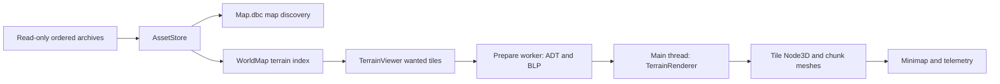

# Existing project assessment

## Architecture and dependencies — confirmed
The main scene is a single TerrainViewer Node3D. It constructs camera, lighting/environment and Control UI at runtime. TerrainViewer combines UI, asset-source lifecycle, camera input, map selection, stream scheduling, error display and smoke testing. TerrainRenderer owns Godot resources; AssetStore/TerrainData/MpqArchive/BlpTexture are ordinary C# and already relatively independent of Godot. TerrainMinimap presents WDT availability and loaded tile state. [V1–V3](references/source-references.md#v1-viewer-configuration)

The project targets .NET 8; the Godot package is 4.7.1, not merely a version inferred from the README. global.json pins SDK 8.0.425. SharpZipLib supplies bzip2; zlib uses System.IO.Compression. GL Compatibility is selected. Jolt is configured but the inspected terrain renderer creates no collision shapes.

## Data flow

AssetStore recursively opens every MPQ beneath the selected directory, ranks base/expansion/Wrath then patches, and searches in reverse so last hit wins. A lock serializes archive access. Rank is heuristic, locale-neutral and accepts backup/unknown archives; tie-breaking is path order. MPQ filename hashes do not provide general file enumeration. Maps reads only Map.dbc, choosing the first nonempty localized map name and checking WDT existence. [V2](references/source-references.md#v2-archive-and-texture-code)

WorldMap interprets MPHD bit 4 and MAIN entries. TerrainTile checks MVER 18, reads MTEX and MCNK, retains 145 heights, optional normals/tint/shadow, hole mask, and one to four texture layers. It omits placement/liquid/metadata chunks and most raw bytes. It is a render DTO, not a lossless editable file representation.

## Mesh/material representation
Tile size S=1600/3; chunk size S/16. BeginTile positions tile (i,j) at ((i-32)S,0,(j-32)S). AddChunk constructs a staggered 145-vertex grid, 8x8 squares with four triangles each, suppressing triangles through a 4x4 hole mask. At most 256 triangles/chunk, 65,536 triangles/tile, 37,120 vertices/tile before holes. These are derived topology counts, not measured rendered draw counts. [V3](references/source-references.md#v3-rendering-and-streaming)

MCNR components are transformed into viewer axes; computed fallback normals are forced upward. Each nonempty chunk creates its own ArrayMesh, MeshInstance3D, ShaderMaterial, 64x64 blend texture and shadow texture. Base textures are shared by path with logical reference counts. Shader uses repeated UVs, four texture samples plus blend/shadow, vertex tint, and either sequential or big-alpha blending. CPU RGBA texture decode selects a mip at or below 512 pixels, then Godot generates mipmaps. This is an approximation of client shading, not complete WoW rendering.

## Streaming and performance
Prepare runs asynchronously, but only one tile task is active and the next starts after the current tile finishes building. _Process builds up to eight chunks per frame. A full 256-chunk tile needs at least 32 build frames, approximately 0.53 seconds at 60 FPS excluding parsing/upload/interruptions. Radius 1 requests up to nine tiles, 2,304 chunk nodes; radius 3 up to 49 tiles, 12,544 nodes. These structural costs justify profiling and budgeted uploads. They do not establish actual bottlenecks.

Generation checks and cancellation protect map changes; obsolete wanted tiles unload, failed keys avoid repeated retries, texture dictionary references drop as chunks disappear. Prepared textures are decoded per tile, including paths decoded for other tiles. Dropping managed resource references plus QueueFree is not a verified immediate VRAM release guarantee. Archive reads remain serialized. UpdateWanted, telemetry sums, minimap hash copies/redraws happen per frame. RaiseAboveTerrain scans mesh vertices to raise the camera; it is not triangle intersection or terrain collision.

**Measured evidence:** four representative CPU asset samples pass in ~0.24–0.45 seconds total using a prebuilt binary and warm caches. Existing smoke logs show load/move/return; no new Godot launch or FPS/VRAM benchmark was conducted. The old diagnostic log contains a restore failure; the existing binary success does not prove a clean current-source build. [Notes](references/research-notes.md)

## Reuse/refactor matrix
| Component | Decision | Required change |
|---|---|---|
| TerrainTile/WorldMap readers | Reuse for viewing | Version/profile tags, strict size budgets, diagnostics, corpus coverage |
| AssetStore | Refactor | Explicit mount manifest, locale selection, hash provenance and source tracing |
| MPQ reader | Retain baseline; compare StormLib | Unsupported masks/patches exposed as capability errors, not silent fallback |
| BLP decode | Reuse initially | Separate preview mip choice from full-resolution/edit pipeline |
| TerrainRenderer | Reuse behind viewport interface | CPU geometry retained, picking, upload time budget, resource lifecycle accounting |
| TerrainViewer | Split | WorldSession, stream service, viewport input, shell/panels, project controller |
| Minimap | Reuse | Domain coordinates, layers, region filter, event-driven redraw |
| Existing tests/smoke | Preserve | Add source-built fixture suite later; current smoke writes project artifacts |

## Editor readiness
The architecture supports a prototype editor if authoritative state is removed from scene nodes. Streamed nodes disappear; spawn identity and undo history must survive unloading. Selection should use stable entity IDs, and hit testing should map render proxies to entities. Editable terrain collision needs a triangle/BVH query or derived collision resources; current meshes alone cannot support accurate drop placement.

Introduce a document command bus; gizmo drags update preview state and commit one command at release. Inspector edits use the same command route. Docked hierarchy is a filtered virtual projection by map/region/type/phase, not one permanent Godot node per database row. Asset/template catalogs need separate identity spaces. Autosave is project state, not .tscn scene serialization.

## Godot versus alternatives — proposed evaluation
| Option | Benefit | Cost/risk | Decision |
|---|---|---|---|
| Standalone Godot C# | Reuse renderer, one deployable shell, custom domain UI | Build docking/gizmos/inspector behavior; text editing limitations | Preferred MVP if usability gate passes |
| Godot EditorPlugin | Built-in docks, inspector/gizmo/undo hooks | User sees general engine project concepts; tool lifecycle and imports | Phase 0 comparison, not dismissed |
| Qt/C++ plus native viewport/Noggit extension | Existing map-tool ecosystem, native desktop UI | Rebuild C# integration, GPL obligations if borrowing code | Alternative if terrain editing dominates |
| .NET desktop shell plus Godot viewport process | Mature forms/data tooling, engine-independent shell | Embedding/input/window/IPC packaging work | Fallback if standalone panel UX fails |
| Web/Electron plus custom 3D viewport | Strong text/graph/form tooling | Rewrite renderer/streaming, desktop GPU/native archive boundary | Avoid for MVP without measured benefit |
| Unity/Unreal | Mature editor tooling | Custom format pipeline still needed; migration and distribution overhead | No evidence justifies replacement now |

Godot EditorPlugin has documented dock, inspector, import and gizmo extension points; these are editor-only facilities, not automatically available in an exported runtime app. Stable docs and installed version may differ. [Official API](https://docs.godotengine.org/en/stable/classes/class_editorplugin.html)

**Readiness conclusion:** viable viewer foundation, early editor readiness, no native writer readiness. Conditional retention avoids both a premature rewrite and an assumption that engine reuse solves content integrity.

