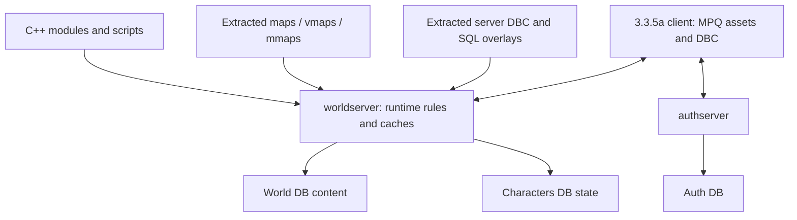

# AzerothCore architecture and content authority

## Confirmed system boundaries
The inspected core is a C++ server built through CMake, with separate authserver and worldserver entry points and MySQL persistence. Auth handles account/realm/session state; characters holds persistent player/world-instance state; world contains static authored content. Editor MVP requires only world-content reads. No account secrets, character records or live-state modifications are needed. Test schema metadata shows 22 auth, 108 character and 314 world tables. [A1](references/source-references.md#a1-server-loading-and-entities), [D1](references/source-references.md#d1-read-only-test-database-evidence)

The server transmits many template/quest/gameplay records but does not send arbitrary ADT/M2/texture replacements to clients. Existing client asset identifiers can often be reused through world rows; new visual assets require distributed client changes. Server DBC SQL overlays do not patch client DBCs. Database updates do not automatically update already-created runtime objects.

## Subsystems and proposed editor objects
| Development object | Confirmed persistence/relationships | Authority and change class | Useful UI |
|---|---|---|---|
| Creature definition | creature_template, creature_template_model, template addon/movement/resistance/spell, equipment, model info | DB for supported parameters/known displays; DBC/client for new appearance; C++/Lua for novel behavior | Identity/appearance/stats/behavior/services tabs |
| Creature placement | creature.guid -> creature.id -> template.entry; map, coordinates, orientation, masks, overrides; multispawn/events/pools | DB, with runtime cache/restart caveats | Scene gizmo, inheritance indicators, event badges |
| GameObject definition | gameobject_template.type, displayId, size, Data0–23; template addon | DB fields interpreted by GO type; DBC/assets for new visuals; code for unsupported mechanics | Door/chest/etc. forms with named fields |
| GameObject placement | gameobject GUID/template, position, orientation, rotation0–3, state, masks; addon/events/pools | DB; full rotations need client/type validation | Transform and state inspector |
| Quest | quest_template plus addon/details/request/offer/locale/POI; creature/gameobject starter/ender | Primarily DB for supported objectives/rewards; new assets/spells need client; novel quest mechanics need scripts | Structured objectives and relationship graph |
| Dialogue | gossip_menu, gossip_menu_option, npc_text, broadcast_text/locales, conditions, creature_text | DB for dialogue/options; action execution may use SmartAI/code | Conversation menu and conditional choice editor |
| Vendor | npc_vendor -> item_template, extended-cost data; template NPC flags | DB, existing client items/cost definitions | Inventory list with stock/cost and availability |
| Trainer | trainer, trainer_spell, creature_default_trainer; gossip wiring and flags | DB with DBC spell/skill references | Training service and requirements |
| Loot | creature/gameobject/item/etc. loot tables, reference_loot_template, conditions | DB; item appearance relies on client | Grouped probability/references, shared-table warnings |
| Patrol | creature MovementType; addon path_id; waypoint_data + addon + waypoint_scripts | DB; navigation/collision determine actual motion | 3D path editor |
| Scripted escort | SmartAI-owned waypoints table and events/actions | DB SmartAI, distinct from normal patrol path | Behavior-bound route and action sequence |
| Event/encounter | SmartAI, conditions, creature_text, game_event*, pool*, instance_template/encounters; script names | DB for bounded logic; C++/Lua for complex state | Encounter ownership, actors, timelines, state views |
| Spells | spell_dbc overlay, SpellMgr corrections, spell_script_names/procs/linked behavior | DB changes cover some behavior; new icons/visuals/tooltips may need client; new mechanics code | Referenced spell browser first |
| Achievements | achievement/criteria DBC, achievement_criteria_data/reward, script checks | DB support + client DBC + sometimes code | Reward/criteria browser; creation later |
| Faction/reputation | creature_template.faction references FactionTemplate; quests/rewards refer Faction | Existing IDs DB; new factions require synchronized definitions/client behavior | Semantic faction picker distinguishing both namespaces |
| Area triggers | areatrigger/DBC and teleport/tavern/script relations | DB or DBC depending record; code for trigger behavior | Shape overlay with authority label |

[A1–A3 evidence](references/source-references.md#a1-server-loading-and-entities), [schema columns](references/database-query-1.txt), [quest/loot columns](references/database-query-2.txt). UI and ownership groupings above are proposals.

## Details that must not be flattened
### Templates and instances
LoadCreatures joins event and pool membership, checks template/map, verifies masks, handles equipment conventions and applies template ScriptName fallback when the spawn has none. Template edits affect many instances; placement overrides affect one. Creature multi-spawn is a separate table, not id1/id2/id3 columns. Model choices are rows in creature_template_model ordered by Idx with scale/probability; no hard-coded modelid1–4 UI. [ObjectMgr](references/source-references.md#a1-server-loading-and-entities)

GameObjects store a quaternion and an orientation; do not edit those independently without defining synchronization. Data0–23 are a tagged union: chest Data1 is loot ID; door Data1 is lock ID. Door autoclose is stored in fixed-point units according to source comments. A generic numeric form would obscure both references and units. [GameObjectTemplate](references/source-references.md#a1-server-loading-and-entities)

### Quests
LoadQuests constructs base records then integrates addon and related records. RequiredNpcOrGo is signed: negative encodes a GO target; QuestDef converts to the client query bit encoding. Four NPC/GO objective slots and six required item fields are present in the inspected base schema. Rewards and choice slots are also bounded; a visual graph must compile to those bounds rather than invent unlimited runtime nodes. PrevQuestID/ExclusiveGroup semantics require signed decoding and checks against player eligibility behavior. Graph edges need named semantics, not a generic dependency arrow.

### Paths and behavior
Player::SatisfyQuestPreviousQuest checks positive previous IDs against rewarded completion and negative IDs against active/status logic, with additional group and seasonal handling. SatisfyQuestExclusiveGroup applies positive-group exclusion with daily/weekly/seasonal/repeatable exceptions. Negative-group previous-quest logic contains branch-specific checks, so a compiler must test the exact pinned implementation rather than translating source comments into a blanket rule. Breadcrumb eligibility is another dedicated function. These are distinct edge types in the proposed graph. [PlayerQuest source](references/source-references.md#d1-read-only-test-database-evidence)

WaypointMgr loads normal waypoint_data ordered by id,point and supports spline addon points. SmartAI waypoints use entry,pointid and are separate. Do not assume path ID equals spawn GUID or rewrite a shared path when changing one NPC. Clone-on-edit is a first-class operation. SmartAI owner/source, event/link/timing/phase/action/target semantics are not a general-purpose programming language. Conditions evaluate AND within ElseGroup and OR between groups; negative identifiers can encode references. [A2](references/source-references.md#a2-behavior-and-relationships)

### Loot/services/events
Loot loading checks references and probability groups. Equal-chance rows, quest-required drops, group probabilities and repeated references need real semantics. Trainers use trainer/ trainer_spell / creature_default_trainer here, not an assumed legacy npc_trainer table. Event membership may mean active or inverse/inactive behavior through signed associations; raw visibility in the editor is not current server activation. Display static records plus scenario filters.

## Modules, scripts and runtime
No Lua module is installed in the inspected modules directory: only infrastructure files were observed. C++ content extends through script registration and modules; use module-owned changes for custom behavior. Source navigation/build workflow belongs to the configured core checkout/build directory, not a virtual SQL entity. The mod-eluna URL now points to ALE; original Eluna compatibility is a separate profile. [A4](references/source-references.md#a4-updates-and-extension), [ALE](https://github.com/azerothcore/mod-ale)

## Migration compatibility
DBUpdater and UpdateFetcher read updates/updates_include, source-relative paths, states and applied hashes. Test include paths explicitly cover archive, released, pending and custom world directories. Generated files should enter either an upstream pending workflow or a custom/module workflow, with different packaging policy. The editor must not insert fabricated updater hashes or alter previously released SQL files. Base SQL alone is historical; runtime schema fingerprint plus core revision plus update metadata determine support. [A4](references/source-references.md#a4-updates-and-extension)

## Higher-level abstraction
An NPC aggregate is a navigable composition of shared definition, instances, model references, services, dialogue and behavior. An encounter is an editor project object organizing actors/paths/scripts/conditions, with an ownership manifest identifying which underlying rows are owned versus referenced. AzerothCore need not gain an encounter table to support that abstraction. Export remains ordinary supported data/scripts; ownership is editor metadata. Unknown extensions and shared records remain visible and preserved.

