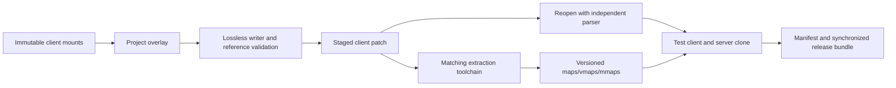

# Client formats, asset pipeline and world modification

## Three separate capabilities
1. **Confirmed viewer:** read terrain/texture data and create render resources.
2. **Proposed server world editing:** modify spawns/behavior using existing assets. New SQL does not change ADTs.
3. **Proposed client authoring:** modify ADTs/DBC/assets, package client patches, rebuild affected server geometry, test synchronized versions.

These have distinct domain models and release gates. Reading a known chunk subset does not demonstrate safe writing.

## Current format coverage
| Format | Confirmed current coverage | Required extension |
|---|---|---|
| MPQ | v0/v1; hash/block tables, encrypted sectors, zlib/bzip2; bounded reads | Explicit mount/locale; listfile/catalog discovery; broader compression/patch/delete semantics; safe writer |
| DBC | WDBC Map.dbc map ID/directory/name reader | Versioned record layouts, localized strings, display/model/GO/spell catalogs, consistent references |
| WDT | MAIN terrain flags and MPHD big alpha | Global WMO, full metadata preservation, writer and paired map changes |
| ADT v18 | Terrain MCNK/MTEX/heights/normals/colors/shadows/layers/alpha/holes | Placements, liquids, areas/metadata, all offsets/references and unknown chunks |
| BLP2 | Palette/raw BGRA/DXT1/3/5 decode; preview mip choice | Original mip chain and encoding preservation; writer/quality assessment |
| M2 + SKIN | None | Mesh/material/pass parsing, skin indices, animation/bones/attachments, texture substitutions |
| WMO | None | Root/group geometry/materials, placements, doodad sets, portals/liquids/interior visibility |
| WDL | None | Optional far-terrain overview, not MVP prerequisite |
| maps/vmaps/mmaps | None | Server-derived geometry verification/build orchestration |

[Viewer readers](references/source-references.md#v2-archive-and-texture-code). Custom reader rejects extended MPQ block tables, incremental patch flags and unsupported masks/implode; these limitations must become diagnostics. It does not validate a universal client archive profile.

## Version and provenance
Current wow-data junction targets OGClient/Data after user correction; executable metadata is 3.3.5.12340. Both corrected paths pass four sample ADTs. Former HD profile failed; that history motivates detecting format/build mismatches before opening a project. Client authenticity, every tile and all archive semantics remain unverified. [Notes](references/research-notes.md)

Proposed ClientProfile records executable build, locale, ordered selected mounts, per-archive hash/version, lookup policy, parser versions and allowed format capabilities. Never recursively mount arbitrary backups/HD assets by default. Let users compare winning source archive for any path. Reject unsupported overlay semantics with actionable errors, without falling back to an earlier file invisibly.

## Coordinates: proposed convention and mandatory proof
The current terrain frame is east/south/up as Godot (X,Z,Y), with map center at zero. Recommended server-to-viewer position:
```text
viewer = (-serverY, serverZ, -serverX)
server = (-viewerZ, -viewerX, viewerY)
tileX = floor(32 - serverY/S)
tileY = floor(32 - serverX/S)
S = 1600/3
```
**Derived/proposed:** these equations align existing renderer tile origin and its MCNR transform with server axes. GridDefines and extractor conventions support the approach, but actual landmark parity has not been experimentally proved. Do not equate internal server grid numbering with ADT filenames without the inversion/swap checks.

A heading o in radians gives server direction (cos(o),sin(o),0), mapped to viewer (-sin(o),0,-cos(o)); for a -Z-forward proxy Godot yaw is o under this convention. Model bind orientation may add a separate fixed basis correction. Keep position basis, model basis, ADT placement basis and quaternion conversion separate. Validate 0, pi/2, pi and 3pi/2 in-game before export.

Use double precision in domain coordinates; float at rendering/persistence boundary. Rebase viewport origin if necessary; subtract origin only in view projection. The inspected database stores float positions, so tests allow a stated tolerance after SQL round-trip. Validate map bounds rather than clamp; invalid coordinates should not silently become another location.

Reference sample guid 1 maps from (-14467.8,468.374,15.1064) to (-468.374,15.1064,14467.8), expected ADT indices (31,59). This is a numerical test vector, not a verified visual landmark. GameObject quaternion uses server x/y/z/w and basis conjugation with a verified proper rotation matrix; normalize only authored rotations, preserve imported unknown/invalid ones for diagnosis.

## Rendering development
Add terrain ray/triangle query from retained CPU geometry; preserve hole-aware topology. Static placement parsing reads MMDX/MMID, MWMO/MWID, MDDF/MODF and references from MCNK. Source extractor structures show unique IDs, rotations, bounds and sets; an editor needs visual/material data that collision extraction omits. [A3](references/source-references.md#a3-dbc-and-spatial-data)

Asset catalog joins creature_template_model display IDs to CreatureDisplayInfo -> CreatureModelData model paths, with extra appearance/texture choices; GO displayId to GameObjectDisplayInfo. DBC references must distinguish server overlay from client presentation. Static buildings should be optional read-only context before editable client placements; they are not database GameObjects merely because they share a model path.

Stream CPU parsing/decode separately from bounded main-thread uploads. Track CPU/GPU resource budgets and cancellation generations. Cache by normalized asset path plus mount fingerprint/parser/preview quality, not path alone. Spatial index stores stable entities even when nodes unload. Later use batched repeated models, distance culling and selectable proxies; preserve per-instance identification.

## Native terrain editing requirements — proposed
A lossless AssetDocument stores ordered chunks, raw bytes, offsets and decoded views. Unchanged chunks must survive exactly where possible; changed offsets/counts are regenerated deliberately. Write to project overlay files, never source MPQs.

Height brush commands contain affected chunks/vertices and before/after values. Shared borders across chunks/tiles update atomically; retain local height-base conventions. Recompute normals/bounds and derived metadata through versioned rules. Texture painting preserves layer paths, packed/full/RLE alpha policy, edge conventions and WDT flag consistency. Keep brush semantics separate from packing; do not serialize the current decoded TerrainTile as if it retained the original document.

Placement tools must allocate client unique IDs independently of server spawn GUIDs, update per-chunk object references, relevant extents and neighboring tiles for large WMOs. Water requires dedicated MCLQ/MH2O version handling, masks/heights/types and matching gameplay/collision tests. New maps also touch WDT/map DBC and server map support; defer to a later capability.

## Patch/rebuild pipeline


Use StormLib for archive packing rather than growing the custom reader into a security-critical writer. Still test archive precedence, filenames/locale, independent reopen and actual stock-client acceptance. Regenerate affected server maps for heights/liquids/areas and vmaps/mmaps for collision/navigation changes as applicable. Full regeneration may initially be more reliable than selective rebuilds; measure cost before promising incremental output. Avoid client DLL modifications for ordinary patch workflows.

## Reuse evaluation
| Candidate | Verified evidence | Proposed role / maturity limit | License consideration |
|---|---|---|---|
| Current C# parsers | Actual code and sample pass | Fastest viewer reuse; incomplete writer/provenance coverage | Viewer license not found at root; establish before distribution |
| StormLib | Archive creation source and established API repository | Primary native archive candidate; test .NET wrapper/platform packaging | MIT notice inspected |
| warcraft-rs | Separate format crates and CLI; workspace license declared | Independent parser/validator first; corpus-test version-specific writers before adoption | MIT OR Apache-2.0; audit crate/dependencies |
| Noggit3/Red | Existing WoTLK map editor and MapIndex read/save source | First terrain handoff; pinned workflow/client build trial required | GPL3; code reuse changes distribution obligations |
| AC extraction tools | Local ADT/WDT/model/WMO collision readers | Server artifact pipeline and transform references, not full viewer library | GPL notices; file-level review |
| WoW Spell Editor | Upstream specialist editor | External DBC authoring candidate; interoperability untested | Not audited in this research |

[StormLib](https://github.com/ladislav-zezula/StormLib), [warcraft-rs](https://github.com/wowemulation-dev/warcraft-rs), [Noggit3](https://github.com/wowdev/noggit3). Maturity above means demonstrated scope, not a promise that untested versions can write the full local corpus.

## Phase 4 entry gate
Require unchanged full-file round-trip, changed height/alpha/placement fixtures, independent parse, boundary/seam checks, stock-client load, and server collision/path parity on an isolated clone. A terrain authoring release must include the client and derived-server artifact manifests. Until then expose external-tool handoff, overlay diff and preview only.

