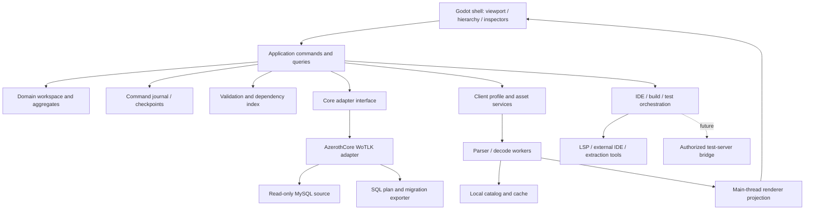

# Proposed editor architecture

**Status:** implementation proposal. Named interfaces/components below do not exist in the viewer.

## Architectural decisions
### ADR-01: Conditional Godot retention
Keep C# Godot viewport for MVP, standalone UI shell unless the Phase 0 EditorPlugin comparison wins on measured task usability. Do not fork the engine. EditorPlugin APIs apply only to editor-hosted mode; a standalone app implements its own domain gizmos/panels/command history. Existing code is runtime Node3D code, not a plugin. [Current architecture](02-existing-project-assessment.md)

### ADR-02: Domain state is independent of rendering
Use ordinary .NET records/value types for content, IDs, commands and diagnostics. Scene nodes are transient projections; no persistence logic in Godot properties. Separate database row snapshots from normalized editor entities so version-specific storage and unknown fields remain intact.

### ADR-03: Modular monolith first
One local application with engine-free libraries and bounded worker jobs is simpler than microservices. Isolate language servers, native asset tools, extraction/build and future runtime bridge in processes where useful. No cloud/backend is needed for the MVP.

### ADR-04: Export-first persistence
Read-only source -> baseline snapshots -> staged commands -> validated SQL bundle. MVP never applies SQL to source. Add a separate deployment service later for explicitly configured test targets. Domain undo is not database rollback.

### ADR-05: Schema/expansion are two dimensions
CoreAdapter handles schema/behavior/update conventions; ClientFormatAdapter handles build/archives/coordinates/render formats. Shared domain capabilities are negotiated. A core for another expansion is not supported merely by changing its connection string.

## Components


Dependency direction: Domain references neither Godot nor MySQL packages. Application references Domain and abstractions. Adapters implement infrastructure interfaces. Godot references Application plus its renderer implementation. Tests can instantiate Domain/Application and adapter fixtures without a game engine.

## Proposed assembly responsibilities
| Assembly | Owned concerns | Forbidden dependencies |
|---|---|---|
| Editor.Domain | EntityRef, poses, typed objectives, aggregate changes, immutable snapshots | Godot, SQL driver, file-format structs |
| Editor.Application | WorkspaceSession, CommandBus, query handlers, validation orchestration, export use cases | Scene tree APIs |
| Editor.AzerothCore335 | Schema descriptors, row mapping, semantics, SQL compiler, update dialect | Godot |
| Editor.Client335 | Mount profile, format readers/documents, display catalog, asset manifest | MySQL content mutation |
| Editor.Godot | Viewport render/picking/input, inspector presentation, shell | Direct SQL writes |
| Editor.Storage | JSON project persistence, journal, caches, backup manifests | Runtime entity ownership |
| Editor.Tooling | LSP clients, external IDE navigation, process supervision, diagnostics | Unrestricted deployment logic |
| Editor.Deployment, later | Target verification, backups, apply/revert state machine | Gizmo interaction |

Small implementation can use fewer physical assemblies while preserving those logical boundaries. Avoid a plugin SDK before a second adapter actually needs it.

## Proposed contracts
```csharp
// Illustrative; not existing APIs.
record EntityRef(string CoreProfile, string Kind, string StableKey);
record WorldPose(ushort Map, double X, double Y, double Z, double Heading);
record Diagnostic(string Code, Severity Level, EntityRef? Entity,
                  string? Field, string Message, string Evidence);
interface ICoreAdapter {
    Task<CapabilityReport> ProbeAsync(IContentSource source, CancellationToken ct);
    Task<AggregateSnapshot> LoadAsync(EntityRef id, CancellationToken ct);
    ValidationResult Validate(ChangeSet changes, Baseline baseline);
    ExportPlan Compile(ChangeSet changes, Baseline baseline, ExportPolicy policy);
}
interface IWorldProjection {
    void Apply(EntityDelta delta); // caller dispatches to main thread
    PickResult? Pick(ViewRay ray, PickFilter filter);
}
interface IEditCommand {
    ValidationResult Check(WorkspaceState state);
    CommandResult Apply(WorkspaceState state); // includes inverse and delta
}
```
References distinguish template IDs, spawn GUIDs, path IDs, script owner IDs and client display IDs. New entities have UUID stable keys and symbolic persistence identities until export. Domain pose stays in server coordinates; client/model transforms reside in profile-specific projection.

## State and jobs
Workspace state combines baseline row bags, normalized aggregates, pending changes, ownership graph, selection and diagnostics. Stream job key = client/map/generation/tile/quality. Results are immutable CPU DTOs. Cancel on map/profile replacement; never attach obsolete results. Queue uploads with elapsed-time budget (e.g. initial 2 ms/frame target subject to profiling), not only eight-chunk count. Main-thread scene changes follow documented threading restrictions. [Godot guidance](https://docs.godotengine.org/en/4.6/tutorials/performance/thread_safe_apis.html)

Separate stream working set from durable edited content. A draft does not pin every render node. Read-only CPU cache can evict; dirty asset documents are persisted or pinned with an explicit memory policy. Track archive handles, textures, meshes and native worker memory; retry missing assets when profile changes, not every frame.

## Spatial and database queries
Cache metadata/content by profile and source revision. Query visible map rectangles using parameterized SQL on map and coordinate bounds, keyset pagination by guid. Observed creature has map/id/guid indexes but no combined spatial index. Expect map filtering plus a coordinate scan; measure rather than modifying upstream schema as a convenience. Build a local tile/region index (optional SQLite/R-tree after measurement) without adding columns to AzerothCore. Shared template lookup cache prevents per-instance queries. [Database indexes](references/database-extra-1.txt)

## Workspace proposal
```text
project/
  project.json                 # schema version, profiles, relative paths
  content/                     # semantic recipes and owned draft entities
  baselines/                   # original rows + query/read-set provenance
  journal/                     # append-only command records and checkpoints
  exports/<bundle-id>/         # forward.sql, reverse.sql, manifest.json, notes.md
  client-overlay/              # future authoring copies only
  scripts/                     # project/module links or generated owned files
  diagnostics/                 # redacted logs and validation reports
  cache/                       # rebuildable, ignored by version control
```
This is a proposed future workspace layout, not a request to create it now. Credentials remain in OS-backed secret storage; project files use connection aliases. Source client/core remain read-only unless a later operation explicitly targets an isolated editable checkout. JSON versions migrate by backup-and-convert; never silently reinterpret an older journal.

## Change tracking and recovery
Command journal persists after accepted commands, with sequence number, payload version, before/after references and checksum. Checkpoints use write-temp, flush, atomic replacement; journal replay ignores only a demonstrably torn final record and reports it. Undo/redo also journaled; reopen restores cursor and IDs. Uncommitted gizmo preview is discardable. Export is a frozen copy of ChangeSet; edits after export create a new bundle.

Record tool logs by job ID, profile and affected object; redact secrets/connection strings. Native parser failures return structured path/archive/offset errors. External processes use explicit argument arrays and working directories, cancellation/timeouts, output limits and trusted tool configuration.

## Extension contract
Initially internal adapters/panel providers. Later signed/trusted plugin manifests describe API version, dependencies, core/client profiles and capabilities (read, validate, compile, script backend, asset writer, runtime bridge). Unknown data is read-only with raw preservation. In-process plugins are trusted code, not a sandbox; untrusted/native parsers need process isolation. A plugin cannot bypass the export/target state machine.

## Technologies and trade-offs
- C#/.NET aligned to current viewer; pin a supported runtime compatible with installed Godot rather than upgrading on assumption.
- MySqlConnector for cancellable parameterized reads and later explicit transactions; compare against installed MySQL/MariaDB versions. Generic EF-style models alone cannot infer polymorphic/signed references or ownership.
- System.Text.Json for versioned workspace/manifest; SQLite optional for large rebuildable catalogs, not the authoritative world DB.
- Explicit command pattern and immutable before/after records; bounded history with durable checkpoints.
- External VS Code/Visual Studio initially; LSP/DAP integrations later.
- StormLib native worker/wrapper for packing after corpus proof; separate client writers.
- Git file workflow for scripts/JSON/SQL; record Git revision if available but never auto-commit/rewrite user history.

## Safe runtime communication
MVP has no bridge. Built-in RA/SOAP exposes commands and is disabled by default in the inspected config; it is not a typed entity editing/transaction API. Later bridge is an opt-in module for test servers only, authenticated, capability scoped and dispatched on the server thread. It reports runtime cache revision and applied command acknowledgements, supports idempotency IDs, and distinguishes preview transient entities from persistent content. No protocol injection/client packet automation is necessary. [A4](references/source-references.md#a4-updates-and-extension)

