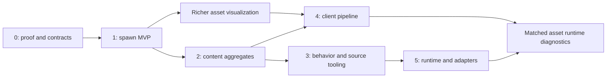

# Incremental development roadmap

All phases are **proposed**. Relative size is a comparison, not a schedule. No editor implementation was started during this task.

## Phase 0 — Foundation and architectural validation
**Value:** establish a reliable stock-client/profile, pose and change pipeline before writing content.
**Prerequisites:** research acceptance, developer hardware target, isolated source-built test workspace, test DB clone for future write experiments.
**Tasks:** split viewport/state boundaries; explicit client mounts; current-source parser fixtures; coordinate/picking proof; schema fingerprint; typed spawn mapping; command/checkpoint prototype; one deterministic SQL bundle; standalone versus EditorPlugin UX trial.
**Complexity:** medium; high correctness risk.
**Milestones/deliverables:** P0-1..5 reports, golden fixtures, selected shell ADR, adapter support matrix, domain/SQL contract and resource budget.
**Acceptance:** corrected client corpus sample passes; position/heading gates pass; unknown columns preserved; basic commands recover after restart; stale row/ID preconditions detected; source/DB unchanged by normal edit flow.
**Performance gate proposal:** on agreed baseline machine, 3x3 terrain with 2,000 proxies, stationary median >=60 FPS and streaming p95 frame <=33 ms; input p95 <=50 ms; upload work target <=2 ms/frame. Teleport-to-usable-scene target <=5 s warm and <=15 s cold. Peak resource budget initially 4 GiB RAM/2 GiB VRAM, revised by measured target hardware. These are targets, not current measurements.
**Dependency:** blocks Phase 1 release. Failure changes shell/backend or narrows profile rather than hiding deficits.

## Phase 1 — Visual world database editor / MVP
**Value:** routine placement and spawn edits without hand SQL.
**Prerequisites:** Phase 0 profile/transform/state/export gates.
**Tasks:** terrain navigation/picking; region spawn queries; template search; proxies; scene selection/yaw/translate; duplicate/delete ordinary placements; inspectors; masks/respawn/movement validation; dependency warnings; undo/redo/autosave; forward/reverse SQL and manifest.
**Complexity:** medium; moderate UI work, high integrity risk.
**Milestones:** read-only spawn overlay -> selectable inspector -> staged placement transforms -> export/recovery release.
**Acceptance:** all MVP scenarios in 12 pass; unloaded edited objects retain state; no database/client writes; supported SQL applies/reverses in isolated clone under selected workflow; complex unsupported records are clearly protected.
**Deliverables:** usable editor build, sample project, export bundles, help/limitations, adapter fixture suite and acceptance report.
**Dependency:** no M2/WMO/IDE/terrain writer needed.

## Phase 2 — Integrated content authoring
**Value:** create coherent NPCs/quests/services and patrols rather than editing unrelated tables.
**Prerequisites:** Phase 1 stable change/dependency model.
**Tasks:** NPC aggregate and guided template clone; appearance catalog/initial static model previews; GO type forms; gossip/vendor/trainer/loot; standard quest forms and graph; normal patrol authoring/shared route clone; locale and advanced reference diagnostics.
**Complexity:** large; relationship semantics and ownership dominate.
**Milestones:** appearance/services -> quests and relation editing -> patrols and shared-content impact.
**Acceptance:** each aggregate supports import/change/export/reverse with unrelated rows untouched; signed quest objectives and fixed slots correct; shared edit scope visible; patrol addon/movement wiring works in game; ordinary services/quest lifecycle tested on clone.
**Deliverables:** typed content descriptor set, recipes, workflow docs, reference validation and shared-impact reports.
**Dependency:** does not require arbitrary visual scripting. Full WMO/interior rendering remains separate incremental viewer work.

## Phase 3 — SmartAI and scripting/IDE integration
**Value:** bounded encounter behaviors plus source-aware development.
**Prerequisites:** aggregate ownership and full-block exporter; backend profile metadata.
**Tasks:** curated SmartAI cards/links/timed lists; condition UI; lossless unknown row retention; encounter project organization; external IDE source links; compiler/log diagnostics; optional LuaLS/clangd text panel; detect ALE versus Eluna.
**Complexity:** large; semantic compatibility and runtime tests.
**Milestones:** SmartAI round-trip -> supported authoring -> controlled encounter tests -> IDE integration.
**Acceptance:** P3-1 passes; full owner blocks and conditions preserved; unsupported enums not silently transformed; configured Lua API completions match engine; builds use user's existing task configuration; no arbitrary C++/Lua-to-graph conversion.
**Deliverables:** SmartAI capability matrix, script profiles, round-trip corpus, source links and supervised build/log services.
**Dependency:** debugging is optional later, not a release gate for SmartAI utility.

## Phase 4 — Client world/asset pipeline
**Value:** author client-side terrain/assets with reliable compatibility packaging.
**Prerequisites:** explicit client mounts/provenance, richer model/static rendering and external tool workflow; lossless writer proof for each native edit capability.
**Tasks:** first external Noggit handoff/import; overlay asset diff; full ADT/WDT document layer; StormLib packaging; texture/height/placement tools incrementally; extraction/rebuild manifests; later liquids/metadata and new-map support.
**Complexity:** very large; highest data-format and testing risk.
**Milestones:** external overlay preview -> patch/rebuild pipeline -> height brush -> texture brush -> placements -> water only if separately justified.
**Acceptance:** P4-1 gates per feature; unchanged/unknown data survives; stock client loads; seams/holes/placement IDs correct; geometry/artifact profile matches client patch; rollback copies and staged release complete.
**Deliverables:** verified patch bundles, extractor orchestration, format corpus and per-feature support limitations.
**Dependency:** release native features independently; no all-or-nothing terrain suite.

## Phase 5 — Advanced environment and adapter expansion
**Value:** faster test/diagnostic loops and wider ecosystem coverage.
**Prerequisites:** mature bundle/target identity/capability contract, demonstrated demand.
**Tasks:** controlled deployment runner; opt-in test bridge; actor/runtime traces; conditional DAP debugging; plugin packaging; narrow alternate-core adapter; possible team ID coordination.
**Complexity:** very large/open-ended, split into independent projects.
**Milestones:** controlled clone apply -> bridge proof -> alternate spawn adapter -> supported debug backend.
**Acceptance:** target preconditions and backups verified; cache/commit status explicit; no accidental live writes; alternate-core adapter passes same semantic fixtures without UI fork; debug support matrix accurately states capabilities.
**Deliverables:** audited apply/test state machine, bridge module/protocol, plugin contracts and pinned adapter packages.
**Dependency:** P5-1 gates live functionality; additional expansions separately prove client formats.

## Release ordering and resourcing

For a small team, complete Phase 1 before expanding scope. Afterward prioritize by developer usage: quests/patrols/services can provide more value than perfect character animation. Asset rendering can proceed as a separate internal workstream once contracts stabilize; no multi-agent implementation is implied by this document.

## Stop/go rules
Do not proceed with client writing without lossless proof, live apply without target/read-set checks, new scripting backend without installed-version proof, or new emulator without fixtures. Feature expansion must preserve safe export/recovery behavior. Review scope at each milestone using actual task time/error reduction, support burden and known unsupported cases.

